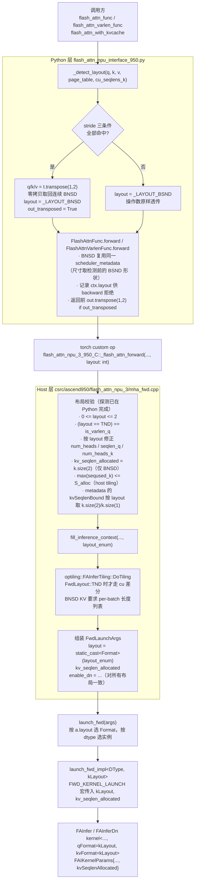
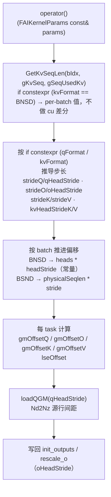

# 950 后端 QKV BNSD 布局支持实现方案（仅前向）

> 对应提交：`feat: support BNSD (B,H,S,D) QKV layout in the 950 backend forward`（分支 `950bnsd`）
> 覆盖后端：`flash_attn_npu_3`（v3）、`flash_attn_npu_4`（v4），仅 Ascend 950 / CANN 9.1.0

---

## 1. 目标与范围

| 项 | 内容 |
|---|---|
| 目标 | 让 950 后端的 `flash_attn_func` / `flash_attn_varlen_func`（v3/v4）与 `flash_attn_with_kvcache`（仅 v3）支持 Q/K/V 为 BNSD（`(B, H, S, D)`）输入 |
| 硬约束 | **不改变对外 Python 接口参数**；不改 AICPU metadata ABI；仅前向 |
| 触发方式 | 全自动探测（stride 严格匹配），调用方无需传任何布局开关 |
| 输出约定 | 返回的 `out` 形状始终等于调用方传入的 `q` 形状 |
| DN 快路径 | Qᵀ·K 变体（`FAInferDn`）对 BNSD 同样开放，根因修复与差分验证见 §7 |

---

## 2. 原理

### 2.1 三种布局的 shape / stride 特征

以 `D` 为 head dim、`H` 为 head 数、`S` 为序列长：

| 布局 | shape | 连续时的 strides |
|---|---|---|
| BSND | `(B, S, H, D)` | `(H*S*D, H*D, D, 1)` |
| BNSD | `(B, H, S, D)` | `(H*S*D, S*D, D, 1)` |
| BNSD 的 BSND 形状视图<br>（`bnsd.transpose(1, 2)`） | `(B, S, H, D)` | `(H*S*D, D, S*D, 1)` |

第三行是关键：推理侧把 per-head plane 的 BNSD 数据喂给 BSND 文档化接口，最自然的写法就是
`q = bnsd.transpose(1, 2)`。转置只改 stride 不改数据，于是得到一个
**shape 是 BSND、但 dim1(S) 与 dim2(H) 的 stride 被互换**的非连续视图。

### 2.2 stride 判据的推导

对 shape 为 `(B, S, H, D)` 的**转置视图**（代码里记 `_, n1, _, n3 = t.shape`，即 `n1 = S`、`n3 = D`）：

- `stride(3) == 1`：最后一维 D 是内存连续方向；
- `stride(1) == n3`：S 维步长是 `D`（而不是 BSND 的 `H*D`）；
- `stride(2) == n1 * n3`：H 维步长是 `S*D`（而不是 BSND 的 `D`）。

三条同时成立即判定为 BNSD 转置视图。命中后执行 `t.transpose(1, 2)`，得到 shape `(B, H, S, D)`、
strides `(H*S*D, S*D, D, 1)` —— **恰好是原连续 BNSD 的 storage 本身，零拷贝**。

### 2.3 为什么必须先做 `is_contiguous()` 短路

连续张量的 stride 是 shape 的**纯函数**，所以一个连续 BSND 张量在 stride 上无法与连续 BNSD 张量区分。
代入判据：连续 BSND `(B, S, H, D)` 的 strides 为 `(H*S*D, H*D, D, 1)`，
判据要求 `H*D == D`（即 `H == 1`）且 `D == S*D`（即 `S == 1`）。
即只有 `S == H == 1` 的退化形状会巧合命中，而此时 BSND 与 BNSD 的 shape/strides 完全相同、两种读法数值等价。
即便如此，仍用 `t.is_contiguous()` 优先短路，显式表达“连续张量永远不是 BNSD 转置视图”这一语义，
避免退化形状走进无意义的分支（该退化用例在既有测试集中出现过）。

### 2.4 数值等价性：stride 路径是纯性能优化

设 `t` 为连续 BNSD，视图 `V = t.transpose(1, 2)`，则 `V[b, s, h, d] == t[b, h, s, d]`。
把 `V` 当 BSND 读，和把 `t` 当 BNSD 读，访问的是**同一个逻辑元素**。因此
stride 命中时的 BNSD 路径与 BSND 路径**逐元素相等**，唯一区别是省掉了一次 `contiguous()` 物化拷贝。

### 2.5 探测策略

```
_detect_layout(q, k, v, page_table, cu_seqlens_k)
    │
    ├─ 前置门：q/k/v 必须全部 rank-4，且 page_table / cu_seqlens_k 均为 None
    │           （TND varlen query 是 rank-3；paged / cu-packed KV 永不是 BNSD）
    │
    └─ stride 严格匹配
          q、k、v 三者全部命中 `_transposed_bnsd_view` ？
            是 → 返回 (_LAYOUT_BNSD, q.transpose(1,2), k.transpose(1,2), v.transpose(1,2), out_transposed=True)
            否 → 返回 (_LAYOUT_BSND, q, k, v, out_transposed=False)
```

**为什么必须 q/k/v 三者全部命中 stride 才判定 BNSD**：若只让部分操作数走 stride 路径，
混合输入下会把 BSND 的 q 误读成 BNSD。三者要求一致后，混合输入安全回退到 BSND 读法——
数值仍然正确，代价只是多一次 `contiguous()` 拷贝。

**为什么不再用 shape 判别**：shape 本身无法区分 BSND 与 BNSD——同一组 `(dim1, dim2)`
既可读成 `(S, H)` 也可读成 `(H, S)`，用 `qHeads % kvHeads == 0` 之类的整除规则去猜，
在两种读法都成立时会静默选错，且错误结果不报错。因此判别只依赖 strides 这一条
**可证伪的硬信号**，其余 rank-4 输入一律按文档化的 BSND 解读。调用方要喂 BNSD 数据，
须写成 `bnsd.transpose(1, 2)` 的 BSND 形状视图（零拷贝，见场景 A）。

### 2.6 输出形状约定

| 路径 | 传入的 q | kernel 产出的 out | Python 返回的 out |
|---|---|---|---|
| stride 命中 | BSND 形状视图 `(B, S, H, D)` | `(B, H, S, D)` | `out.transpose(1, 2)` → `(B, S, H, D)` |

该规则即：**`out.shape == 传入的 q.shape`**，调用方不需要记住自己喂的是哪种形态。
LSE 沿用各入口既有约定（v3 `flash_attn_func` 为 `(B, S, H)`；v3 `flash_attn_with_kvcache` 与 v4 为 `(B, H, S)`），
不因布局路径改变。

### 2.7 为什么用编译期 `Format` 而不是运行期 `bnsd` 标量

布局语义最终收敛为一个 `Format` 枚举值，并且它是 kernel 的**编译期模板参数**
（`FAInfer<..., Format qFormat, Format kvFormat, ...>`），业务分支全部写作 `if constexpr`：

- Q、K、V 理论上是同一种输入格式 → 只需要一个布局值，不需要 `q_bnsd` / `kv_bnsd`；
- 布局在编译期已知，步长推导、LSE 分支、DN 快路径取舍都被编译器折叠，运行期零判断；
- 运行期不再有 `bool bnsd` 变量：Python → host 边界传 `int64_t layout`（0/1/2），
  host 把它 `static_cast` 成 `Format` 后交给 dispatch，kernel 只认模板参数；
- BNSD 与 TND 天然互斥（BNSD 要求 rank-4 query），因此 `kLayout` 同时喂给 `qFormat` 与 `kvFormat`；
- 代价是编译实例从 4 个（2 dtype × 2 IS_TND）增到 6 个（2 dtype × 3 `Format`），
  `autogen/` 生成脚本加一行即可，`setup.py` 用 glob 收集无需改动。

---

## 3. 代码调用流程

### 3.1 总览



### 3.2 Kernel 内部寻址



---

## 4. Python 侧修改点

文件：

- [flash_attn_npu_3/flash_attn_npu_interface_950.py](file:///home/w00811046/code/fan/261017/flash-attention-npu/flash_attn_npu_3/flash_attn_npu_interface_950.py)
- [flash_attn_npu_4/flash_attn_npu_interface_950.py](file:///home/w00811046/code/fan/261017/flash-attention-npu/flash_attn_npu_4/flash_attn_npu_interface_950.py)

### 4.1 修改清单

| 位置 | v3 | v4 | 说明 |
|---|---|---|---|
| `_LAYOUT_TND/_LAYOUT_BSND/_LAYOUT_BNSD` | L37–42 | L37–42 | 新增模块常量 `0/1/2`，与 C++ 的 `FwdLayout` / `Format` 数值一致 |
| `_transposed_bnsd_view(t)` | L50–70 | L60–80 | 新增：stride 三条件严格匹配，命中返回 `t.transpose(1, 2)` |
| `_detect_layout(...)` | L73–135 | L83–145 | 新增：返回 5 元组 `(layout, q, k, v, out_transposed)` |
| `_flash_attn_forward(..., layout)` | L140–234 | L315–382 | 底层 `layout: int` 形参，把布局码透传给自定义算子 |
| `_flash_attn_forward_fake(..., layout)` | L238–310 | L1050–1095 | fake 按 `layout == _LAYOUT_BNSD` 推导 `out` / LSE 形状 |
| `_training_forward(..., layout=_LAYOUT_BSND)` | L589–645 | — | `seqused_k` 默认值按布局取 `k.shape[2]` 或 `k.shape[1]` |
| `FlashAttnFunc.forward` | L670–735 | L594–666 | 调用 `_detect_layout`；BNSD 复用同一 metadata（尺寸取检测前的 BSND 形状）；返回前按 `out_transposed` 转置 `out`；`ctx.layout = layout` |
| `FlashAttnVarlenFunc.forward` | L821–890 | L804–890 | v3 恒为 `_LAYOUT_TND`；v4 为 `cu_seqlens_q is not None ? TND : BSND` |
| `flash_attn_with_kvcache` | L1171–1290 | — | `cu_seqlens_q is not None` 时为 TND，否则走 `_detect_layout`；BNSD 复用同一 metadata（尺寸取检测前的 BSND 形状，并校验 KV 平面长度） |
| backward 拒绝 BNSD | L738–741 | L694–697 | `ctx.layout == _LAYOUT_BNSD` 时抛 `NotImplementedError` |
| 公开签名 | L~1400+ | — | `flash_attn_func` / `flash_attn_varlen_func` / `flash_attn_with_kvcache` 均**无**布局参数 |

### 4.2 关键片段

```python
# Layout codes shared with the C++ host (FwdLayout / Format).
_LAYOUT_TND = 0
_LAYOUT_BSND = 1
_LAYOUT_BNSD = 2


def _transposed_bnsd_view(t):
    """``t.transpose(1, 2)`` if ``t`` is a contiguous BNSD tensor seen as BSND, else ``None``."""
    if t is None or t.dim() != 4 or t.is_contiguous():
        return None
    _, n1, _, n3 = t.shape
    if t.stride(3) == 1 and t.stride(1) == n3 and t.stride(2) == n1 * n3:
        return t.transpose(1, 2)
    return None


def _detect_layout(q, k, v, page_table, cu_seqlens_k):
    ...
    if q.dim() != 4 or k.dim() != 4 or page_table is not None or cu_seqlens_k is not None:
        return _LAYOUT_BSND, q, k, v, False

    q_bnsd = _transposed_bnsd_view(q)
    k_bnsd = _transposed_bnsd_view(k)
    v_bnsd = _transposed_bnsd_view(v)
    if q_bnsd is not None and k_bnsd is not None and v_bnsd is not None:
        return _LAYOUT_BNSD, q_bnsd, k_bnsd, v_bnsd, True

    return _LAYOUT_BSND, q, k, v, False
```

调用点收尾（v3 `FlashAttnFunc.forward` L729–734 / v4 L666–670）：

```python
ctx.layout = layout
if out_transposed:
    # Q/K/V 是连续 BNSD storage 的 BSND 形状视图，所以按调用方传入的形状回报
    out = out.transpose(1, 2)
return (out, softmax_lse.transpose(-1, -2)) if return_softmax else out
```

### 4.3 Python 层的行为边界

- `flash_attn_varlen_func`（v3）：packed varlen query 是 rank-3，直接置 `layout = _LAYOUT_TND`，不参与探测。
- `FlashAttnVarlenFunc`（v4）：`layout = _LAYOUT_TND if cu_seqlens_q is not None else _LAYOUT_BSND`
  （v4 该 autograd 也承担非 varlen 的 rank-4 调用）。
- `flash_attn_with_kvcache`：`cu_seqlens_q is not None` 时为 `_LAYOUT_TND`；否则 `_detect_layout` 传入
  `page_table`，paged / rank-3 cache 永不按 BNSD 解读。
- BNSD 复用与 BSND 相同的 `scheduler_metadata`：该 buffer 只承载数字（`max_seqlen_q` = S、`num_heads_q` = H 等），
  不含布局语义，因此尺寸一律取 `_detect_layout` **检测之前**的 BSND 形状；显式传入的 metadata 同样有效。
- BNSD 的 `use_host_tiling` 不再强制为真：`num_splits > 1` 与 auto-FD 候选形状的判断与 BSND 完全一致。
- `flash_attn_with_kvcache` 在 BNSD 且 `cache_seqlens` 已知时，额外校验 `max(cache_seqlens) <= bsnd_seqlen_k`
  （KV 平面 pitch 由分配长度决定，host tiling 分支有等价校验）。
- 全局不变式：`layout == _LAYOUT_TND ⟺ cu_seqlens_q is not None`，host 侧重复校验一次。

---

## 5. Host 侧修改点（CANN C++）

以 v3 为例（文件均在 `csrc/ascend950/flash_attn_npu_3/`，v4 同构）：

### 5.1 枚举与结构体

| 位置 | 改动 |
|---|---|
| [tilingdata.h](file:///home/w00811046/code/fan/261017/flash-attention-npu/csrc/ascend950/flash_attn_npu_3/tilingdata.h#L19-L23) | 新增 `enum class FwdLayout : uint32_t { TND = 0, BSND = 1, BNSD = 2 }`，替换原 `bool is_tnd` |
| [tiling.cpp](file:///home/w00811046/code/fan/261017/flash-attention-npu/csrc/ascend950/flash_attn_npu_3/tiling.cpp#L79) | `FAInferContext::isTnd` → `FwdLayout layout = FwdLayout::BSND` |
| [kernel_common.hpp](file:///home/w00811046/code/fan/261017/flash-attention-npu/csrc/ascend950/flash_attn_npu_3/kernel_common.hpp#L51-L53) | `FAIKernelParams` 新增 `int64_t kvSeqlenAllocated`，构造函数同步；**无 `bnsd` 成员** |
| [fwd_dispatch.hpp](file:///home/w00811046/code/fan/261017/flash-attention-npu/csrc/ascend950/flash_attn_npu_3/fwd_dispatch.hpp#L15-L42) | `FwdLaunchArgs` 新增 `Format layout` 与 `int64_t kv_seqlen_allocated` |

> 说明：`FwdLayout` 与 `Format` 的取值逐项一致（`TND = 0`、`BSND = 1`、`BNSD = 2`），
> 因此 host 侧只需 `static_cast<Format>(layout_enum)` 就能得到编译期模板实参，
> `Format::BNSD` 是独立的第 3 个编译实例。

### 5.2 [mha_fwd.cpp](file:///home/w00811046/code/fan/261017/flash-attention-npu/csrc/ascend950/flash_attn_npu_3/mha_fwd.cpp) 的校验与透传

**入口**：`mha_fwd(..., int64_t layout)`。这是**底层入口**，Python 公开层不透出；
布局探测（stride 严格匹配）已在 Python 侧一次算完，host 不再重复探测，只做校验。

**校验与派生**（以 v3 为例）：

```cpp
TORCH_CHECK(layout >= static_cast<int64_t>(FwdLayout::TND) &&
                layout <= static_cast<int64_t>(FwdLayout::BNSD),
            "950 backend (v3) received an unsupported layout code (", layout, ")");
const FwdLayout layout_enum = static_cast<FwdLayout>(layout);
TORCH_CHECK((layout_enum == FwdLayout::TND) == is_varlen_q,
            "950 backend (v3) layout code conflicts with cu_seqlens_q: TND requires it, "
            "BSND and BNSD forbid it");

if (layout_enum == FwdLayout::TND) {
    batch_size = static_cast<int>(cu_seqlens_q.size(0)) - 1;   // packed query
    seqlen_q   = static_cast<int>(max_seqlen_q_.value());
    num_heads  = static_cast<int>(sizes[1]);
    head_size_q = static_cast<int>(sizes[2]);
} else {
    batch_size  = static_cast<int>(sizes[0]);
    head_size_q = static_cast<int>(sizes[3]);
    if (layout_enum == FwdLayout::BNSD) {                      // (B, H, S, D)
        num_heads = static_cast<int>(sizes[1]);
        seqlen_q  = static_cast<int>(sizes[2]);
    } else {                                                   // (B, S, H, D)
        num_heads = static_cast<int>(sizes[2]);
        seqlen_q  = static_cast<int>(sizes[1]);
    }
}

int64_t kv_seqlen_allocated = 0;
if (layout_enum == FwdLayout::BNSD) {
    TORCH_CHECK(!paged_KV && !is_varlen_kv && k.dim() == 4 && v.dim() == 4, "...");
    kv_seqlen_allocated = static_cast<int64_t>(k.size(2));      // BNSD 的 S_alloc
    TORCH_CHECK(k.size(0) == v.size(0) && k.size(1) == v.size(1) && k.size(2) == v.size(2),
                "... BNSD key and value must share batch, head and sequence dimensions ...");
}
const int num_heads_k = (layout_enum == FwdLayout::BNSD)
                            ? static_cast<int>(k.size(1))
                            : (k.dim() == 3 ? static_cast<int>(k.size(1)) : static_cast<int>(k.size(2)));
```

host tiling 分支下 BNSD 额外校验 `max(seqused_k) <= kv_seqlen_allocated`。
metadata 分支（`scheduler_metadata_.has_value()`）同样按布局取 KV 上界：BNSD 读 `k.size(2)`（序列维），
非 BNSD 读 `k.size(1)`（或 3D 的 `k.size(0)`）。该上界用于 window 归一化与 `DeriveFwdMask` 的掩码推导，
因此 BNSD 必须传序列维，否则会把 head 数当成 KV 长度。

**DN 快路径**：`enableDN` 不再排除 BNSD（取值与 §7.4 一致）。FlashDecode 候选本身要求
`paged_KV`，而 BNSD 要求非 paged，两者天然互斥。

**下发**：

```cpp
fill_inference_context(ctx, scratch, ..., return_softmax_lse, layout_enum);

const Format fmt = static_cast<Format>(layout_enum);
const FwdLaunchArgs fwdArgs{ ..., static_cast<uint32_t>(max_num_blocks_per_seq), kv_seqlen_allocated };
```

**输出/LSE 分配**：`output_sizes` 直接取 `q.sizes()` 再覆盖最后一维为 `head_size_v`，
因此 BNSD 下 `out` 自然分配为 `(B, H, S, D_v)`；LSE 为 `(B, H, S)`（用的是修正后的 `num_heads` / `seqlen_q`）。

### 5.3 Tiling 链路

| 文件 | 改动 |
|---|---|
| [tiling_from_tensors.hpp](file:///home/w00811046/code/fan/261017/flash-attention-npu/csrc/ascend950/flash_attn_npu_3/tiling_from_tensors.hpp#L121) | `fill_inference_context(..., FwdLayout layout)` 取代 `bool is_tnd`；L152–158 增加 BNSD KV 必须是 per-batch 长度列表（`numel == batch`）的校验；L225 `ctx.layout = layout` |
| [tiling.cpp](file:///home/w00811046/code/fan/261017/flash-attention-npu/csrc/ascend950/flash_attn_npu_3/tiling.cpp#L286) | 两处读取 cumulated KV 长度的分支（L286、L446）改为只在 `FwdLayout::TND` 时执行；**未新增 `FAInferTilingData` 字段** |

### 5.4 Dispatch（6 个编译实例）

[fwd_dispatch.hpp](file:///home/w00811046/code/fan/261017/flash-attention-npu/csrc/ascend950/flash_attn_npu_3/fwd_dispatch.hpp#L48-L73)：

```cpp
template <typename DType, Format kLayout>
void launch_fwd_impl(const FwdLaunchArgs& a);

inline void launch_fwd(const FwdLaunchArgs& a) {
    if (a.is_bf16) {
        if (a.layout == Format::TND)       { launch_fwd_impl<bfloat16_t, Format::TND>(a); }
        else if (a.layout == Format::BNSD) { launch_fwd_impl<bfloat16_t, Format::BNSD>(a); }
        else                               { launch_fwd_impl<bfloat16_t, Format::BSND>(a); }
    } else { /* half 同理 */ }
}
```

[fwd_dispatch_impl.hpp](file:///home/w00811046/code/fan/261017/flash-attention-npu/csrc/ascend950/flash_attn_npu_3/fwd_dispatch_impl.hpp#L48-L56) 的宏把 `kLayout` 同时喂给 kernel 的 `qFormat` 与 `kvFormat`，
实参列表尾部追加 `a.kv_seqlen_allocated`；DN 快路径增加编译期剪枝：

```cpp
#define FWD_KERNEL_LAUNCH(KERNEL, MASK_CAT, CACHE_MODE_V, PAGE_SHAPE_V, LSE_MODE, HAS_SOFTCAP) \
    KERNEL<DType, float, kLayout, kLayout, CACHE_MODE_V, PAGE_SHAPE_V, MASK_CAT, kCacheLayout, LSE_MODE, HAS_SOFTCAP> \
        <<<a.block_dim, nullptr, a.stream>>>(..., a.kv_seqlen_allocated)

constexpr bool kUseDnFastPath =
    (MaskCat == MaskCategory::NO_MASK) && IsDN;
```

`FWD_BOOL_SWITCH(a.enable_dn, ...)` 的两个 arm 都会实例化，`kUseDnFastPath` 是编译期常量，
`if constexpr` 因此把 masked 的 `FAInferDn` 彻底剪掉；非 masked 的 `FAInferDn` 对所有布局
（含 BNSD）都会实例化。BNSD 的实例化代价与配套改动见 §7.4。

[autogen/generate_kernels.py](file:///home/w00811046/code/fan/261017/flash-attention-npu/csrc/ascend950/flash_attn_npu_3/autogen/generate_kernels.py#L25-L30) 的 `LAYOUTS` 增加一行并重新生成：

```python
LAYOUTS = [("bsnd", "BSND", "Format::BSND"),
           ("tnd",  "TND",  "Format::TND"),
           ("bnsd", "BNSD", "Format::BNSD")]
# 生成 fwd_dispatch_{fp16,bf16}_{bsnd,tnd,bnsd}.cpp，共 6 个 TU
# template void launch_fwd_impl<ctype, fmt>(const FwdLaunchArgs &a);
```

`setup.py` 用 `glob(autogen/*.cpp)` 收集源码，无需改动。

---

## 6. Kernel 侧修改点

### 6.1 入口参数

```cpp
struct FAIKernelParams {
    ...
    int64_t kvSeqlenAllocated;  // BNSD 下 KV 的 plane 长度 S_alloc，其余布局为 0
    __aicore__ inline FAIKernelParams(..., int64_t kvSeqlenAllocated_);
};
```

布局本身不作为入口参数：`FAInfer` 与 `FAInferDn` 的 `CATLASS_GLOBAL` 模板签名
（[fwd_kernel.cpp L963](file:///home/w00811046/code/fan/261017/flash-attention-npu/csrc/ascend950/flash_attn_npu_3/fwd_kernel.cpp#L963)、
[L1036](file:///home/w00811046/code/fan/261017/flash-attention-npu/csrc/ascend950/flash_attn_npu_3/fwd_kernel.cpp#L1036)）
形如 `FAInfer<InDtype, SMDtype, Format qFormat, Format kvFormat, ...>`，
`CATLASS_GLOBAL` 签名只追加 `int64_t kvSeqlenAllocated` 一个参数，两处 `FAIKernelParams{...}`
（L1029、L1096）同步追加。
[fd_combine.hpp](file:///home/w00811046/code/fan/261017/flash-attention-npu/csrc/ascend950/flash_attn_npu_3/fd_combine.hpp#L364) 的 FD combine kernel 也用同一结构体，
按“FlashDecode 与 BNSD 互斥”补 `kvSeqlenAllocated = 0`。

### 6.2 步长推导（[fwd_kernel.cpp L270–284](file:///home/w00811046/code/fan/261017/flash-attention-npu/csrc/ascend950/flash_attn_npu_3/fwd_kernel.cpp#L270-L284)）

| 量 | BSND / TND | BNSD | 含义 |
|---|---|---|---|
| `strideQ` | `qHeads_ * embed_` | `embed_` | batch 内相邻 token 距离 |
| `qHeadStride` | `embed_` | `maxQSeqlen * embed_` | 相邻 head plane 距离 |
| `strideO` | `qHeads_ * embedV_` | `embedV_` | 同上（O） |
| `oHeadStride` | `embedV_` | `maxQSeqlen * embedV_` | 同上（O） |
| `strideK` | `kvHeads_ * embed_` | `embed_` | KV token 距离 |
| `kvHeadStrideK` | `embed_` | `kvSeqlenAllocated * embed_` | KV head plane 距离 |
| `strideV` / `kvHeadStrideV` | 同上，用 `embedV_` | 同上，用 `embedV_` | |

全部由 `if constexpr (qFormat == Format::BNSD)` / `if constexpr (kvFormat == Format::BNSD)` 选出。
batch 推进（L338–345）：

```cpp
int64_t qBatchStride = (qFormat == Format::BNSD) ? qHeads_ * qHeadStride : qPhysicalSeqlen * strideQ;
int64_t oBatchStride = (qFormat == Format::BNSD) ? qHeads_ * oHeadStride : qPhysicalSeqlen * strideO;
int64_t kBatchStride = (kvFormat == Format::BNSD) ? kvHeads_ * kvHeadStrideK : kvPhysicalSeqlen * strideK;
int64_t vBatchStride = (kvFormat == Format::BNSD) ? kvHeads_ * kvHeadStrideV : kvPhysicalSeqlen * strideV;
```

> 关键点：BSND 的 batch 步长依赖“离开那个 batch 的物理序列长”，所以必须逐 batch 重算；
> BNSD 的每个 head plane 都是 `maxQSeqlen` / `S_alloc` 大小的常量平面，batch 步长是常量。

### 6.3 偏移计算（L394–423）

```cpp
gmOffsetQ = qBOffset + qSOffset * strideQ + qNStartIdx * qHeadStride;
gmOffsetO = oBOffset + qSOffset * strideO + qNStartIdx * oHeadStride;
gmOffsetK = kBOffset + kvHeadIdx * kvHeadStrideK;
gmOffsetV = vBOffset + kvHeadIdx * kvHeadStrideV;
```

LSE offset（L401–414）：BSND/TND 沿用原公式；BNSD 单独分支：

```cpp
lseHeadStride = faiTilingData->maxQSeqlen;
lseOffset = curBatch * qHeads_ * lseHeadStride + qNStartIdx * lseHeadStride + qSOffset;
```

BNSD 下无法从 `qBOffset / strideQ` 反推 batch 索引（`strideQ == embed_`），
故直接使用循环内已维护的 `curBatch`。

### 6.4 KV 长度（L94–114、L263–267）

```cpp
__aicore__ inline int64_t GetKvSeqLen(uint32_t bIdx, ...) const {
    if constexpr (kvFormat == Format::BNSD) {   // BNSD KV 按 (batch, head) 索引，永不使用 TND 的 cu 差分
        return hasSeqUsedKv ? gSeqUsedKv.GetValue(bIdx) : gKvSeq.GetValue(bIdx);
    }
    if constexpr (kvFormat == Format::TND) { ... gKvSeq.GetValue(bIdx+1) - gKvSeq.GetValue(bIdx) ... }
    return gKvSeq.GetValue(bIdx);
}
```

`kvPhysicalSeqlen` 的 TND 分支（`kvFormat == Format::TND && normalCache`）直接按 `kvFormat` 判定，
不再需要 `if (!params.bnsd)` 守卫（原守卫在 `kvFormat == TND` 下恒真，属死代码，已删除）。

### 6.5 Nd2Nz 源行间距与输出写回

| 文件 | 改动 |
|---|---|
| [qk_matmul.hpp L238–264](file:///home/w00811046/code/fan/261017/flash-attention-npu/csrc/ascend950/flash_attn_npu_3/qk_matmul.hpp#L238-L264) | `loadQGM` 新增 `int64_t qHeadStride`，作为 Nd2Nz 源矩阵（行 = Q head）的行间距；L1 目的布局不变 |
| [qk_matmul_DN.hpp L190–212](file:///home/w00811046/code/fan/261017/flash-attention-npu/csrc/ascend950/flash_attn_npu_3/qk_matmul_DN.hpp#L190-L212) | DN 版 `loadQGM` 同样新增 `int64_t qHeadStride`，并把它作为 `copyGmToL1B` 的 `srcNdMatrixStride`（改动前硬编码 `embed`，仅对 BSND/TND 成立）。根因、实例化影响与差分验证见 §7 |
| [init_outputs.hpp L48, L86](file:///home/w00811046/code/fan/261017/flash-attention-npu/csrc/ascend950/flash_attn_npu_3/init_outputs.hpp#L48) | 写回增加 `uint32_t oHeadStride`，per-head 目的地址为 `gOutput[(qNStart + qNIdx) * oHeadStride]` |
| [rescale_o.hpp L296–342](file:///home/w00811046/code/fan/261017/flash-attention-npu/csrc/ascend950/flash_attn_npu_3/rescale_o.hpp#L296-L342) | `ScatterGroupedOutput` 增加 `oHeadStride`，per-head 目的地址为 `gO[head * oHeadStride + localS * outputStride]` |

两处 `oHeadStride` 在 BSND 下取值等于 `embedV_`，与改动前逐项等价，保证 BSND 数值不变。

---

## 7. DN 快路径（Qᵀ·K）支持 BNSD

非 causal、非 local、`head_size <= 256` 且未走 FlashDecode 时，host 会开启 **DN 变体**
（`FAInferDn`）：Q 以 ColumnMajor 作右操作数，算 `K·Qᵀ`，softmax 按列进行。
该变体与布局强耦合的只有**一处** GM→L1 的拷贝步长，下面给出根因、修复与验证。

### 7.1 根因：`loadQGM` 的 `srcNdMatrixStride` 被硬编码

DN 版 `loadQGM` 把每个 Q head 当作一个 ND 矩阵，通过 `copyGmToL1B(l1QTile, gmQTile, qNBlockSize,
srcNdMatrixStride, dstNzMatrixStride)` 拷进 L1。这里的 `srcNdMatrixStride` 是**相邻 Q head
平面在 GM 中的间距（以元素计）**：

| 布局 | `qHeadStride`（= `srcNdMatrixStride`） |
|---|---|
| BSND / TND | `embed_`（H 是倒数第二维，head 间距恒为一个 head 的行宽） |
| BNSD | `maxQSeqlen * embed_`（H 在 S 之外，每个 head 占一整块 `maxQSeqlen × embed_` 平面） |

改动前该实参被硬编码为 `embed_`，只在 `ndNum == 1` 时恰好正确 —— 即 MHA（`groupSize == 1`，
`qNBlockSize` 覆盖全部 head）。GQA 下 `qNBlockSize > 1` 使 `ndNum > 1`，多 head 的 ND 矩阵
间距被当成 `embed_`，于是读到**错误的 head 平面**，非 causal 的 BNSD 用例数值全错
（实测 `max|actual - ref|` 落在 9.875 ~ 16.89）。

### 7.2 修复（v3 / v4 各三处）

| 文件 | 改动 |
|---|---|
| [qk_matmul_DN.hpp](file:///home/w00811046/code/fan/261017/flash-attention-npu/csrc/ascend950/flash_attn_npu_3/qk_matmul_DN.hpp#L190-L212) | `loadQGM` 形参表尾部新增 `int64_t qHeadStride`，并把 `copyGmToL1B` 的 `srcNdMatrixStride` 由硬编码 `embed` 改为 `static_cast<uint32_t>(qHeadStride)` |
| [fwd_kernel.cpp](file:///home/w00811046/code/fan/261017/flash-attention-npu/csrc/ascend950/flash_attn_npu_3/fwd_kernel.cpp#L583-L589) | DN 调用点 `blockMmadQK.loadQGM(gmQTensorTlaDN, ..., qHeadStride)` 透传（v4 L626） |
| [qk_matmul.hpp](file:///home/w00811046/code/fan/261017/flash-attention-npu/csrc/ascend950/flash_attn_npu_3/qk_matmul.hpp#L236-L255) | 非 DN 版 `loadQGM` 此前已带 `qHeadStride`（TLA 视图的 stride），此处**保持不动**，仅作对照 |

```cpp
// qk_matmul_DN.hpp（v3 L190–212）
// qHeadStride is the source-tensor distance (in elements) between adjacent
// Q heads: embed for BSND, maxQSeqlen * embed for BNSD.  It is the
// srcNdMatrixStride of the Nd2Nz copy (one ND matrix per Q head).
void loadQGM(TensorA &gATensor, GemmCoord actualOriShape,
             uint32_t qSBlockSize, uint32_t qNBlockSize, int64_t qHeadStride) {
    ...
    copyGmToL1B(l1QTile, gmQTile,
        qNBlockSize, static_cast<uint32_t>(qHeadStride), qSBlockSize * C0_ELEMS);
}

// fwd_kernel.cpp（v3 L585–589）
if constexpr (IsDN) {
    blockMmadQK.loadQGM(gmQTensorTlaDN, actualBlockShapeQ, qSBlockSize, qNBlockSize, qHeadStride);
} else {
    blockMmadQK.loadQGM(gmQTensorTla,   actualBlockShapeQ, qSBlockSize, qNBlockSize, qHeadStride);
}
```

`qHeadStride` 由 §6.2 的布局驱动推导给出：BSND/TND 为 `embed_`，BNSD 为 `maxQSeqlen * embed_`。
因此本修复对 BSND / TND 是**逐项等价**（同一个值），BNSD 才取到新的正确值。

### 7.3 未改动但已逐点核对的地方

DN 全链路（Q/K/V 加载 → mmad → UB 转置 S → 按列 softmax → PV → O/LSE 写回）中，除 §7.1 那一处外，
其余位置都已由**布局驱动的 stride** 承载，无需 BNSD 专有分支：

| 位置 | 为什么天然兼容 |
|---|---|
| `kvHeadStrideK / kvHeadStrideV` | 已按 `kvFormat == BNSD` 取 `S_alloc * embed_`（§6.2） |
| batch 推进 `qBatchStride / kBatchStride` | 已按 `qFormat/kvFormat == BNSD` 取常量平面（§6.2） |
| LSE offset | 已按 `if constexpr` 分流到 BNSD 公式（§6.3） |
| `qkRowNumRound` 的 32 对齐 | DN 与非 DN 共用，与布局无关 |
| `WriteGroupedLse` 的 `rowAlign = isDN ? 32 : 8` | 由 `IsDN` 决定，与布局无关 |

### 7.4 门禁放开与实例化影响

改动前有**两处**显式排除 BNSD×DN，现均已放开：

| 位置 | 放开前 | 放开后 |
|---|---|---|
| [mha_fwd.cpp](file:///home/w00811046/code/fan/261017/flash-attention-npu/csrc/ascend950/flash_attn_npu_3/mha_fwd.cpp#L497-L498) | `enableDN` 的条件里带 BNSD 排除项 | `enableDN = !flashDecodeEnabled && (!is_causal) && (!is_local) && (head_size_q <= 256) && (head_size_v <= 256)`，不再看布局 |
| [fwd_dispatch_impl.hpp](file:///home/w00811046/code/fan/261017/flash-attention-npu/csrc/ascend950/flash_attn_npu_3/fwd_dispatch_impl.hpp#L76-L77) | 实例化模板排除 BNSD×DN 组合 | `constexpr bool kUseDnFastPath = (MaskCat == MaskCategory::NO_MASK) && IsDN;` |

FlashDecode 候选本身要求 `paged_KV`，而 BNSD 要求非 paged，两者天然互斥，故 `enableDN`
去掉布局判断后不会把 BNSD 带进 FD 路径。

`kUseDnFastPath` 必须保留 `NO_MASK`：`FWD_BOOL_SWITCH(a.enable_dn, ...)` 的两个 arm 都会被实例化，
把 `NO_MASK` 写进编译期常量后，`if constexpr` 才能把 **masked 的 `FAInferDn`** 剪掉。
放开后实际新增的编译实例只有 **非 masked 的 `FAInferDn<BNSD>`**（`(fp16, bf16) × 1`）。
`enableDN` 是**运行期** h/w 条件，`kUseDnFastPath` 是**编译期**常量，二者配合完成剪枝。

### 7.5 边界

- 只有 **非 masked**（`NO_MASK`）才走 DN 快路径；causal / SWA 恒走 `FAInfer`。
- 只有 **非 causal、非 local**、`head_size_q/v <= 256` 且未走 FlashDecode 时 `enableDN` 为真。
- BNSD 的 KV 必须非 paged，与 FD 互斥（§9）。
- `H_KV == 1` 时 BNSD 的 stride 探测会失效（KV 转置视图含 size-1 维，torch 的 `is_contiguous()`
  跳过该维校验而判为连续，`_transposed_bnsd_view` 短路返回 `None`）→ 因此 **BNSD 用例必须保证
  `H_KV >= 2`**，DN 专项用例中 v3 的宽分组场景取 `(16, 2)`（`groupSize = 8`）。

### 7.6 差分验证与新增用例

采用**两步差分**，把「门禁放开」与「根因修复」的效应分离：

1. **只放开两处门禁**（不动 `loadQGM`）→ BNSD 的非 causal 用例全部失败
   （`max|actual - ref|` 9.875 ~ 16.89），证明 DN 确实被选中、且修复确有必要。
2. **加上 `qHeadStride` 修复并全量重编**（TU 仍为 6）→ BNSD 用例全部通过。

新增 6 个 BNSD×DN 专项用例：

| 文件 | 用例 |
|---|---|
| [v3](file:///home/w00811046/code/fan/261017/flash-attention-npu/tests/test_flash_attn_npu_v3_bnsd.py#L221) | `test_bnsd_dn_grouped_heads_with_lse`（L221）、`test_bnsd_dn_head_size_192`（L245）、`test_bnsd_dn_wide_group_two_kv_heads`（L260） |
| [v4](file:///home/w00811046/code/fan/261017/flash-attention-npu/tests/test_flash_attn_npu_v4_bnsd.py#L160) | `test_v4_bnsd_dn_grouped_heads_with_lse`（L160）、`test_v4_bnsd_dn_head_size_256`（L179）、`test_v4_bnsd_dn_unaligned_q_seqlen`（L194） |

回归：BSND / TND 的 DN 路径取值与改动前逐项相同，非 BNSD 全量套件 **823 passed / 200 skipped /
20 deselected，0 failed**，零回归。

---

## 8. 端到端 walkthrough

### 场景 A：stride 命中（零拷贝，推荐路径）

调用方持有连续 BNSD `q_b`、`k_b`、`v_b`，按接口文档写成 BSND 形状喂入：

```python
out = flash_attn_func(q_b.transpose(1, 2), k_b.transpose(1, 2), v_b.transpose(1, 2))
```

1. **Python**：三者的 shape 都是 `(B, S, H, D)`、strides 都是 `(H*S*D, D, S*D, 1)`，
   且都非连续 → `_transposed_bnsd_view` 全部命中 → `layout = _LAYOUT_BNSD`，
   操作数被零拷贝还原为 `q_b / k_b / v_b`（连续 BNSD），`out_transposed = True`。
2. **Host**：收到 `layout = 2` → 校验通过；`num_heads = H`、`seqlen_q = S`、`num_heads_k = H_kv`；
   `kv_seqlen_allocated = S_alloc`；metadata 复用 BSND 数值；
   `layout_enum = FwdLayout::BNSD`；`fmt = static_cast<Format>(layout_enum)` 即 `Format::BNSD`，
   因此 dispatch 到 **BNSD 编译实例**（与 BSND 实例各自独立）。
3. **Kernel**：`qFormat == kvFormat == Format::BNSD` → `strideQ = D`、`qHeadStride = maxQSeqlen * D`、
   `kvHeadStrideK = S_alloc * D`；LSE 用 `curBatch` 公式；输出写回 `(B, H, S, D_v)`。
4. **Python 收尾**：`out = out.transpose(1, 2)` → 回到 `(B, S, H, D_v)`，与传入的 `q` 形状一致。
   **全程零次额外拷贝**。

### 场景 B：连续 BNSD 直接传入（不再按 BNSD 解读）

若调用方把连续的 `(B, H, S, D)` 张量直接喂进接口（未做 `transpose(1, 2)`）：

1. stride 判据因 `is_contiguous()` 短路全部不命中；
2. 没有其它信号可以判别布局（shape 无法区分 BSND/BNSD），因此按文档化的 BSND 解读，
   `layout = _LAYOUT_BSND`、`out_transposed = False`，`out` 原样以传入 shape 返回。

要得到 BNSD 语义，必须写成场景 A 的 BSND 形状视图：`q_b.transpose(1, 2)`。

### 场景 C：混合输入（部分命中 stride）

q 是 BNSD 转置视图而 v 是普通 BSND → 三者未全部命中，stride 判定不成立 →
整体按 BSND 解读，非连续的操作数会被 `_maybe_contiguous` / `contiguous()` 物化一次，
数值仍正确，仅多一次拷贝。

---

## 9. 约束与边界

| 项 | 行为 |
|---|---|
| 仅前向 | v3 `FlashAttnFunc` / `FlashAttnVarlenFunc` 与 v4 `FlashAttnFunc` 的 backward 在 `ctx.layout == _LAYOUT_BNSD` 时抛 `NotImplementedError` |
| TND 互斥 | 全局不变式 `layout == TND ⟺ cu_seqlens_q is not None`；rank-3 varlen query 恒为 `TND`，永不落到 BNSD 实例 |
| paged / cu-packed KV | 恒不按 BNSD 解读 |
| 连续 BNSD 直接传入 | 不按 BNSD 解读（shape 无法与 BSND 区分）；须写成 `bnsd.transpose(1, 2)` 的 BSND 形状视图才走 BNSD 路径 |
| `scheduler_metadata` | BNSD 复用同一 buffer：AICPU metadata 只承载数字、不含布局语义，尺寸一律取 `_detect_layout` 检测前的 BSND 形状 |
| `enable_dn` | 与布局无关：非 causal、非 local、`head_size <= 256` 且未走 FlashDecode 时对 BNSD 同样开启；DN 快路径在编译期用 `kUseDnFastPath = NO_MASK && IsDN` 剪枝，`FAInferDn<BNSD>` 在非 masked 时被实例化（详见 §7） |
| FlashDecode | BNSD 与 FD 互斥（FD 仅用于 paged KV），`fd_combine.hpp` 按此补 `kvSeqlenAllocated = 0` |
| KV 长度校验 | BNSD 时要求 `max(seqused_k) <= kv_seqlen_allocated` |
| ABI | 未改 `FAInferTilingData` 字段集合，未改 `fa_metadata.aicpu` |
| 编译实例 | `launch_fwd_impl<DType, Format kLayout>`，`autogen/` TU 数由 4 增至 **6**（`(fp16,bf16) × (TND,BSND,BNSD)`） |
| 910 后端 | 未改动 |
| `bnsd=` 关键字 | 公开 Python 签名已移除，调用方传入会得到 `TypeError` |

---

## 10. 验证结果

### 10.1 BNSD 功能验证

| 项 | 结果 |
|---|---|
| `tests/test_flash_attn_npu_v3_bnsd.py` | **8 passed** —— stride 零拷贝、连续 rank-4 回退 BSND、causal、LSE 布局、forward-only 拒绝、BNSD kvcache 分配平面长度 |
| `tests/test_flash_attn_npu_v4_bnsd.py` | **6 passed** —— stride 零拷贝、causal、16/4 GQA 多头组、LSE 布局、forward-only 拒绝 |
| `tests/test_flash_attn_npu_v3_metadata.py` | 15 passed / 80 skipped / **0 failed** |
| `tests/test_flash_attn_npu_v4_metadata.py` | 45 passed / 6 skipped / **0 failed** |
| `tests/test_flash_attn_npu_v3.py` | 345 passed / 99 skipped / **0 failed** |
| `tests/test_flash_attn_npu_v4.py` | 320 passed / 4 skipped / **0 failed** |
| 编译环境 | conda `ascend` + `~/miniconda3/Ascend/cann/set_env.sh`（CANN 9.1.0），`FLASH_ATTN_BUILD_NPU=950` |

### 10.2 去 `bnsd` 变量重构后验证（Task 8）

| 项 | 结果 |
|---|---|
| 全量重编（`FLASH_ATTN_BUILD_NPU=950`） | **成功**，0 error；`flash_attn_npu_3_950` / `flash_attn_npu_4_950` 两个 `.so` 均链接并就地拷贝 |
| `docs/enable-950-qkv-bnsd/test_kv_seqlen_allocated.py`（BSND + BNSD） | **2 passed**（159s） |
| `tests/test_flash_attn_npu_v3.py` | **345 passed / 99 skipped / 0 failed**（745s） |
| `tests/test_flash_attn_npu_v4.py` | **320 passed / 4 skipped / 0 failed**（216s） |
| 静态核对 | `csrc/ascend950/` 下 `grep '\bbnsd\b'` 仅剩 `autogen/generate_kernels.py` 的 `("bnsd", ...)` 生成键；`_detect_bnsd` 全仓无残留；autogen TU = 6（v3/v4 各 6） |

### 10.3 BNSD 支持 `scheduler_metadata` 后验证

| 项 | 结果 |
|---|---|
| 全量重编（`FLASH_ATTN_BUILD_NPU=950`） | **成功**，0 error；host `flash_api.cpp`（含 `mha_fwd.cpp`）重编，两个 `.so` 重新链接并就位拷出 |
| metadata 路由探针（`/tmp/probe_metadata_bnsd.py`，monkeypatch 计数） | v3/v4 对 BNSD 均调用 `get_scheduler_metadata` **恰好 1 次**，尺寸取 BSND 语义（`max_seqlen_q`=64=S、`max_seqlen_k`=128=S_k、heads=8=H），证明 BNSD 已改走 metadata 路径 |
| `tests/test_flash_attn_npu_v3_bnsd.py` | **8 passed**（含 `flash_attn_with_kvcache` BNSD 分配平面用例，现已走 metadata） |
| `tests/test_flash_attn_npu_v4_bnsd.py` | **6 passed** |
| `tests/test_flash_attn_npu_v3_metadata.py` | **15 passed / 80 skipped / 0 failed** |
| `tests/test_flash_attn_npu_v4_metadata.py` | **45 passed / 6 skipped / 0 failed** |
| `tests/test_flash_attn_npu_v3.py` | **345 passed / 99 skipped / 0 failed**（与基线一致，757s） |
| `tests/test_flash_attn_npu_v4.py` | **320 passed / 4 skipped / 0 failed**（与基线一致，202s） |

### 10.4 DN 快路径支持后验证

| 项 | 结果 |
|---|---|
| 全量重编（`FLASH_ATTN_BUILD_NPU=950`） | **成功**，0 error；TU 仍为 **6**（新增的 `FAInferDn<BNSD>` 在既有 TU 内实例化） |
| 第一步差分（只放开两处门禁） | BNSD 非 causal 用例**全部失败**，`max\|actual - ref\|` 9.875 ~ 16.89 —— 证明 DN 确实被选中、修复确有必要 |
| 第二步差分（加 `qHeadStride` 并重编） | 上述用例**全部通过** |
| `tests/test_flash_attn_npu_v3_bnsd.py` | **10 passed**（含 3 个 DN 专项） |
| `tests/test_flash_attn_npu_v4_bnsd.py` | **9 passed**（含 3 个 DN 专项） |
| 两套 BNSD 用例合计 | **19 passed in 166s**（单次运行） |
| 非 BNSD 全量 | **823 passed / 200 skipped / 20 deselected / 0 failed** —— BSND/TND 下 `qHeadStride == embed_`，DN 取值与改动前逐项等价，零回归 |
