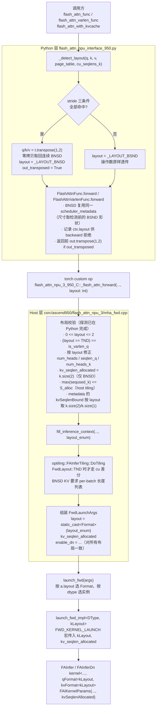
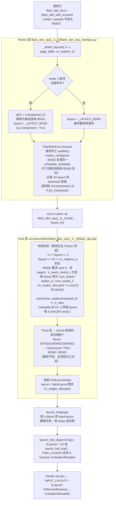
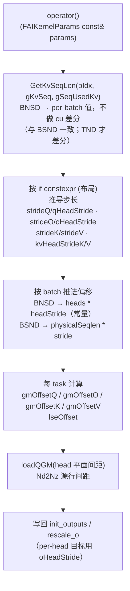

# Ascend NPU 后端 QKV BNSD 布局支持实现方案（仅前向）

> 覆盖后端（两代芯片、共 5 个后端）：
>
> | 代际 | 后端目录 | 版本 | 平台 |
> |---|---|---|---|
> | Ascend 950 | `csrc/ascend950/flash_attn_npu_3/` | v3 | Ascend 950 |
> | Ascend 950 | `csrc/ascend950/flash_attn_npu_4/` | v4 | Ascend 950 |
> | Ascend 910 | `csrc/ascend910/flash_attn_npu/` | v2 | Ascend 910 |
> | Ascend 910 | `csrc/ascend910/flash_attn_npu_3/` | v3 | Ascend 910 |
> | Ascend 910 | `csrc/ascend910/flash_attn_npu_4/` | v4 | Ascend 910 |
>
> 对应提交：
> - 950 先落地：`feat: support BNSD (B,H,S,D) QKV layout in the 950 backend forward`（`a514357`，分支 `950bnsd`）
> - 910 按同一设计移植：`feat: support BNSD (B,H,S,D) QKV layout in the 910 backends' forward`（`0309443`，分支 `950bnsd`）
>
> 两代实现同一特性：**前向支持 Q/K/V 的 BNSD（`(B, H, S, D)`）布局，反向报错**；对外 Python 公开签名不新增任何布局参数，布局靠 stride 严格匹配自动探测。

---

## 1. 目标与范围

| 项 | 内容 |
|---|---|
| 目标 | 让两代后端的公开入口支持 Q/K/V 为 BNSD（`(B, H, S, D)`）输入，长序列 / 长 cache 场景下免去调用方手写的 `transpose(1,2).contiguous()` 拷贝 |
| 硬约束 | **不改变对外 Python 接口参数**（`flash_attn_func` / `flash_attn_varlen_func` / `flash_attn_with_kvcache` / packed 变体均不新增 `bnsd` / `q_bnsd` / `kv_bnsd`）；不改 AICPU metadata ABI（`fa_metadata.aicpu`）；不改 `FAInferTilingData` / `FAInferStaticTilingData` / `FAInferRuntimeData` 字段集合；`setup.py` 用 glob 收集 autogen 无需改；仅前向 |
| 触发方式 | 全自动探测（stride 严格匹配），调用方无需传任何布局开关 |
| 输出约定 | 返回的 `out` 形状始终等于调用方传入的 `q` 形状 |
| 布局码 | 两代统一为 Python `_LAYOUT_TND=0 / _LAYOUT_BSND=1 / _LAYOUT_BNSD=2` |
| 编译期落法 | 950 用 `Format qFormat/kvFormat`（两个模板参数）；910 用 `inputLayout kLayout`（一个模板参数） |
| DN 快路径 | 仅 950 有 Qᵀ·K 变体（`FAInferDn`），对 BNSD 同样开放，根因修复与差分验证见 §4.4；910 无 DN 变体 |

### 1.1 支持矩阵

| 后端 | 平台 | `flash_attn_func` | `flash_attn_varlen_func` | `flash_attn_with_kvcache` | packed 变体 |
|---|---|---|---|---|---|
| `flash_attn_npu_3`（950 v3） | Ascend 950 | ✅ BNSD | ❌ 恒 `TND` | ✅ BNSD | — |
| `flash_attn_npu_4`（950 v4） | Ascend 950 | ✅ BNSD | ❌（varlen 走 `TND`/`BSND`，不含 BNSD） | — 无该入口 | — |
| `flash_attn_npu_3`（910 v3） | Ascend 910 | ✅ BNSD | ❌ 恒 `TND` | ✅ BNSD | — |
| `flash_attn_npu_4`（910 v4） | Ascend 910 | ✅ BNSD | ❌（`cu_seqlens_q` 非空 → `TND`，否则 `BSND`，不含 BNSD） | — 无该入口 | — |
| `flash_attn_npu`（910 v2） | Ascend 910 | ✅ BNSD | ❌ 不参与 BNSD | ✅ BNSD | ❌ 不参与 BNSD |

- 「✅ BNSD」表示该入口在 stride 判据命中时按 BNSD 解读（仅前向）；反向一律抛 `NotImplementedError`。
- v3 的 `flash_attn_with_kvcache` 在 BNSD 下额外禁止 `k_new` / `v_new`（append-KV）与 `q_v`。
- 全局不变式：`layout == _LAYOUT_TND ⟺ cu_seqlens_q is not None`（Python 与 host 侧各校验一次）。

---

## 2. 原理（950 与 910 共用）

### 2.1 三种布局的 shape / stride 特征

以 `D` 为 head dim、`H` 为 head 数、`S` 为序列长：

| 布局 | shape | 连续时的 strides |
|---|---|---|
| BSND | `(B, S, H, D)` | `(H*S*D, H*D, D, 1)` |
| BNSD | `(B, H, S, D)` | `(H*S*D, S*D, D, 1)` |
| BNSD 的 BSND 形状视图<br>（`bnsd.transpose(1, 2)`） | `(B, S, H, D)` | `(H*S*D, D, S*D, 1)` |

第三行是关键：推理侧把 per-head plane 的 BNSD 数据喂给 BSND 文档化接口，最自然的写法就是
`q = bnsd.transpose(1, 2)`。转置只改 stride 不改数据，于是得到一个
**shape 是 BSND、但 dim1(S) 与 dim2(H) 的 stride 被互换**的非连续视图。

### 2.2 stride 判据的推导

对 shape 为 `(B, S, H, D)` 的**转置视图**（代码里记 `_, n1, _, n3 = t.shape`，即 `n1 = S`、`n3 = D`）：

- `stride(3) == 1`：最后一维 D 是内存连续方向；
- `stride(1) == n3`：S 维步长是 `D`（而不是 BSND 的 `H*D`）；
- `stride(2) == n1 * n3`：H 维步长是 `S*D`（而不是 BSND 的 `D`）。

三条同时成立即判定为 BNSD 转置视图。命中后执行 `t.transpose(1, 2)`，得到 shape `(B, H, S, D)`、
strides `(H*S*D, S*D, D, 1)` —— **恰好是原连续 BNSD 的 storage 本身，零拷贝**。

### 2.3 为什么必须先做 `is_contiguous()` 短路

连续张量的 stride 是 shape 的**纯函数**，所以一个连续 BSND 张量在 stride 上无法与连续 BNSD 张量区分。
代入判据：连续 BSND `(B, S, H, D)` 的 strides 为 `(H*S*D, H*D, D, 1)`，
判据要求 `H*D == D`（即 `H == 1`）且 `D == S*D`（即 `S == 1`）。
即只有 `S == H == 1` 的退化形状会巧合命中，而此时 BSND 与 BNSD 的 shape/strides 完全相同、两种读法数值等价。
即便如此，仍用 `t.is_contiguous()` 优先短路，显式表达“连续张量永远不是 BNSD 转置视图”这一语义，
避免退化形状走进无意义的分支（该退化用例在既有测试集中出现过）。

> 同理，当 `H_KV == 1` 时 KV 的转置视图含 size-1 维，torch 的 `is_contiguous()` 会跳过该维校验而判为连续，
> `_transposed_bnsd_view` 短路返回 `None` → **BNSD 用例必须保证 `H_KV >= 2`**（两代一致）。

### 2.4 数值等价性：stride 路径是纯性能优化

设 `t` 为连续 BNSD，视图 `V = t.transpose(1, 2)`，则 `V[b, s, h, d] == t[b, h, s, d]`。
把 `V` 当 BSND 读，和把 `t` 当 BNSD 读，访问的是**同一个逻辑元素**。因此
stride 命中时的 BNSD 路径与 BSND 路径**逐元素相等**，唯一区别是省掉了一次 `contiguous()` 物化拷贝。

### 2.5 探测策略

```
_detect_layout(q, k, v, page_table, cu_seqlens_k)
    │
    ├─ 前置门：q/k/v 必须全部 rank-4，且 page_table / cu_seqlens_k 均为 None
    │           （TND varlen query 是 rank-3；paged / cu-packed KV 永不是 BNSD）
    │
    └─ stride 严格匹配
          q、k、v 三者全部命中 `_transposed_bnsd_view` ？
            是 → 返回 (_LAYOUT_BNSD, q.transpose(1,2), k.transpose(1,2), v.transpose(1,2), out_transposed=True)
            否 → 返回 (_LAYOUT_BSND, q, k, v, out_transposed=False)
```

**为什么必须 q/k/v 三者全部命中 stride 才判定 BNSD**：若只让部分操作数走 stride 路径，
混合输入下会把 BSND 的 q 误读成 BNSD。三者要求一致后，混合输入安全回退到 BSND 读法——
数值仍然正确，代价只是多一次 `contiguous()` 拷贝。

**为什么不再用 shape 判别**：shape 本身无法区分 BSND 与 BNSD——同一组 `(dim1, dim2)`
既可读成 `(S, H)` 也可读成 `(H, S)`，用 `qHeads % kvHeads == 0` 之类的整除规则去猜，
在两种读法都成立时会静默选错，且错误结果不报错。因此判别只依赖 strides 这一条
**可证伪的硬信号**，其余 rank-4 输入一律按文档化的 BSND 解读。调用方要喂 BNSD 数据，
须写成 `bnsd.transpose(1, 2)` 的 BSND 形状视图（零拷贝，见场景 A）。

### 2.6 输出形状约定

| 路径 | 传入的 q | kernel 产出的 out | Python 返回的 out |
|---|---|---|---|
| stride 命中 | BSND 形状视图 `(B, S, H, D)` | `(B, H, S, D)` | `out.transpose(1, 2)` → `(B, S, H, D)` |

该规则即：**`out.shape == 传入的 q.shape`**，调用方不需要记住自己喂的是哪种形态。
LSE 沿用各入口既有约定，不因布局路径改变：

- 950 v3 `flash_attn_func` 为 `(B, S, H)`；950 v3 `flash_attn_with_kvcache` 与 950 v4 为 `(B, H, S)`；
- **910 全部入口（v2 / v3 / v4）在 BNSD 下 LSE 保持 `(B, H, S)`**（与注释一致：
  “On the 910 backend the LSE keeps its `(B, H, S)` layout (the 950 backend reports `(B, S, H)`)”）。

### 2.7 为什么用编译期布局枚举而不是运行期 `bnsd` 标量

布局语义最终收敛为一个枚举值，并且它是 kernel 的**编译期模板参数**，业务分支全部写作 `if constexpr`：

- Q、K、V 理论上是同一种输入格式 → 不需要 `q_bnsd` / `kv_bnsd` 两个运行期布尔；
  950 出于历史签名保留了 `qFormat` / `kvFormat` 两个模板参数，910 只用**一个** `kLayout`；
- 布局在编译期已知，步长推导、LSE 分支、DN 快路径取舍都被编译器折叠，运行期零判断；
- 运行期不再有 `bool bnsd` 变量：Python → host 边界传 `int64_t layout`（0/1/2），
  host 把它转成枚举后交给 dispatch，kernel 只认模板参数；
- BNSD 与 TND 天然互斥（BNSD 要求 rank-4 query），因此布局码同时决定 Q 与 KV 的读法；
- 代价是编译实例从 4 个（2 dtype × 2 `IS_TND`/`Format`）增到 6 个（2 dtype × 3 枚举值），
  `autogen/` 生成脚本加一行即可，`setup.py` 用 glob 收集无需改动。

**两代在「如何落成编译期参数」上的差异**：

| 维度 | 950 | 910 |
|---|---|---|
| 编译期枚举 | `enum class Format { TND = 0, BSND = 1, BNSD = 2 }`（`kernel_common.hpp`） | `enum class inputLayout { BSND = 0, TND = 1, BNSD = 2 }`（三份 `kernel_common.hpp` 各自独立定义） |
| kernel 模板参数 | 两个：`Format qFormat, Format kvFormat` | 一个：`inputLayout kLayout`（Q/K/V 同格式） |
| host 侧枚举 | 另有 `enum class FwdLayout : uint32_t { TND = 0, BSND = 1, BNSD = 2 }`（`tilingdata.h`），取值与 `Format` 逐项一致，`static_cast<Format>(layout_enum)` 即得模板实参 | **无** host 枚举；host 只持 `int64_t layout`，三后端各自把 host 码 `0=TND / 1=BSND / 2=BNSD` **显式映射**到 `inputLayout`（编号不同，见 §6） |
| dispatch 模板签名 | `launch_fwd_impl<DType, Format kLayout>` | `launch_fwd_dtype<DType, inputLayout kLayout>`（v2 另经 `launch_fwd_impl` → `FWD_KERNEL_LAUNCH`） |
| 反向布局列表 | bwd `LAYOUTS` 保持 2 项（无 BNSD 反向 TU） | v3 bwd / v2 fag 列表保持 2 项，不生成 BNSD 反向 TU |

---

## 3. 代码调用流程

### 3.1 总览

950 侧（v3 / v4 同构）：



910 侧（v2 / v3 / v4 同构；差异：无 DN 变体、无 host `FwdLayout` 枚举、LSE 恒 `(B,H,S)`、`inputLayout` 单模板参数）：



### 3.2 Kernel 内部寻址



> 950 的 DN 变体只在 K5 处多一条 `loadQGM(..., qHeadStride)` 分支；910 无 DN 变体。

---

## 4. 950 后端实现

950 落地文件：`csrc/ascend950/flash_attn_npu_3/`（v3）与 `csrc/ascend950/flash_attn_npu_4/`（v4，同构）。

### 4.1 Python 侧修改点

文件：

- `flash_attn_npu_3/flash_attn_npu_interface_950.py`
- `flash_attn_npu_4/flash_attn_npu_interface_950.py`

#### 4.1.1 修改清单

| 位置 | v3 | v4 | 说明 |
|---|---|---|---|
| `_LAYOUT_TND/_LAYOUT_BSND/_LAYOUT_BNSD` | L37–42 | L37–42 | 新增模块常量 `0/1/2`，与 C++ 的 `FwdLayout` / `Format` 数值一致 |
| `_transposed_bnsd_view(t)` | L50–70 | L60–80 | 新增：stride 三条件严格匹配，命中返回 `t.transpose(1, 2)` |
| `_detect_layout(...)` | L73–135 | L83–145 | 新增：返回 5 元组 `(layout, q, k, v, out_transposed)` |
| `_flash_attn_forward(..., layout)` | L140–234 | L315–382 | 底层 `layout: int` 形参，把布局码透传给自定义算子 |
| `_flash_attn_forward_fake(..., layout)` | L238–310 | L1050–1095 | fake 按 `layout == _LAYOUT_BNSD` 推导 `out` / LSE 形状 |
| `_training_forward(..., layout=_LAYOUT_BSND)` | L589–645 | — | `seqused_k` 默认值按布局取 `k.shape[2]` 或 `k.shape[1]` |
| `FlashAttnFunc.forward` | L670–735 | L594–666 | 调用 `_detect_layout`；BNSD 复用同一 metadata（尺寸取检测前的 BSND 形状）；返回前按 `out_transposed` 转置 `out`；`ctx.layout = layout` |
| `FlashAttnVarlenFunc.forward` | L821–890 | L804–890 | v3 恒为 `_LAYOUT_TND`；v4 为 `cu_seqlens_q is not None ? TND : BSND` |
| `flash_attn_with_kvcache` | L1171–1290 | — | `cu_seqlens_q is not None` 时为 TND，否则走 `_detect_layout`；BNSD 复用同一 metadata（尺寸取检测前的 BSND 形状，并校验 KV 平面长度） |
| backward 拒绝 BNSD | L738–741 | L694–697 | `ctx.layout == _LAYOUT_BNSD` 时抛 `NotImplementedError` |
| 公开签名 | L~1400+ | — | `flash_attn_func` / `flash_attn_varlen_func` / `flash_attn_with_kvcache` 均**无**布局参数 |

#### 4.1.2 关键片段

```python
# Layout codes shared with the C++ host (FwdLayout / Format).
_LAYOUT_TND = 0
_LAYOUT_BSND = 1
_LAYOUT_BNSD = 2


def _transposed_bnsd_view(t):
    """``t.transpose(1, 2)`` if ``t`` is a contiguous BNSD tensor seen as BSND, else ``None``."""
    if t is None or t.dim() != 4 or t.is_contiguous():
        return None
    _, n1, _, n3 = t.shape
    if t.stride(3) == 1 and t.stride(1) == n3 and t.stride(2) == n1 * n3:
        return t.transpose(1, 2)
    return None


def _detect_layout(q, k, v, page_table, cu_seqlens_k):
    ...
    if q.dim() != 4 or k.dim() != 4 or page_table is not None or cu_seqlens_k is not None:
        return _LAYOUT_BSND, q, k, v, False

    q_bnsd = _transposed_bnsd_view(q)
    k_bnsd = _transposed_bnsd_view(k)
    v_bnsd = _transposed_bnsd_view(v)
    if q_bnsd is not None and k_bnsd is not None and v_bnsd is not None:
        return _LAYOUT_BNSD, q_bnsd, k_bnsd, v_bnsd, True

    return _LAYOUT_BSND, q, k, v, False
```

调用点收尾（v3 `FlashAttnFunc.forward` L729–734 / v4 L666–670）：

```python
ctx.layout = layout
if out_transposed:
    # Q/K/V 是连续 BNSD storage 的 BSND 形状视图，所以按调用方传入的形状回报
    out = out.transpose(1, 2)
return (out, softmax_lse.transpose(-1, -2)) if return_softmax else out
```

#### 4.1.3 Python 层的行为边界

- `flash_attn_varlen_func`（v3）：packed varlen query 是 rank-3，直接置 `layout = _LAYOUT_TND`，不参与探测。
- `FlashAttnVarlenFunc`（v4）：`layout = _LAYOUT_TND if cu_seqlens_q is not None else _LAYOUT_BSND`
  （v4 该 autograd 也承担非 varlen 的 rank-4 调用）。
- `flash_attn_with_kvcache`：`cu_seqlens_q is not None` 时为 `_LAYOUT_TND`；否则 `_detect_layout` 传入
  `page_table`，paged / rank-3 cache 永不按 BNSD 解读。
- BNSD 复用与 BSND 相同的 `scheduler_metadata`：该 buffer 只承载数字（`max_seqlen_q` = S、`num_heads_q` = H 等），
  不含布局语义，因此尺寸一律取 `_detect_layout` **检测之前**的 BSND 形状；显式传入的 metadata 同样有效。
- BNSD 的 `use_host_tiling` 不再强制为真：`num_splits > 1` 与 auto-FD 候选形状的判断与 BSND 完全一致。
- `flash_attn_with_kvcache` 在 BNSD 且 `cache_seqlens` 已知时，额外校验 `max(cache_seqlens) <= bsnd_seqlen_k`
  （KV 平面 pitch 由分配长度决定，host tiling 分支有等价校验）。
- 全局不变式：`layout == _LAYOUT_TND ⟺ cu_seqlens_q is not None`，host 侧重复校验一次。

### 4.2 Host 侧修改点（CANN C++）

以 v3 为例（文件均在 `csrc/ascend950/flash_attn_npu_3/`，v4 同构）：

#### 4.2.1 枚举与结构体

| 位置 | 改动 |
|---|---|
| `csrc/ascend950/flash_attn_npu_3/tilingdata.h` L17–23 | 新增 `enum class FwdLayout : uint32_t { TND = 0, BSND = 1, BNSD = 2 }`，替换原 `bool is_tnd` |
| `csrc/ascend950/flash_attn_npu_3/tiling.cpp` L79 | `FAInferContext::isTnd` → `FwdLayout layout = FwdLayout::BSND` |
| `csrc/ascend950/flash_attn_npu_3/kernel_common.hpp` L71–75 | `enum class Format { TND = 0, BSND = 1, BNSD = 2 }`；`FAIKernelParams` 新增 `int64_t kvSeqlenAllocated`，构造函数同步；**无 `bnsd` 成员** |
| `csrc/ascend950/flash_attn_npu_3/fwd_dispatch.hpp` L15–42 | `FwdLaunchArgs` 新增 `Format layout` 与 `int64_t kv_seqlen_allocated` |

> 说明：`FwdLayout` 与 `Format` 的取值逐项一致（`TND = 0`、`BSND = 1`、`BNSD = 2`），
> 因此 host 侧只需 `static_cast<Format>(layout_enum)` 就能得到编译期模板实参，
> `Format::BNSD` 是独立的第 3 个编译实例。

#### 4.2.2 `mha_fwd.cpp` 的校验与透传

**入口**：`mha_fwd(..., int64_t layout)`（`csrc/ascend950/flash_attn_npu_3/mha_fwd.cpp` L182 起）。
这是**底层入口**，Python 公开层不透出；布局探测（stride 严格匹配）已在 Python 侧一次算完，
host 不再重复探测，只做校验。

**校验与派生**（以 v3 为例）：

```cpp
TORCH_CHECK(layout >= static_cast<int64_t>(FwdLayout::TND) &&
                layout <= static_cast<int64_t>(FwdLayout::BNSD),
            "950 backend (v3) received an unsupported layout code (", layout, ")");
const FwdLayout layout_enum = static_cast<FwdLayout>(layout);
TORCH_CHECK((layout_enum == FwdLayout::TND) == is_varlen_q,
            "950 backend (v3) layout code conflicts with cu_seqlens_q: TND requires it, "
            "BSND and BNSD forbid it");

if (layout_enum == FwdLayout::TND) {
    batch_size = static_cast<int>(cu_seqlens_q.size(0)) - 1;   // packed query
    seqlen_q   = static_cast<int>(max_seqlen_q_.value());
    num_heads  = static_cast<int>(sizes[1]);
    head_size_q = static_cast<int>(sizes[2]);
} else {
    batch_size  = static_cast<int>(sizes[0]);
    head_size_q = static_cast<int>(sizes[3]);
    if (layout_enum == FwdLayout::BNSD) {                      // (B, H, S, D)
        num_heads = static_cast<int>(sizes[1]);
        seqlen_q  = static_cast<int>(sizes[2]);
    } else {                                                   // (B, S, H, D)
        num_heads = static_cast<int>(sizes[2]);
        seqlen_q  = static_cast<int>(sizes[1]);
    }
}

int64_t kv_seqlen_allocated = 0;
if (layout_enum == FwdLayout::BNSD) {
    TORCH_CHECK(!paged_KV && !is_varlen_kv && k.dim() == 4 && v.dim() == 4, "...");
    kv_seqlen_allocated = static_cast<int64_t>(k.size(2));      // BNSD 的 S_alloc
    TORCH_CHECK(k.size(0) == v.size(0) && k.size(1) == v.size(1) && k.size(2) == v.size(2),
                "... BNSD key and value must share batch, head and sequence dimensions ...");
}
const int num_heads_k = (layout_enum == FwdLayout::BNSD)
                            ? static_cast<int>(k.size(1))
                            : (k.dim() == 3 ? static_cast<int>(k.size(1)) : static_cast<int>(k.size(2)));
```

host tiling 分支下 BNSD 额外校验 `max(seqused_k) <= kv_seqlen_allocated`。
metadata 分支（`scheduler_metadata_.has_value()`）同样按布局取 KV 上界：BNSD 读 `k.size(2)`（序列维），
非 BNSD 读 `k.size(1)`（或 3D 的 `k.size(0)`）。该上界用于 window 归一化与 `DeriveFwdMask` 的掩码推导，
因此 BNSD 必须传序列维，否则会把 head 数当成 KV 长度。

**DN 快路径**：`enableDN` 不再排除 BNSD（取值与 §4.4.4 一致）。FlashDecode 候选本身要求
`paged_KV`，而 BNSD 要求非 paged，两者天然互斥。

**下发**：

```cpp
fill_inference_context(ctx, scratch, ..., return_softmax_lse, layout_enum);

const Format fmt = static_cast<Format>(layout_enum);
const FwdLaunchArgs fwdArgs{ ..., static_cast<uint32_t>(max_num_blocks_per_seq), kv_seqlen_allocated };
```

**输出/LSE 分配**：`output_sizes` 直接取 `q.sizes()` 再覆盖最后一维为 `head_size_v`，
因此 BNSD 下 `out` 自然分配为 `(B, H, S, D_v)`；LSE 为 `(B, H, S)`（用的是修正后的 `num_heads` / `seqlen_q`）。

#### 4.2.3 Tiling 链路

| 文件 | 改动 |
|---|---|
| `csrc/ascend950/flash_attn_npu_3/tiling_from_tensors.hpp` L121 | `fill_inference_context(..., FwdLayout layout)` 取代 `bool is_tnd`；L152–158 增加 BNSD KV 必须是 per-batch 长度列表（`numel == batch`）的校验；L225 `ctx.layout = layout` |
| `csrc/ascend950/flash_attn_npu_3/tiling.cpp` L286 / L446 | 两处读取 cumulated KV 长度的分支改为只在 `FwdLayout::TND` 时执行；**未新增 `FAInferTilingData` 字段** |

#### 4.2.4 Dispatch（6 个编译实例）

`csrc/ascend950/flash_attn_npu_3/fwd_dispatch.hpp` L48–73：

```cpp
template <typename DType, Format kLayout>
void launch_fwd_impl(const FwdLaunchArgs& a);

inline void launch_fwd(const FwdLaunchArgs& a) {
    if (a.is_bf16) {
        if (a.layout == Format::TND)       { launch_fwd_impl<bfloat16_t, Format::TND>(a); }
        else if (a.layout == Format::BNSD) { launch_fwd_impl<bfloat16_t, Format::BNSD>(a); }
        else                               { launch_fwd_impl<bfloat16_t, Format::BSND>(a); }
    } else { /* half 同理 */ }
}
```

`csrc/ascend950/flash_attn_npu_3/fwd_dispatch_impl.hpp` L48–56 的宏把 `kLayout` 同时喂给 kernel 的 `qFormat` 与 `kvFormat`，
实参列表尾部追加 `a.kv_seqlen_allocated`；DN 快路径增加编译期剪枝：

```cpp
#define FWD_KERNEL_LAUNCH(KERNEL, MASK_CAT, CACHE_MODE_V, PAGE_SHAPE_V, LSE_MODE, HAS_SOFTCAP) \
    KERNEL<DType, float, kLayout, kLayout, CACHE_MODE_V, PAGE_SHAPE_V, MASK_CAT, kCacheLayout, LSE_MODE, HAS_SOFTCAP> \
        <<<a.block_dim, nullptr, a.stream>>>(..., a.kv_seqlen_allocated)

constexpr bool kUseDnFastPath =
    (MaskCat == MaskCategory::NO_MASK) && IsDN;
```

`FWD_BOOL_SWITCH(a.enable_dn, ...)` 的两个 arm 都会实例化，`kUseDnFastPath` 是编译期常量，
`if constexpr` 因此把 masked 的 `FAInferDn` 彻底剪掉；非 masked 的 `FAInferDn` 对所有布局
（含 BNSD）都会实例化。BNSD 的实例化代价与配套改动见 §4.4.4。

`csrc/ascend950/flash_attn_npu_3/autogen/generate_kernels.py` L25–30 的 `LAYOUTS` 增加一行并重新生成：

```python
LAYOUTS = [("bsnd", "BSND", "Format::BSND"),
           ("tnd",  "TND",  "Format::TND"),
           ("bnsd", "BNSD", "Format::BNSD")]
# 生成 fwd_dispatch_{fp16,bf16}_{bsnd,tnd,bnsd}.cpp，共 6 个 TU
# template void launch_fwd_impl<ctype, fmt>(const FwdLaunchArgs &a);
```

`setup.py` 用 `glob(autogen/*.cpp)` 收集源码，无需改动。

### 4.3 Kernel 侧修改点

#### 4.3.1 入口参数

```cpp
struct FAIKernelParams {
    ...
    int64_t kvSeqlenAllocated;  // BNSD 下 KV 的 plane 长度 S_alloc，其余布局为 0
    __aicore__ inline FAIKernelParams(..., int64_t kvSeqlenAllocated_);
};
```

布局本身不作为入口参数：`FAInfer` 与 `FAInferDn` 的 `CATLASS_GLOBAL` 模板签名
（`csrc/ascend950/flash_attn_npu_3/fwd_kernel.cpp` L963、L1036）形如
`FAInfer<InDtype, SMDtype, Format qFormat, Format kvFormat, ...>`，
`CATLASS_GLOBAL` 签名只追加 `int64_t kvSeqlenAllocated` 一个参数，两处 `FAIKernelParams{...}`
（L1029、L1096）同步追加。
`csrc/ascend950/flash_attn_npu_3/fd_combine.hpp` L364 的 FD combine kernel 也用同一结构体，
按“FlashDecode 与 BNSD 互斥”补 `kvSeqlenAllocated = 0`。

#### 4.3.2 步长推导（`csrc/ascend950/flash_attn_npu_3/fwd_kernel.cpp` L270–284）

| 量 | BSND / TND | BNSD | 含义 |
|---|---|---|---|
| `strideQ` | `qHeads_ * embed_` | `embed_` | batch 内相邻 token 距离 |
| `qHeadStride` | `embed_` | `maxQSeqlen * embed_` | 相邻 head plane 距离 |
| `strideO` | `qHeads_ * embedV_` | `embedV_` | 同上（O） |
| `oHeadStride` | `embedV_` | `maxQSeqlen * embedV_` | 同上（O） |
| `strideK` | `kvHeads_ * embed_` | `embed_` | KV token 距离 |
| `kvHeadStrideK` | `embed_` | `kvSeqlenAllocated * embed_` | KV head plane 距离 |
| `strideV` / `kvHeadStrideV` | 同上，用 `embedV_` | 同上，用 `embedV_` | |

全部由 `if constexpr (qFormat == Format::BNSD)` / `if constexpr (kvFormat == Format::BNSD)` 选出。
batch 推进（L338–345）：

```cpp
int64_t qBatchStride = (qFormat == Format::BNSD) ? qHeads_ * qHeadStride : qPhysicalSeqlen * strideQ;
int64_t oBatchStride = (qFormat == Format::BNSD) ? qHeads_ * oHeadStride : qPhysicalSeqlen * strideO;
int64_t kBatchStride = (kvFormat == Format::BNSD) ? kvHeads_ * kvHeadStrideK : kvPhysicalSeqlen * strideK;
int64_t vBatchStride = (kvFormat == Format::BNSD) ? kvHeads_ * kvHeadStrideV : kvPhysicalSeqlen * strideV;
```

> 关键点：BSND 的 batch 步长依赖“离开那个 batch 的物理序列长”，所以必须逐 batch 重算；
> BNSD 的每个 head plane 都是 `maxQSeqlen` / `S_alloc` 大小的常量平面，batch 步长是常量。

#### 4.3.3 偏移计算（L394–423）

```cpp
gmOffsetQ = qBOffset + qSOffset * strideQ + qNStartIdx * qHeadStride;
gmOffsetO = oBOffset + qSOffset * strideO + qNStartIdx * oHeadStride;
gmOffsetK = kBOffset + kvHeadIdx * kvHeadStrideK;
gmOffsetV = vBOffset + kvHeadIdx * kvHeadStrideV;
```

LSE offset（L401–414）：BSND/TND 沿用原公式；BNSD 单独分支：

```cpp
lseHeadStride = faiTilingData->maxQSeqlen;
lseOffset = curBatch * qHeads_ * lseHeadStride + qNStartIdx * lseHeadStride + qSOffset;
```

BNSD 下无法从 `qBOffset / strideQ` 反推 batch 索引（`strideQ == embed_`），
故直接使用循环内已维护的 `curBatch`。

#### 4.3.4 KV 长度（L94–114、L263–267）

```cpp
__aicore__ inline int64_t GetKvSeqLen(uint32_t bIdx, ...) const {
    if constexpr (kvFormat == Format::BNSD) {   // BNSD KV 按 (batch, head) 索引，永不使用 TND 的 cu 差分
        return hasSeqUsedKv ? gSeqUsedKv.GetValue(bIdx) : gKvSeq.GetValue(bIdx);
    }
    if constexpr (kvFormat == Format::TND) { ... gKvSeq.GetValue(bIdx+1) - gKvSeq.GetValue(bIdx) ... }
    return gKvSeq.GetValue(bIdx);
}
```

`kvPhysicalSeqlen` 的 TND 分支（`kvFormat == Format::TND && normalCache`）直接按 `kvFormat` 判定，
不再需要 `if (!params.bnsd)` 守卫（原守卫在 `kvFormat == TND` 下恒真，属死代码，已删除）。

#### 4.3.5 Nd2Nz 源行间距与输出写回

| 文件 | 改动 |
|---|---|
| `csrc/ascend950/flash_attn_npu_3/qk_matmul.hpp` L238–264 | `loadQGM` 新增 `int64_t qHeadStride`，作为 Nd2Nz 源矩阵（行 = Q head）的行间距；L1 目的布局不变 |
| `csrc/ascend950/flash_attn_npu_3/qk_matmul_DN.hpp` L190–212 | DN 版 `loadQGM` 同样新增 `int64_t qHeadStride`，并把它作为 `copyGmToL1B` 的 `srcNdMatrixStride`（改动前硬编码 `embed`，仅对 BSND/TND 成立）。根因、实例化影响与差分验证见 §4.4 |
| `csrc/ascend950/flash_attn_npu_3/init_outputs.hpp` L48, L86 | 写回增加 `uint32_t oHeadStride`，per-head 目的地址为 `gOutput[(qNStart + qNIdx) * oHeadStride]` |
| `csrc/ascend950/flash_attn_npu_3/rescale_o.hpp` L296–342 | `ScatterGroupedOutput` 增加 `oHeadStride`，per-head 目的地址为 `gO[head * oHeadStride + localS * outputStride]` |

两处 `oHeadStride` 在 BSND 下取值等于 `embedV_`，与改动前逐项等价，保证 BSND 数值不变。

### 4.4 DN 快路径（Qᵀ·K）支持 BNSD

非 causal、非 local、`head_size <= 256` 且未走 FlashDecode 时，host 会开启 **DN 变体**
（`FAInferDn`）：Q 以 ColumnMajor 作右操作数，算 `K·Qᵀ`，softmax 按列进行。
该变体与布局强耦合的只有**一处** GM→L1 的拷贝步长，下面给出根因、修复与验证。

#### 4.4.1 根因：`loadQGM` 的 `srcNdMatrixStride` 被硬编码

DN 版 `loadQGM` 把每个 Q head 当作一个 ND 矩阵，通过 `copyGmToL1B(l1QTile, gmQTile, qNBlockSize,
srcNdMatrixStride, dstNzMatrixStride)` 拷进 L1。这里的 `srcNdMatrixStride` 是**相邻 Q head
平面在 GM 中的间距（以元素计）**：

| 布局 | `qHeadStride`（= `srcNdMatrixStride`） |
|---|---|
| BSND / TND | `embed_`（H 是倒数第二维，head 间距恒为一个 head 的行宽） |
| BNSD | `maxQSeqlen * embed_`（H 在 S 之外，每个 head 占一整块 `maxQSeqlen × embed_` 平面） |

改动前该实参被硬编码为 `embed_`，只在 `ndNum == 1` 时恰好正确 —— 即 MHA（`groupSize == 1`，
`qNBlockSize` 覆盖全部 head）。GQA 下 `qNBlockSize > 1` 使 `ndNum > 1`，多 head 的 ND 矩阵
间距被当成 `embed_`，于是读到**错误的 head 平面**，非 causal 的 BNSD 用例数值全错
（实测 `max|actual - ref|` 落在 9.875 ~ 16.89）。

#### 4.4.2 修复（v3 / v4 各三处）

| 文件 | 改动 |
|---|---|
| `csrc/ascend950/flash_attn_npu_3/qk_matmul_DN.hpp` L190–212 | `loadQGM` 形参表尾部新增 `int64_t qHeadStride`，并把 `copyGmToL1B` 的 `srcNdMatrixStride` 由硬编码 `embed` 改为 `static_cast<uint32_t>(qHeadStride)` |
| `csrc/ascend950/flash_attn_npu_3/fwd_kernel.cpp` L583–589 | DN 调用点 `blockMmadQK.loadQGM(gmQTensorTlaDN, ..., qHeadStride)` 透传（v4 L626） |
| `csrc/ascend950/flash_attn_npu_3/qk_matmul.hpp` L236–255 | 非 DN 版 `loadQGM` 此前已带 `qHeadStride`（TLA 视图的 stride），此处**保持不动**，仅作对照 |

```cpp
// qk_matmul_DN.hpp（v3 L190–212）
// qHeadStride is the source-tensor distance (in elements) between adjacent
// Q heads: embed for BSND, maxQSeqlen * embed for BNSD.  It is the
// srcNdMatrixStride of the Nd2Nz copy (one ND matrix per Q head).
void loadQGM(TensorA &gATensor, GemmCoord actualOriShape,
             uint32_t qSBlockSize, uint32_t qNBlockSize, int64_t qHeadStride) {
    ...
    copyGmToL1B(l1QTile, gmQTile,
        qNBlockSize, static_cast<uint32_t>(qHeadStride), qSBlockSize * C0_ELEMS);
}

// fwd_kernel.cpp（v3 L585–589）
if constexpr (IsDN) {
    blockMmadQK.loadQGM(gmQTensorTlaDN, actualBlockShapeQ, qSBlockSize, qNBlockSize, qHeadStride);
} else {
    blockMmadQK.loadQGM(gmQTensorTla,   actualBlockShapeQ, qSBlockSize, qNBlockSize, qHeadStride);
}
```

`qHeadStride` 由 §4.3.2 的布局驱动推导给出：BSND/TND 为 `embed_`，BNSD 为 `maxQSeqlen * embed_`。
因此本修复对 BSND / TND 是**逐项等价**（同一个值），BNSD 才取到新的正确值。

#### 4.4.3 未改动但已逐点核对的地方

DN 全链路（Q/K/V 加载 → mmad → UB 转置 S → 按列 softmax → PV → O/LSE 写回）中，除 §4.4.1 那一处外，
其余位置都已由**布局驱动的 stride** 承载，无需 BNSD 专有分支：

| 位置 | 为什么天然兼容 |
|---|---|
| `kvHeadStrideK / kvHeadStrideV` | 已按 `kvFormat == BNSD` 取 `S_alloc * embed_`（§4.3.2） |
| batch 推进 `qBatchStride / kBatchStride` | 已按 `qFormat/kvFormat == BNSD` 取常量平面（§4.3.2） |
| LSE offset | 已按 `if constexpr` 分流到 BNSD 公式（§4.3.3） |
| `qkRowNumRound` 的 32 对齐 | DN 与非 DN 共用，与布局无关 |
| `WriteGroupedLse` 的 `rowAlign = isDN ? 32 : 8` | 由 `IsDN` 决定，与布局无关 |

#### 4.4.4 门禁放开与实例化影响

改动前有**两处**显式排除 BNSD×DN，现均已放开：

| 位置 | 放开前 | 放开后 |
|---|---|---|
| `csrc/ascend950/flash_attn_npu_3/mha_fwd.cpp` L497–498 | `enableDN` 的条件里带 BNSD 排除项 | `enableDN = !flashDecodeEnabled && (!is_causal) && (!is_local) && (head_size_q <= 256) && (head_size_v <= 256)`，不再看布局 |
| `csrc/ascend950/flash_attn_npu_3/fwd_dispatch_impl.hpp` L76–77 | 实例化模板排除 BNSD×DN 组合 | `constexpr bool kUseDnFastPath = (MaskCat == MaskCategory::NO_MASK) && IsDN;` |

FlashDecode 候选本身要求 `paged_KV`，而 BNSD 要求非 paged，两者天然互斥，故 `enableDN`
去掉布局判断后不会把 BNSD 带进 FD 路径。

`kUseDnFastPath` 必须保留 `NO_MASK`：`FWD_BOOL_SWITCH(a.enable_dn, ...)` 的两个 arm 都会被实例化，
把 `NO_MASK` 写进编译期常量后，`if constexpr` 才能把 **masked 的 `FAInferDn`** 剪掉。
放开后实际新增的编译实例只有 **非 masked 的 `FAInferDn<BNSD>`**（`(fp16, bf16) × 1`）。
`enableDN` 是**运行期** h/w 条件，`kUseDnFastPath` 是**编译期**常量，二者配合完成剪枝。

#### 4.4.5 边界

- 只有 **非 masked**（`NO_MASK`）才走 DN 快路径；causal / SWA 恒走 `FAInfer`。
- 只有 **非 causal、非 local**、`head_size_q/v <= 256` 且未走 FlashDecode 时 `enableDN` 为真。
- BNSD 的 KV 必须非 paged，与 FD 互斥（§8）。
- `H_KV == 1` 时 BNSD 的 stride 探测会失效（KV 转置视图含 size-1 维，torch 的 `is_contiguous()`
  跳过该维校验而判为连续，`_transposed_bnsd_view` 短路返回 `None`）→ 因此 **BNSD 用例必须保证
  `H_KV >= 2`**，DN 专项用例中 v3 的宽分组场景取 `(16, 2)`（`groupSize = 8`）。

#### 4.4.6 差分验证与新增用例

采用**两步差分**，把「门禁放开」与「根因修复」的效应分离：

1. **只放开两处门禁**（不动 `loadQGM`）→ BNSD 的非 causal 用例全部失败
   （`max|actual - ref|` 9.875 ~ 16.89），证明 DN 确实被选中、且修复确有必要。
2. **加上 `qHeadStride` 修复并全量重编**（TU 仍为 6）→ BNSD 用例全部通过。

新增 6 个 BNSD×DN 专项用例：

| 文件 | 用例 |
|---|---|
| `tests/test_flash_attn_npu_v3_bnsd.py` | `test_bnsd_dn_grouped_heads_with_lse`（L221）、`test_bnsd_dn_head_size_192`（L245）、`test_bnsd_dn_wide_group_two_kv_heads`（L260） |
| `tests/test_flash_attn_npu_v4_bnsd.py` | `test_v4_bnsd_dn_grouped_heads_with_lse`（L160）、`test_v4_bnsd_dn_head_size_256`（L179）、`test_v4_bnsd_dn_unaligned_q_seqlen`（L194） |

回归：BSND / TND 的 DN 路径取值与改动前逐项相同，非 BNSD 全量套件 **823 passed / 200 skipped /
20 deselected，0 failed**，零回归。

---

## 5. 910 后端实现

910 落地文件：`csrc/ascend910/flash_attn_npu/`（v2）、`csrc/ascend910/flash_attn_npu_3/`（v3）、
`csrc/ascend910/flash_attn_npu_4/`（v4）。三个目录**彼此独立、无共享头**，各自定义自己的 `inputLayout`。

### 5.1 三后端共性设计

| 项 | 三后端共同做法 |
|---|---|
| 编译期布局 | 三份 `kernel_common.hpp` 各自定义 `enum class inputLayout { BSND = 0, TND = 1, BNSD = 2 }`（v2 L58–61、v3 L63–67、v4 L55–58）。注意其编号与 Python 的 `_LAYOUT_*`（`0=TND / 1=BSND / 2=BNSD`）**不同**，必须显式映射，见下行 |
| 入口参数 | 三份 `FAIKernelParams` 均新增 `int64_t kvSeqlenAllocated`（BNSD 下为 KV 的 `S_alloc`，其余布局为 0），构造函数同步（v2 L80、v3 L86–88、v4 L78–80） |
| dispatch 签名 | `launch_fwd<kLayout>` / `launch_fwd_dtype<DType, kLayout>`（v2 另经 `launch_fwd_impl<DType, kLayout>`），模板参数由 `bool IS_TND` 改为 `inputLayout kLayout` |
| `FwdLaunchArgs` | 均新增 `inputLayout layout` 与 `int64_t kv_seqlen_allocated`；`FWD_LAUNCH` 宏把二者传入 kernel 例化 |
| host 入口 | v3 / v4 `mha_fwd`、v2 `mha_fwd` 与 `mha_fwd_kvcache` 均新增 `int64_t layout` 形参并注册进 `PYBIND11_MODULE` |
| host 码 → 枚举 | host 码 `0=TND / 1=BSND / 2=BNSD` 与 kernel 枚举编号**不同**（kernel 侧 `BSND=0 / TND=1 / BNSD=2`），必须**显式映射**（如 v3 `fwd_args.layout = (layout == 0) ? TND : (is_bnsd ? BNSD : BSND)`），不可直接 `static_cast` |
| KV 实际长度 | BNSD 与 BSND 完全一致，取 per-batch 的 `gActualKvseqlen.GetValue(BIdx)`，**不使用** TND 的 cu 差分 |
| LSE | BNSD 下 LSE 仍为 `(B, H, S)`，`lseBOffset / lseHeadStride` 与 BSND 取值相同；kernel 中**不**从 `qBOffset / strideQ` 反推 batch |
| 无 DN 变体 | 910 三后端均无 `FAInferDn`，不存在 950 的 DN 快路径问题 |
| autogen | 三份 `generate_kernels.py` 的 fwd 布局列表由 2 项改 3 项（含 `bnsd`）；bwd / fag 列表保持 2 项；`setup.py` 未改 |

### 5.2 v3 后端（`csrc/ascend910/flash_attn_npu_3/`）

#### 5.2.1 Python 侧

文件：`flash_attn_npu_3/flash_attn_npu_interface.py`（约 1683 行）。

| 位置 | 改动 |
|---|---|
| L43–45 | 新增模块常量 `_LAYOUT_TND = 0` / `_LAYOUT_BSND = 1` / `_LAYOUT_BNSD = 2` |
| L48–55 | 新增 `_transposed_bnsd_view(t)`：rank-4、非连续、stride 三条件命中则返回 `t.transpose(1, 2)` |
| L58–80 | 新增 `_detect_layout(q, k, v, page_table, cu_seqlens_k)`，返回 5 元组；含 k/v rank 一致性 `RuntimeError` |
| L187 | `_flash_attn_forward(..., layout: int = _LAYOUT_BSND)`，L235 把 `layout` 透传给自定义算子 |
| L283 / L307 / L336 | fake 增加 `layout` 形参，按其推导 `out` / LSE 形状 |
| L713–786 | `FlashAttnFunc.forward`：L718 调 `_detect_layout`；L770 `layout=layout`；L782 `ctx.layout = layout`；L783–786 按 `out_transposed` 转置 `out` |
| L790–794 | backward 首行对 `ctx.layout == _LAYOUT_BNSD` 抛 `NotImplementedError` |
| L877 | `FlashAttnVarlenFunc` 恒 `_LAYOUT_TND` |
| L1394–1415 | `flash_attn_with_kvcache`：`cu_seqlens_q` 非空 → TND，否则探测；BNSD 下拒绝 `k_new/v_new/q_v` 并校验 `max(cache_seqlens) <= bsnd_seqlen_k`；L1451 `layout=layout` |

公开签名（`flash_attn_func` / `flash_attn_varlen_func` / `flash_attn_with_kvcache`）**未新增**布局参数。

#### 5.2.2 Host 侧

文件：`csrc/ascend910/flash_attn_npu_3/flash_api.cpp` 的 host `mha_fwd`（L175 含 `int64_t layout` 形参）。

| 位置 | 改动 |
|---|---|
| L180–191 | 校验 `layout ∈ {0,1,2}`；BNSD（`layout == 2`）分支校验 q/k/v rank-4、非 paged、`k_new`/`v_new` 为空、`q_v` 为空 |
| L193–197 | 既有形状校验块（`q must be 3-dimensional` / `batch size must be positive` / `total_q must be positive`） |
| L199–201 | `TORCH_CHECK((layout == 0) == cu_seqlens_q_.has_value(), ...)` —— **位于形状校验块之后**（见 §5.5.3） |
| L292–307 | 派生 `batch_size` / `seqlen_q` / `num_heads` / `head_size_og`（`is_varlen_q` / `is_bnsd` / else 三支） |
| L311 | `num_heads_k = k.dim()==3 ? k.size(1) : (is_bnsd ? k.size(1) : k.size(2))` |
| L314 | `kv_seqlen_allocated = is_bnsd ? k.size(2) : 0` |
| L348 | `seqlen_k_val = is_bnsd ? k.size(2) : k.size(1)` |
| L353–363 | BNSD 下逐 batch 校验 `sk[i] <= kv_seqlen_allocated` |
| L428–435 | metadata 分支 `kvSeqlenBound = is_bnsd ? k.size(2) : k.size(1)` |
| L700–703 | `fwd_args.layout = (layout == 0) ? TND : (is_bnsd ? BNSD : BSND)`；`fwd_args.kv_seqlen_allocated` |
| L720–733 | `switch (layout)` 三分派：`launch_fwd<inputLayout::TND>` / `<BNSD>` / `<BSND>` |

`out` 仍由 `torch::empty_like(q)` 分配，BNSD 下自然得到 `(B, H, S, D)`。

#### 5.2.3 Dispatch 与 autogen

| 文件 | 改动 |
|---|---|
| `csrc/ascend910/flash_attn_npu_3/fwd_dispatch.hpp` | `FwdLaunchArgs`（L31–60）新增 `inputLayout layout`（L41）与 `int64_t kv_seqlen_allocated`（L44）；`launch_fwd_dtype<DType, inputLayout kLayout>`（L64–65）；`launch_fwd<kLayout>` 按 `is_bf16` 选 dtype（L70–78） |
| `csrc/ascend910/flash_attn_npu_3/fwd_dispatch_impl.hpp` | `FWD_LAUNCH` 宏（L24–29）把 `LAYOUT_TYPE = kLayout` 与 `kvSeqlenAllocated` 传入 `SplitFuse::FAInfer<...>`；`launch_fwd_dtype<DType, kLayout>`（L65–101）`constexpr auto LAYOUT = kLayout`，用 `FWD_BOOL_SWITCH` / `FWD_MASK_SWITCH` 展开，L93 `const int64_t kvSeqlenAllocated = a.kv_seqlen_allocated` |
| `csrc/ascend910/flash_attn_npu_3/autogen/generate_kernels.py` | `FWD_LAYOUTS`（L32–37）3 项：`bsnd`/`tnd`/`bnsd`，令牌 `FaiKenel::inputLayout::BSND/TND/BNSD`；`BWD_LAYOUTS`（L42–45）仍 2 项。生成 `fwd_dispatch_{dtype}_{layout}.cpp`：fwd TU **4 → 6**、bwd TU **4 不变** |

#### 5.2.4 Kernel 侧

前向 kernel 文件：`csrc/ascend910/flash_attn_npu_3/mha_fwd_kvcache.cpp`。

| 位置 | 改动 |
|---|---|
| L34 | 模板 `FaiKenel::inputLayout INPUT_LAYOUT = ...::BSND`（单布局参数） |
| L249–273 | 步长推导：BNSD 下 `strideQ = embed`、`qHeadStride = maxQSeqlen*embed`、`kvHeadStrideK = kvSeqlenAllocated*embed`（O/V 用 `embedV`）；else 为 BSND/TND 原值 |
| L632–643 | `qBOffset` / `oBOffset`：BNSD 取 `BIdx*qHeads*qHeadStride`；else 取 `prevQSeqlenSum*strideQ` |
| L644–657 | `kBOffset` / `vBOffset`：BNSD 取 `BIdx*kvHeads*kvHeadStrideK`；else 取 `prevKvSeqlenSum*strideK` |
| L658–671 | LSE offset：TND 用 `prevQSeqlenSum` / `totalQTokens`；else / BNSD 用 `prevQSeqlenSum*qHeads`、`lseHeadStride = maxQSeqlen` |
| L687–702 | `gmOffsetQ/K/V/O/Lse` |
| L817–822 | `epilogueInitOut(..., static_cast<uint32_t>(strideO), static_cast<uint32_t>(oHeadStride))` |
| L838–839 | `blockMmadQK.loadQGM(..., qHeadStride, strideQ)` |
| L1052–1067 | FD 分支 `epilogueRescaleO(..., splitParams, 0, 0, 0, 0, 1, static_cast<uint32_t>(strideO), static_cast<uint32_t>(oHeadStride))`（见 §5.5.2） |
| `csrc/ascend910/flash_attn_npu_3/qk_matmul.hpp` L106–123 | `loadQGM(..., uint32_t qHeadStride, uint32_t qTokenStride)`；L116 `LayoutA layoutSingleANd(singleGroupHeads, embed, qHeadStride)`；L120 `LayoutA denseSrc(rowNum, embed, qTokenStride)` |
| `csrc/ascend910/flash_attn_npu_3/init_outputs.hpp` L60 / L98 | `SubCoreCompute` / `operator()` 形参 `uint32_t outputStride, uint32_t oHeadStride`；L74 `gOutput[qNIdx * oHeadStride]`；L78 `DataCopyExtParams(qSThisSubBlock, embedV*sizeof, 0, (outputStride - embedV)*sizeof, 0)` |
| `csrc/ascend910/flash_attn_npu_3/rescale_o.hpp` L642–659 | `operator()` 形参含 `uint32_t outputStride, uint32_t oHeadStride`，**无默认值**（尾部默认值已删，两处调用点全显式传参） |
| `csrc/ascend910/flash_attn_npu_3/combine_scale.hpp` | 仅含 `CombineScale` 类，**无 BNSD 语义**（FD 与 BNSD 互斥） |
| `csrc/ascend910/flash_attn_npu_3/fa_split.h` | `isSplitKV` 为**逐 task** 判定（`coveredS2 > 0 && coveredS2 < curKSBlockNum`）—— 与 §5.5.2 的 FD 越界写根因相关 |

#### 5.2.5 验证结果

- `tests/test_flash_attn_npu_v3_bnsd_910.py`：**11 passed**（stride 零拷贝、与等价 BSND 逐元素相等、
  连续 rank-4 回退 BSND、causal、LSE 形状 `(B,H,S)` 与数值、forward-only 拒绝、GQA `H_KV >= 2`、
  `S_alloc > cache_seqlens` 的分配平面长度）。
- `tests/test_flash_attn_npu_v3.py` + `tests/test_flash_attn_npu_v3_metadata.py` 全量：
  **528 passed / 11 skipped / 0 failed**；`TestVarlenValidation` **35 passed**。

### 5.3 v4 后端（`csrc/ascend910/flash_attn_npu_4/`）

#### 5.3.1 Python 侧

文件：`flash_attn_npu_4/flash_attn_npu_interface.py`（约 1304 行）。

| 位置 | 改动 |
|---|---|
| L43–45 | 模块常量 `_LAYOUT_TND / _LAYOUT_BSND / _LAYOUT_BNSD` |
| L48–80 | `_transposed_bnsd_view(t)` 与 `_detect_layout(...)`（同 v3） |
| L162 / L194 / L403 | `layout: int` 形参（自定义算子 / fake / 调用点） |
| L422 | fake 按 `layout == _LAYOUT_BNSD` 推导 `out` / LSE |
| L682–755 | `FlashAttnFunc.forward`：L688 探测；L730 `layout=layout`；L751 `ctx.layout`；L752–754 按 `out_transposed` 转置 |
| L759–761 | backward 拒绝 `_LAYOUT_BNSD` |
| L877 | `FlashAttnVarlenFunc`：`_LAYOUT_TND if cu_seqlens_q is not None else _LAYOUT_BSND` |
| L950 / L976 / L991 | 其余 `layout` 透传点 |

v4 **无** `flash_attn_with_kvcache` 入口，也**无** `k_new/v_new` / rotary。

#### 5.3.2 Host 侧

文件：`csrc/ascend910/flash_attn_npu_4/flash_api.cpp` 的 host `mha_fwd`（L119 含 `int64_t layout`）。

| 位置 | 改动 |
|---|---|
| L178–190 | 校验：`is_tnd_layout = (layout == 0)`、`is_bnsd_layout = (layout == 2)`、`is_tnd_layout == is_varlen_q`；BNSD 要求 q/k/v rank-4、非 paged、非 `cu_seqlens_k` |
| L210–226 | 派生：BNSD 下 `seqlen_q = sizes[2]`；else `sizes[1]` |
| L238 | `num_heads_k = (is_bnsd_layout \|\| k.dim() == 3) ? k.size(1) : k.size(2)` |
| L251 | `seqlen_k_val = is_bnsd_layout ? k.size(2) : k.size(1)` |
| L316–318 | metadata 分支 `max_kv_seqlen = is_bnsd_layout ? k.size(2) : k.size(1)` |
| L346 | `kv_seqlen_allocated = is_bnsd_layout ? k.size(2) : 0` |
| L347–349 | 校验 `max_kv_seqlen <= kv_seqlen_allocated` |
| L642–644 | `fwd_args.layout` / `fwd_args.kv_seqlen_allocated` |
| L669–674 | 按 `layout` 三分派 |
| L918 | bwd：`fagInfo.layout = is_varlen_q ? TND : BSND`（BNSD 不进反向） |

#### 5.3.3 Dispatch 与 autogen

| 文件 | 改动 |
|---|---|
| `csrc/ascend910/flash_attn_npu_4/fwd_dispatch.hpp` | `FwdLaunchArgs` 新增 `inputLayout layout`（L34）、`int64_t kv_seqlen_allocated`（L35）；另含既有 `uint64_t blockTableStride`（L47）；`launch_fwd_dtype<DType, kLayout>` / `launch_fwd<kLayout>`（L61–73） |
| `csrc/ascend910/flash_attn_npu_4/fwd_dispatch_impl.hpp` | `FWD_LAUNCH` 宏（L24–29）；`launch_fwd_dtype<DType, kLayout>`（L56–88），L64 `kvSeqlenAllocated = a.kv_seqlen_allocated` |
| `csrc/ascend910/flash_attn_npu_4/autogen/generate_kernels.py` | `LAYOUTS`（L30–34）3 项（含 `bnsd`）；脚本只产 fwd，fwd TU **4 → 6** |

#### 5.3.4 Kernel 侧

前向 kernel 文件：`csrc/ascend910/flash_attn_npu_4/mha_fwd_kvcache.cpp`。

| 位置 | 改动 |
|---|---|
| L267–285 | 步长推导（同 v3 思路：BNSD 用常量 head-plane pitch） |
| L313 | KV 实际长度取 `gActualKvseqlen.GetValue(BIdx)`（BNSD 与 BSND 一致；TND 才用 cu 差分） |
| L498–513 | `prevKvSeqlenSum`（BNSD 设 0） |
| L520–541 | `qBOffset` / `kBOffset` 等（BNSD 分支）；含 `blockBOffset = BIdx*blockTableStride` |
| L550–557 | LSE offset |
| L570–576 | `gmOffset{Q,K,V,O,Lse}` |
| L675–676 | `epilogueInitOut(..., embedV, oHeadStride)` |
| L686–691 | `LayoutQ layoutQTemp(rowNum, embed, qHeadStride)`；`loadQGM(..., strideQ)` |
| L860–868 | `epilogueRescaleO(..., curStackTileMod, static_cast<uint32_t>(oHeadStride), splitParams)`（`oHeadStride` 为**必填**形参，无需 v3 式补传） |
| `csrc/ascend910/flash_attn_npu_4/qk_matmul.hpp` L116–138 | `loadQGM(gA, LayoutA layoutA, rowNum, singleGroupHeads, uint32_t srcNdStride)` —— `layoutA` 的 row stride 已编码 head-plane pitch（BNSD 为 `maxQSeqlen*embed`），`srcNdStride` 为 Q token stride（与 v2/v3 的两形参 `qHeadStride/qTokenStride` 写法不同） |
| `csrc/ascend910/flash_attn_npu_4/init_outputs.hpp` L60 / L103 | 形参 `uint32_t embedV, uint32_t oHeadStride`；L80 gap 用 `(oHiddenSize - embedV)` |
| `csrc/ascend910/flash_attn_npu_4/rescale_o.hpp` L669–681 | `operator()` 形参含 `uint32_t oHeadStride`（必填） |

#### 5.3.5 验证结果

- `tests/test_flash_attn_npu_v4_bnsd_910.py`：**10 passed**。
- `tests/test_flash_attn_npu_v4.py` 全量：**370 passed / 0 failed**。

### 5.4 v2 后端（`csrc/ascend910/flash_attn_npu/`）

v2 有独有的 `fwd_kvcache` 与 varlen / packed 入口，是本代差异最多的后端。

#### 5.4.1 Python 侧

文件：`flash_attn_npu/flash_attn_npu_interface.py`（约 2066 行）。

| 位置 | 改动 |
|---|---|
| L19–21 | 模块常量 `_LAYOUT_TND = 0` / `_LAYOUT_BSND = 1` / `_LAYOUT_BNSD = 2` |
| L24–31 | `_transposed_bnsd_view(t)` |
| L34–56 | `_detect_layout(q, k, v, page_table, cu_seqlens_k)` |
| L141–169 | `_wrapped_flash_attn_forward(..., layout=_LAYOUT_BSND)`，L167 透传给 `flash_attn_npu.fwd` |
| L172–217 | fake；**L196 / L198 / L205 / L217 / L312 / L314 / L321 / L333 的 `layout=q.layout`（torch tensor layout）既有用法未被破坏** |
| L926–1002 | `FlashAttnFunc.forward`：L934 `head_size_og`；**L938–941 探测先于 padding**；L942–945 padding 非对齐 head_dim；L946–951 按 `layout` 解包 `batch_size/num_heads/seqlen_q/head_size` 与 `seqlen_k/num_heads_k`；L952 `cache_seqlens`；L957–971 `get_scheduler_metadata`；L985 `layout=layout`；L997 `ctx.layout`；L999–1001 转置（见 §5.5.1） |
| L1005–1009 | backward 拒绝 BNSD（错误信息「910 后端 BNSD 仅支持前向，反向未实现」） |
| L1782–1852 | `flash_attn_with_kvcache`：L1808 `bsnd_seqlen_k = k_cache.shape[1]`；L1809–1811 探测；L1812–1824 BNSD 下拒绝 `k/v` 并校验 `max(cache_seqlens)`；L1847 `layout=layout`；L1849–1851 转置 |

packed（rank-5）与 varlen（rank-3）入口**不参与 BNSD**（`tests/test_flash_attn_npu_v2_bnsd_910.py::test_v2_packed_varlen_not_bnsd` 专门核对）。

#### 5.4.2 Host 侧

文件：`csrc/ascend910/flash_attn_npu/flash_api.cpp`。

| 位置 | 改动 |
|---|---|
| L231 | `mha_fwd_kvcache(..., int64_t layout)` |
| L304–321 | 校验 `layout ∈ {0,1,2}`、`layout != 0`（v2 该入口不支持 TND）；`is_bnsd = (layout == 2)`；派生 `seqlen_q/num_heads/num_heads_k/kv_seqlen_allocated` |
| L327–337 | BNSD 下 `kcache` / `vcache` 要求 rank-4，并逐维校验 |
| L341 | `!(appendKV && is_bnsd)` |
| L343 | `seqlens_k` 取值 |
| L346–352 | BNSD 逐 batch 校验 |
| L396–417 | metadata 分支 `kvSeqlenBound = paged_KV ? max_num_blocks_per_seq*page_block_size : ...`（BNSD 取序列维） |
| L623–624 | `fwd_args.layout = is_bnsd ? BNSD : BSND`、`kv_seqlen_allocated`；L640 `launch_fwd(fwd_args)` |
| L655 | `mha_fwd(..., int64_t layout)`（BSND rank-4 入口） |
| L674–696 | 校验 `layout ∈ {0,1,2}`、`layout != 0`；`is_bnsd`；派生 `seqlen_q/num_heads/seqlen_k/num_heads_k/kv_seqlen_allocated`；BNSD k/v 各维校验 |
| L1458–1465 | 新增 `static bool IsBnsdTransposedView(const at::Tensor& t)`（rank-4、非连续、stride 三条件） |
| L1467 / L1505–1509 | `mha_bwd` 校验 `!IsBnsdTransposedView(q/k/v/out)`，错误信息「mha_bwd: BNSD layout is not supported for backward (forward-only); pass BSND operands」 |
| L1596–1604 | `PYBIND11_MODULE(flash_attn_npu, m)` 注册 `fwd` / `bwd` / `fwd_kvcache` / `varlen_fwd` / `varlen_bwd` / `get_scheduler_metadata` |

`mha_varlen_fwd`（rank-3 / TND）与 packed 入口**不参与 BNSD**；v2 强制 `v.size(-1) == head_size_q`。

#### 5.4.3 Dispatch 与 autogen

| 文件 | 改动 |
|---|---|
| `csrc/ascend910/flash_attn_npu/fwd_dispatch.hpp` | `FwdLaunchArgs`（L18–46）新增 `inputLayout layout = ...::BSND`（L30）与 `int64_t kv_seqlen_allocated = 0`（L31）；`launch_fwd_impl<DType, kLayout>`（L51–52）；`launch_fwd`（L56–74）**运行期**三分派（TND / BNSD / else BSND） |
| `csrc/ascend910/flash_attn_npu/fwd_dispatch_impl.hpp` | `launch_fwd_impl<DType, kLayout>`（L30–49）用 `FWD_SELECT_COMBO_8(fp16/bf16, tnd/bnsd/bsnd)` **编译期宏 token** 展开 |
| `csrc/ascend910/flash_attn_npu/fwd_kernel_launch.hpp` | `FWD_KERNEL_LAUNCH(DTYPE, PAGED, MASK_TYPE, LAYOUT, SOFTCAP, RETURN_SOFTMAX, DROPOUT)`（L34），`SplitFuse::FAInfer<DTYPE, DTYPE, float, PAGED, MASK_TYPE, LAYOUT, ...>` |
| `csrc/ascend910/flash_attn_npu/autogen/generate_kernels.py` | `FWD_LAYOUTS`（L47–51）3 项（`bsnd`/`tnd`/`bnsd`）；`FAG_LAYOUTS`（L54–57）仍 2 项（反向只有 BSND/TND）；`FAG_HEADDIMS = [64,128,192,256]`（L60）。`fwd_dispatch` TU **4 → 6**、`fwd_combo` TU **32 → 48**（2 dtype × 3 layout × 2 softcap × 2 return_softmax × 2 dropout） |

#### 5.4.4 Kernel 侧

前向 kernel 文件：`csrc/ascend910/flash_attn_npu/mha_fwd_kvcache.cpp`。

| 位置 | 改动 |
|---|---|
| L39 | `INPUT_LAYOUT = ...::BSND` |
| L242–263 | 步长推导（BNSD 常量 head-plane pitch） |
| L624–638 | `prevQSeqlenSum`：TND 用 `GetValue(BIdx)`，else 用 `BIdx*maxQSeqlen`（BNSD 归入 else） |
| L655–674 | `qBOffset` / `kBOffset` / `vBOffset` / `oBOffset`；L666–674 为 BNSD 分支（`BIdx*qHeads*qHeadStride` / `BIdx*kvHeads*kvHeadStrideK`） |
| L683–688 | LSE offset |
| L706–726 | `gmOffset{Q,K,V,O,Lse,KNew,VNew}` |
| L843–849 | `LayoutO layoutOInit(..., (INPUT_LAYOUT == BNSD) ? embedV : embed*qHeads)`；`epilogueInitOut(..., embedV, oHeadStride)` |
| L872–873 | `loadQGM(..., static_cast<int64_t>(qHeadStride), static_cast<uint32_t>(strideQ))` |
| `csrc/ascend910/flash_attn_npu/qk_matmul.hpp` L124–152 | `loadQGM(gA, layoutA, rowNum, singleGroupHeads, int64_t qHeadStride, uint32_t qTokenStride)`；L143 `LayoutA denseSrc(rowNum, embed, static_cast<int64_t>(qTokenStride))`；L148 `LayoutA layoutSingleANd(singleGroupHeads, embed, qHeadStride)` |
| `csrc/ascend910/flash_attn_npu/init_outputs.hpp` L59–66 | `SubCoreCompute(..., uint32_t embedV, uint64_t oHeadStride)`；L76–82 DataCopyPad 用 `oHeadStride`，gap 用 `(oHiddenSize - embedV)` |
| `csrc/ascend910/flash_attn_npu/rescale_o.hpp` L650–671 | `operator()`（L666 `uint64_t oHeadStride`，其后 `splitParams` 起有默认值 —— v2 无需 v3 式删默认值） |
| `csrc/ascend910/flash_attn_npu/combine_scale.hpp` | 无 BNSD 语义（FD 与 BNSD 互斥） |

#### 5.4.5 验证结果

- `tests/test_flash_attn_npu_v2_bnsd_910.py`：**12 passed**（含 packed / varlen 入口不按 BNSD 解读的核对）。
- `tests/test_flash_attn_npu_v2.py` 全量：**376 passed / 0 failed**。
- 回归定位最小复现：`tests/test_flash_attn_npu_v2.py -k "59 or 111"` **38 passed**（见 §5.5.1）。

### 5.5 三个后端的特有坑与修复

910 在移植过程中由全量回归暴露了三个后端级缺陷，均已修复（Task 7 / 8 / 9）。

#### 5.5.1 v2：padding 顺序导致非对齐 head_dim 回归（Task 7）

**现象**：`tests/test_flash_attn_npu_v2.py` 中 `test_fa_func_ops` 的 `head_size` 为 59 / 111 的用例数值全错。

**根因**：`FlashAttnFunc.forward` 中「padding 非对齐 head_dim」的代码块被挪到
`batch_size, seqlen_q, num_heads, head_size = q.shape` **之后**，于是传给 `get_scheduler_metadata`
的 `head_size` 由 padding 后的 64 变成原始 59，AICPU 侧 scheduler metadata 与实际 kernel 工作划分不一致。

**修复**：把 `_detect_layout` 提前到 padding **之前**，padding 之后再按 `layout` 分支解包
（BNSD 取 `(B,H,S,D)` 读法），使 `get_scheduler_metadata` 拿到 kernel 实际运行的（padding 后）head dim；
BNSD 的 `batch_size/num_heads/seqlen_q/seqlen_k` 也随布局取对。此即 `flash_attn_npu_interface.py`
L938–941（探测）位于 L942–945（padding）之前的最终形态。

**验证**：最小复现用例通过；`-k "59 or 111"` 38 passed；`test_flash_attn_npu_v2_bnsd_910.py` 12 passed。

#### 5.5.2 v3：前向 FlashDecode 分支未透传 `outputStride` / `oHeadStride` 导致 GM 越界写（Task 8）

**现象**：`test_flash_attn_npu_v3.py` 的
`test_fa_kvcache_ops` 中 `[...-20000-59-...-TND-True--1--1-2.0-1-False]` 崩溃
`ACL stream synchronize failed, error code:507015`，plog 报 MTE 非法 GM 地址。

**根因**：`flash_api.cpp` 的 `flashDecodeFlag` 条件
（`paged_KV && is_varlen_q && !is_local && maxQSeqlen*groupSize <= 128 && maxQSeqlen <= 16 &&
maxKVSeqlen >= 1024 && (isLongSeq || isShortSeq)`）在该用例下为真，于是 kernel 走
`rescale_o.hpp` 的 FD 分支；而 `fa_split.h` 的 `isSplitKV` 是**逐 task** 的
（`coveredS2 > 0 && coveredS2 < curKSBlockNum`），FD kernel 内仍存在 `isSplitKV == false`
的 task，这些 task 走 `CopyOToGm` 写完整 O。v3 `mha_fwd_kvcache.cpp` 的 FD 调用点
（`flashDecodeFlag != 0U` 分支，L1052–1067）**未传**新增的 `outputStride` / `oHeadStride`，
两者取 `operator()` 的默认值 0，`DataCopyExtParams(..., (outputStride - embed) * 2, ...)` 的
gap 由 0 减 `embed` 下溢成巨值 → MTE 访存非法 GM 地址。

**修复**：v3 FD 调用点补传 `static_cast<uint32_t>(strideO), static_cast<uint32_t>(oHeadStride)`；
并去掉 v3 `rescale_o.hpp` `operator()` 中尾部形参的默认值（C++ 不允许「有默认值的形参后面跟无默认值形参」，
实际做法是把 `splitParams` 起的整组尾部形参默认值一并去掉，两处调用点均已全显式传参；
FD 分支中间 5 个参数按原默认值显式传入 `0, 0, 0, 0, 1`，语义不变）。
同时核对 v2 / v4 的 FD 调用点：**v2 已传 `oHeadStride`、v4 的 `oHeadStride` 为必填形参，均无需改动**。

**验证**：重编 v3 后单跑该用例 1 passed；`tests/test_flash_attn_npu_v3.py` 全量由 443 failed 降为
3 failed（525 passed, 11 skipped），剩余 3 项为另一处回归（见 §5.5.3）。

#### 5.5.3 v3：host `layout`/`cu_seqlens_q` 一致性校验提前触发导致错误文案回归（Task 9）

**现象**：Task 8 修复后 v3 全量暴露 `TestVarlenValidation::test_lowlevel_varlen_validation`
的 `native-q_2d` / `native-empty_batch` / `native-empty_tokens` 3 项 Regex 不匹配。

**根因**：测试的 native 分支用
`inspect.signature(api._flash_attn_forward_fake).bind(**inputs)` + `apply_defaults()`
再直调 `flash_attn_npu_3.fwd`，fake 的 `layout` 取了默认值 `_LAYOUT_BSND(1)`，而输入带
`cu_seqlens_q`；本轮新增在 `flash_api.cpp` L185 的
`TORCH_CHECK((layout == 0) == cu_seqlens_q_.has_value(), ...)` 排在既有形状校验
（L197 `q must be 3-dimensional`、L198 `batch size must be positive`、L199
`total_q must be positive`）**之前**，于是新文案抢先抛出，原有错误信息被遮蔽。

**修复**：把该一致性 `TORCH_CHECK` 移到 L196–L200 的 `if (cu_seqlens_q_.has_value())`
形状校验块**之后**（仍早于任何按布局派生的逻辑），让非法形状仍报原有错误、形状合法但
layout 与 `cu_seqlens_q` 矛盾的调用仍被拒绝；不改测试文件，不改 v2 / v4
（v2 全量 376 passed 0 failed、v4 370 passed 0 failed 无此问题）。
这就是 §5.2.2 表中 L199–201 位于 L193–197 之后的最终形态。

**验证**：重编 v3 后 `TestVarlenValidation` 35 passed；
`tests/test_flash_attn_npu_v3.py` + `test_flash_attn_npu_v3_metadata.py` 全量 **528 passed, 11 skipped, 0 failed**。

---

## 6. 跨代差异对照表

| 对比项 | 950 | 910 |
|---|---|---|
| 落地提交 / 分支 | `a514357`（分支 `950bnsd`） | `0309443`（分支 `950bnsd`） |
| 覆盖后端 | `flash_attn_npu_3`（v3）、`flash_attn_npu_4`（v4） | `flash_attn_npu`（v2）、`flash_attn_npu_3`（v3）、`flash_attn_npu_4`（v4） |
| 编译期枚举名与位置 | `Format { TND=0, BSND=1, BNSD=2 }`（`kernel_common.hpp`；另在 `qk_matmul.hpp` / `pv_matmul.hpp` / `qk_matmul_DN.hpp` 各有副本，取值相同） | `inputLayout { BSND=0, TND=1, BNSD=2 }`（三份 `kernel_common.hpp` 各自独立定义） |
| 模板参数个数 | **两个**：`Format qFormat, Format kvFormat` | **一个**：`inputLayout kLayout`（Q/K/V 同格式） |
| host 侧布局枚举 | 有 `FwdLayout { TND=0, BSND=1, BNSD=2 }`（`tilingdata.h`），与 `Format` 逐项一致，`static_cast<Format>` 即得模板实参 | **无** host 枚举；host 持 `int64_t layout`，需**显式映射** host 码 `0=TND/1=BSND/2=BNSD` → `inputLayout` |
| host 底层入口 | v3 / v4 `mha_fwd.cpp::mha_fwd` | v3 / v4 `flash_api.cpp::mha_fwd`；**v2 另有 `mha_fwd_kvcache` 也带 `layout`** |
| dispatch 模板 | `launch_fwd_impl<DType, Format kLayout>` | `launch_fwd_dtype<DType, inputLayout kLayout>`（v2 另经 `launch_fwd_impl` → `FWD_KERNEL_LAUNCH`） |
| TU 数变化 | v3 fwd 4→**6**、v4 fwd 4→**6**；bwd 不变 | v3 fwd 4→**6**（bwd 4 不变）、v4 fwd 4→**6**、v2 `fwd_dispatch` 4→**6**、`fwd_combo` 32→**48**；fag / varlen_bwd 不变 |
| DN 快路径（Qᵀ·K） | **有** `FAInferDn`，开放 BNSD 并修 `loadQGM` 的 `srcNdMatrixStride`（§4.4） | **无** DN 变体 |
| FlashDecode | `fd_combine.hpp` 的 combine kernel 按「FD 与 BNSD 互斥」补 `kvSeqlenAllocated = 0` | v2/v3 的 FD 在 `rescale_o.hpp` / `combine_scale.hpp`；§5.5.2 修 v3 FD 调用点未透传 `outputStride/oHeadStride` |
| append-KV / rotary | v3 无 append-KV；无 rotary | **v2 有 append-KV（`k_new/v_new`）与 `fwd_kvcache` 入口**：BNSD 下禁止 append（`!(appendKV && is_bnsd)`）；v3 host 校验 `k_new/v_new/q_v` 为空；v4 无 append-KV / rotary |
| varlen 入口 | v3 `flash_attn_varlen_func` 恒 `TND`；v4 `cu_seqlens_q is not None ? TND : BSND` | 同上（v3 恒 `TND`；v4 `cu_seqlens_q is not None ? TND : BSND`）；v2 varlen / packed 入口不参与 BNSD |
| LSE 形状（BNSD 下） | v3 `flash_attn_func` 为 `(B, S, H)`；v3 `with_kvcache` 与 v4 为 `(B, H, S)` | **全部入口恒 `(B, H, S)`** |
| backward 拒绝 | v3 `FlashAttnFunc` / `FlashAttnVarlenFunc`、v4 `FlashAttnFunc` 抛 `NotImplementedError` | v2/v3/v4 的 autograd `backward` 首行抛 `NotImplementedError`；v2 另在 host `mha_bwd` 用 `IsBnsdTransposedView` 拒绝 |
| Python 接口文件命名 | `flash_attn_npu_3/flash_attn_npu_interface_950.py`、`flash_attn_npu_4/flash_attn_npu_interface_950.py` | `flash_attn_npu{,_3,_4}/flash_attn_npu_interface.py`（无 `_950` 后缀） |
| Python 探测实现 | 同一套 `_LAYOUT_*` / `_transposed_bnsd_view` / `_detect_layout` | 同一套（三份各自独立实现）；v2 另有 `layout=q.layout`（tensor layout）既有用法兼容 |
| 测试文件命名 | `tests/test_flash_attn_npu_v{3,4}_bnsd.py`（950 门槛） | `tests/test_flash_attn_npu_v{2,3,4}_bnsd_910.py`（910 门槛，设备名含 `Ascend910`） |
| 编译 / 验证环境 | conda `ascend` + `~/miniconda3/Ascend/cann/set_env.sh`（CANN 9.1.0），`FLASH_ATTN_BUILD_NPU=950` | `source /data/.sysvol/cann/cann-9.3.0/set_env.sh` + conda `zzy311new`（torch 2.7.1 / torch_npu 2.7.1.post5 / Ascend910B3），`FLASH_ATTN_BUILD_NPU=910 FLASH_ATTN_BUILD_VERSION=all python setup.py install` |
| BNSD 用例数 | v3 10 passed、v4 9 passed（含 DN 专项） | v2 12 passed、v3 11 passed、v4 10 passed |
| 全量回归（非 BNSD） | 823 passed / 200 skipped / 20 deselected / 0 failed | v2 376 passed / 0 failed；v3（+metadata）528 passed / 11 skipped / 0 failed；v4 370 passed / 0 failed |

**共同的硬约束（两代一致）**：不改对外 Python 签名、不改 AICPU metadata ABI（`fa_metadata.aicpu`）、
不改 tilingdata 字段集合、`setup.py` 无需改、仅前向、布局码 `0=TND/1=BSND/2=BNSD`、
「输出形状 = 传入 `q` 形状」、「`layout == TND ⟺ cu_seqlens_q is not None`」。

---

## 7. 端到端 walkthrough

两代的 Python 探测、host 校验与 kernel 寻址逻辑一致，以下三个场景对 950 与 910 行为相同
（唯一差别是 910 的 LSE 恒为 `(B, H, S)`、无 DN 变体）。

### 场景 A：stride 命中（零拷贝，推荐路径）

调用方持有连续 BNSD `q_b`、`k_b`、`v_b`，按接口文档写成 BSND 形状喂入：

```python
out = flash_attn_func(q_b.transpose(1, 2), k_b.transpose(1, 2), v_b.transpose(1, 2))
```

1. **Python**：三者的 shape 都是 `(B, S, H, D)`、strides 都是 `(H*S*D, D, S*D, 1)`，
   且都非连续 → `_transposed_bnsd_view` 全部命中 → `layout = _LAYOUT_BNSD`，
   操作数被零拷贝还原为 `q_b / k_b / v_b`（连续 BNSD），`out_transposed = True`。
2. **Host**：收到 `layout = 2` → 校验通过；`num_heads = H`、`seqlen_q = S`、`num_heads_k = H_kv`；
   `kv_seqlen_allocated = S_alloc`；metadata 复用 BSND 数值。
   - 950：`layout_enum = FwdLayout::BNSD`，`fmt = static_cast<Format>(layout_enum)` 即 `Format::BNSD`，
     因此 dispatch 到 **BNSD 编译实例**（与 BSND 实例各自独立）。
   - 910：host 码 `2` 显式映射为 `inputLayout::BNSD`，dispatch 到 `launch_fwd_dtype<DType, BNSD>` 实例。
3. **Kernel**：`kLayout == BNSD` → `strideQ = D`、`qHeadStride = maxQSeqlen * D`、
   `kvHeadStrideK = S_alloc * D`；输出写回 `(B, H, S, D_v)`（910 的 LSE 用 `(B, H, S)`）；
   950 若命中 DN 快路径（非 masked、非 causal），`loadQGM` 取 `qHeadStride = maxQSeqlen * D`
   作为 Nd2Nz 源行间距（§4.4）。
4. **Python 收尾**：`out = out.transpose(1, 2)` → 回到 `(B, S, H, D_v)`，与传入的 `q` 形状一致。
   **全程零次额外拷贝**。

### 场景 B：连续 BNSD 直接传入（不再按 BNSD 解读）

若调用方把连续的 `(B, H, S, D)` 张量直接喂进接口（未做 `transpose(1, 2)`）：

1. stride 判据因 `is_contiguous()` 短路全部不命中；
2. 没有其它信号可以判别布局（shape 无法区分 BSND/BNSD），因此按文档化的 BSND 解读，
   `layout = _LAYOUT_BSND`、`out_transposed = False`，`out` 原样以传入 shape 返回。

要得到 BNSD 语义，必须写成场景 A 的 BSND 形状视图：`q_b.transpose(1, 2)`。

### 场景 C：混合输入（部分命中 stride）

q 是 BNSD 转置视图而 v 是普通 BSND → 三者未全部命中，stride 判定不成立 →
整体按 BSND 解读，非连续的操作数会被 `_maybe_contiguous` / `contiguous()` 物化一次，
数值仍正确，仅多一次拷贝。

---

## 8. 约束与边界

| 项 | 行为 |
|---|---|
| 仅前向 | 950：v3 `FlashAttnFunc` / `FlashAttnVarlenFunc` 与 v4 `FlashAttnFunc` 的 backward 在 `ctx.layout == _LAYOUT_BNSD` 时抛 `NotImplementedError`；910：v2/v3/v4 的 autograd `backward` 同抛，且 v2 host `mha_bwd` 用 `IsBnsdTransposedView` 再次拒绝 |
| TND 互斥 | 全局不变式 `layout == TND ⟺ cu_seqlens_q is not None`；rank-3 varlen query 恒为 `TND`，永不落到 BNSD 实例 |
| paged / cu-packed KV | 恒不按 BNSD 解读 |
| 连续 BNSD 直接传入 | 不按 BNSD 解读（shape 无法与 BSND 区分）；须写成 `bnsd.transpose(1, 2)` 的 BSND 形状视图才走 BNSD 路径 |
| `H_KV == 1` | BNSD 探测会失效（转置视图含 size-1 维被 `is_contiguous()` 判连续）→ BNSD 用例必须 `H_KV >= 2`（两代一致） |
| `scheduler_metadata` | BNSD 复用同一 buffer：AICPU metadata 只承载数字、不含布局语义，尺寸一律取 `_detect_layout` 检测前的 BSND 形状 |
| `enable_dn`（仅 950） | 与布局无关：非 causal、非 local、`head_size <= 256` 且未走 FlashDecode 时对 BNSD 同样开启；DN 快路径在编译期用 `kUseDnFastPath = NO_MASK && IsDN` 剪枝，`FAInferDn<BNSD>` 在非 masked 时被实例化（详见 §4.4） |
| 910 特有：append-KV / rotary | v2 BNSD 下禁止 append-KV（`!(appendKV && is_bnsd)`）；v3 BNSD 下要求 `k_new`/`v_new`/`q_v` 为空；v4 无 append-KV / rotary；`gather_kv_indices` 与 BNSD 互斥 |
| 910 特有：packed / varlen | v2 `mha_varlen_fwd` 与 packed（rank-5）入口不参与 BNSD |
| 910 特有：FD 调用点 | v3 的 FD 分支必须显式透传 `outputStride` / `oHeadStride`（§5.5.2），否则 gap 下溢成 MTE 非法地址 |
| FlashDecode | 950：BNSD 与 FD 互斥（FD 仅用于 paged KV），`fd_combine.hpp` 按此补 `kvSeqlenAllocated = 0`；910：同上互斥，`combine_scale.hpp` 无 BNSD 语义 |
| KV 长度校验 | 两代 BNSD 时均要求 `max(seqused_k) / max(cache_seqlens) <= kv_seqlen_allocated` |
| ABI | 两代均未改 `FAInferTilingData` / `FAInferStaticTilingData` / `FAInferRuntimeData` 字段集合，未改 `fa_metadata.aicpu` |
| 编译实例 | 950：`launch_fwd_impl<DType, Format kLayout>`，TU 由 4 增至 **6**；910：v3 fwd 6 + bwd 4、v4 fwd 6、v2 fwd_dispatch 6 + fwd_combo 48 |
| `bnsd=` 关键字 | 公开 Python 签名已移除，调用方传入会得到 `TypeError` |

---

## 9. 验证结果

### 9.1 950 后端验证

#### 9.1.1 BNSD 功能验证

| 项 | 结果 |
|---|---|
| `tests/test_flash_attn_npu_v3_bnsd.py` | **8 passed** —— stride 零拷贝、连续 rank-4 回退 BSND、causal、LSE 布局、forward-only 拒绝、BNSD kvcache 分配平面长度 |
| `tests/test_flash_attn_npu_v4_bnsd.py` | **6 passed** —— stride 零拷贝、causal、16/4 GQA 多头组、LSE 布局、forward-only 拒绝 |
| `tests/test_flash_attn_npu_v3_metadata.py` | 15 passed / 80 skipped / **0 failed** |
| `tests/test_flash_attn_npu_v4_metadata.py` | 45 passed / 6 skipped / **0 failed** |
| `tests/test_flash_attn_npu_v3.py` | 345 passed / 99 skipped / **0 failed** |
| `tests/test_flash_attn_npu_v4.py` | 320 passed / 4 skipped / **0 failed** |
| 编译环境 | conda `ascend` + `~/miniconda3/Ascend/cann/set_env.sh`（CANN 9.1.0），`FLASH_ATTN_BUILD_NPU=950` |

#### 9.1.2 去 `bnsd` 变量重构后验证（Task 8）

| 项 | 结果 |
|---|---|
| 全量重编（`FLASH_ATTN_BUILD_NPU=950`） | **成功**，0 error；`flash_attn_npu_3_950` / `flash_attn_npu_4_950` 两个 `.so` 均链接并就地拷贝 |
| `docs/enable-qkv-bnsd/test_kv_seqlen_allocated.py`（BSND + BNSD） | **2 passed**（159s） |
| `tests/test_flash_attn_npu_v3.py` | **345 passed / 99 skipped / 0 failed**（745s） |
| `tests/test_flash_attn_npu_v4.py` | **320 passed / 4 skipped / 0 failed**（216s） |
| 静态核对 | `csrc/ascend950/` 下 `grep '\bbnsd\b'` 仅剩 `autogen/generate_kernels.py` 的 `("bnsd", ...)` 生成键；`_detect_bnsd` 全仓无残留；autogen TU = 6（v3/v4 各 6） |

#### 9.1.3 BNSD 支持 `scheduler_metadata` 后验证

| 项 | 结果 |
|---|---|
| 全量重编（`FLASH_ATTN_BUILD_NPU=950`） | **成功**，0 error；host `flash_api.cpp`（含 `mha_fwd.cpp`）重编，两个 `.so` 重新链接并就位拷出 |
| metadata 路由探针（`/tmp/probe_metadata_bnsd.py`，monkeypatch 计数） | v3/v4 对 BNSD 均调用 `get_scheduler_metadata` **恰好 1 次**，尺寸取 BSND 语义（`max_seqlen_q`=64=S、`max_seqlen_k`=128=S_k、heads=8=H），证明 BNSD 已改走 metadata 路径 |
| `tests/test_flash_attn_npu_v3_bnsd.py` | **8 passed**（含 `flash_attn_with_kvcache` BNSD 分配平面用例，现已走 metadata） |
| `tests/test_flash_attn_npu_v4_bnsd.py` | **6 passed** |
| `tests/test_flash_attn_npu_v3_metadata.py` | **15 passed / 80 skipped / 0 failed** |
| `tests/test_flash_attn_npu_v4_metadata.py` | **45 passed / 6 skipped / 0 failed** |
| `tests/test_flash_attn_npu_v3.py` | **345 passed / 99 skipped / 0 failed**（与基线一致，757s） |
| `tests/test_flash_attn_npu_v4.py` | **320 passed / 4 skipped / 0 failed**（与基线一致，202s） |

#### 9.1.4 DN 快路径支持后验证

| 项 | 结果 |
|---|---|
| 全量重编（`FLASH_ATTN_BUILD_NPU=950`） | **成功**，0 error；TU 仍为 **6**（新增的 `FAInferDn<BNSD>` 在既有 TU 内实例化） |
| 第一步差分（只放开两处门禁） | BNSD 非 causal 用例**全部失败**，`max\|actual - ref\|` 9.875 ~ 16.89 —— 证明 DN 确实被选中、修复确有必要 |
| 第二步差分（加 `qHeadStride` 并重编） | 上述用例**全部通过** |
| `tests/test_flash_attn_npu_v3_bnsd.py` | **10 passed**（含 3 个 DN 专项） |
| `tests/test_flash_attn_npu_v4_bnsd.py` | **9 passed**（含 3 个 DN 专项） |
| 两套 BNSD 用例合计 | **19 passed in 166s**（单次运行） |
| 非 BNSD 全量 | **823 passed / 200 skipped / 20 deselected / 0 failed** —— BSND/TND 下 `qHeadStride == embed_`，DN 取值与改动前逐项等价，零回归 |

### 9.2 910 后端验证

| 项 | 结果 |
|---|---|
| 全量编译（`source /data/.sysvol/cann/cann-9.3.0/set_env.sh` + `FLASH_ATTN_BUILD_NPU=910 FLASH_ATTN_BUILD_VERSION=all python setup.py install`） | **成功 0 error**；三个 `.so`（`flash_attn_npu` / `flash_attn_npu_3` / `flash_attn_npu_4`）就地就位 |
| TU 数核对 | v3 **fwd 6 + bwd 4**、v4 **fwd 6**、v2 **fwd_dispatch 6 + fwd_combo 48**；fag / varlen_bwd 不变 |
| `tests/test_flash_attn_npu_v2_bnsd_910.py` | **12 passed** |
| `tests/test_flash_attn_npu_v3_bnsd_910.py` | **11 passed** |
| `tests/test_flash_attn_npu_v4_bnsd_910.py` | **10 passed** |
| `tests/test_flash_attn_npu_v2.py` 全量 | **376 passed / 0 failed** |
| `tests/test_flash_attn_npu_v3.py` + `tests/test_flash_attn_npu_v3_metadata.py` 全量 | **528 passed / 11 skipped / 0 failed** |
| `tests/test_flash_attn_npu_v4.py` 全量 | **370 passed / 0 failed** |
| 回归定位最小复现（Task 7） | `tests/test_flash_attn_npu_v2.py -k "59 or 111"` **38 passed** |
| `TestVarlenValidation`（v3，Task 9） | **35 passed** |
| 静态核对 | `grep -rn '\bbnsd\b' csrc/ascend910/` 仅剩 `autogen/generate_kernels.py` 的 `("bnsd", ...)` 生成键，以及 v2 `fwd_dispatch_impl.hpp` 的 `FWD_SELECT_COMBO_8(fp16/bf16, bnsd)` **编译期宏 token**（无任何运行期 `bnsd` 变量/形参）；`FAInferTilingData` / `FAInferStaticTilingData` / `FAInferRuntimeData` 字段集合未变、`fa_metadata.aicpu` 未改 |
| 编译 / 验证环境 | `source /data/.sysvol/cann/cann-9.3.0/set_env.sh`（CANN 9.3.0） + conda `zzy311new`（torch 2.7.1 / torch_npu 2.7.1.post5 / Ascend910B3） |

