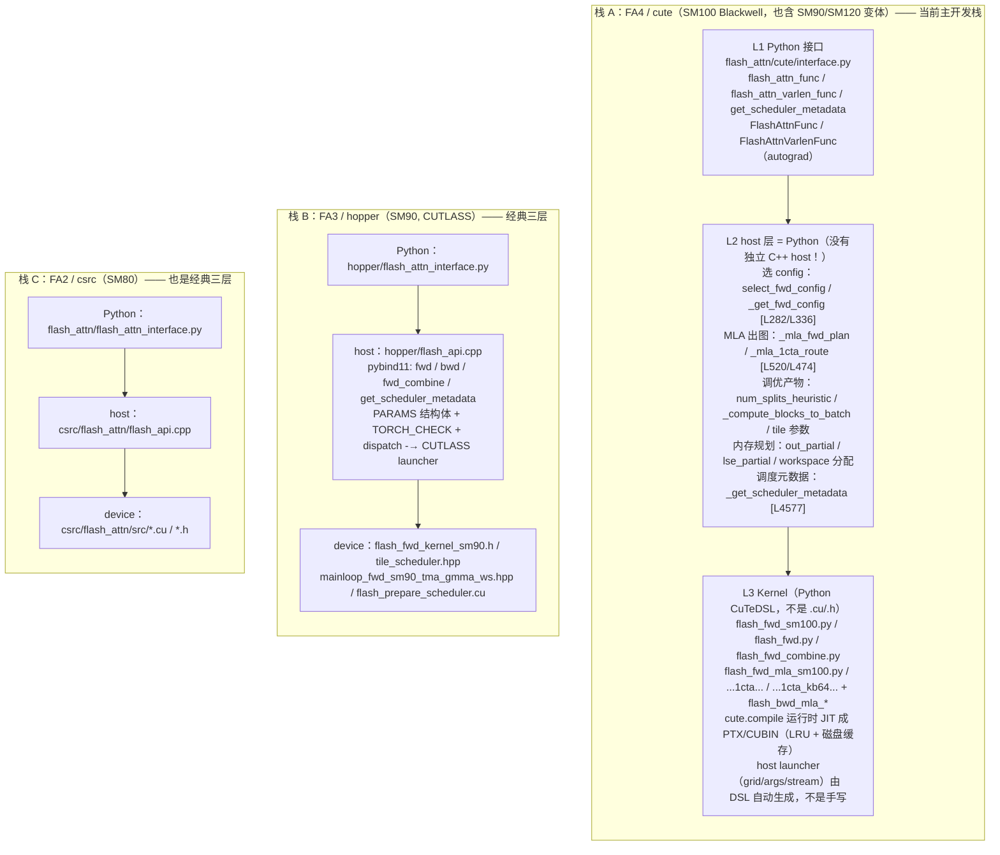
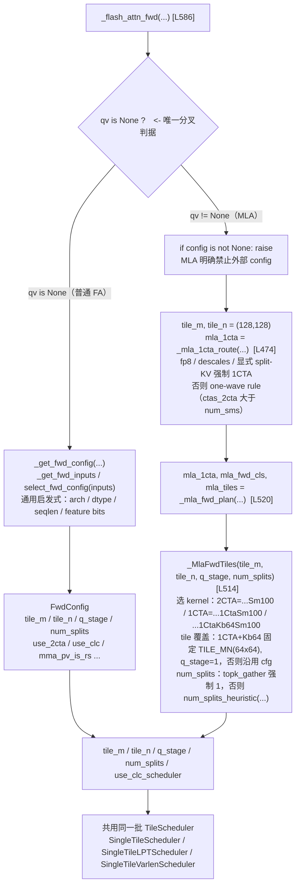
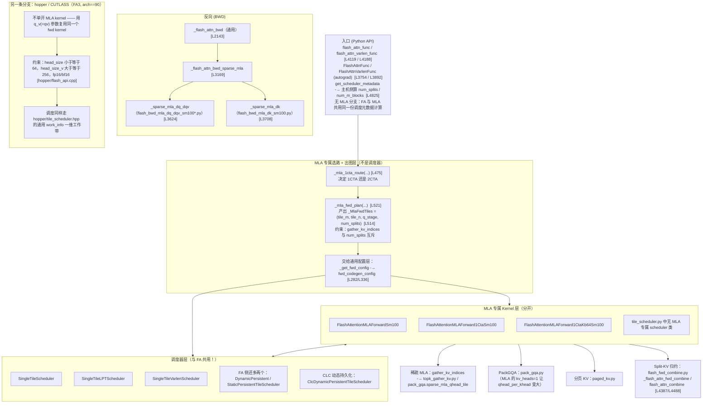
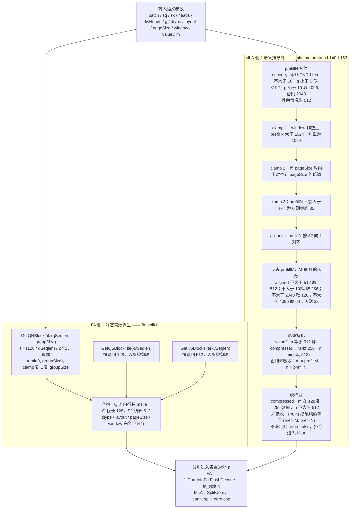
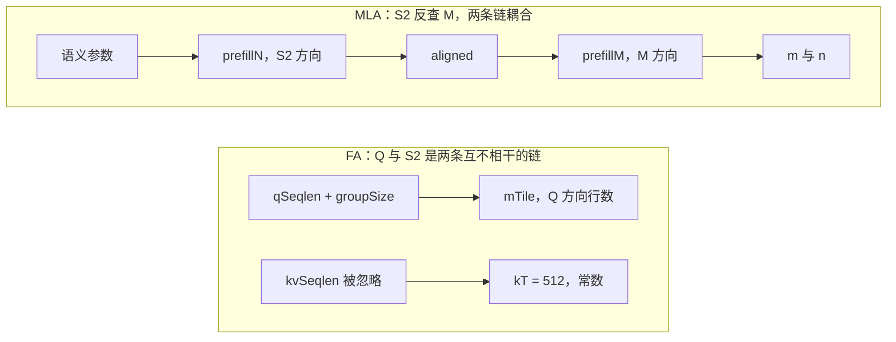

# daoailab (NVIDIA flash-attention) MLA 实现分析

> 分析对象：`/home/w00811046/code/mla/daoailab`
> 仓库性质：flash-attention 官方仓库，同时包含三代实现
> 分析范围：MLA（Multi-head Latent Attention，DeepSeek 系）的对外接口与内部实现
> 附加内容：§9 为与 flash-attention-npu 的**跨仓对照**（分层架构 / tiling 分流 / MLA 架构图 / 工作量统计 / FA 与 MLA 的 tile 推导对比）
>
> 引用约定：`path#Lxxx-Lyyy` 表示该文件的行区间；标注「仓库证据」的结论均可直接在代码中核对，标注「一般结论」的为推导/文献结论。

---

## 0. 背景：仓库里有两条完全独立的 MLA 技术栈

| 栈 | 位置 | 语言 | 平台 | 触发方式 |
|---|---|---|---|---|
| FA3 | `hopper/` | C++ / CUTLASS | Hopper SM90 | `flash_attn_with_kvcache(qv=...)` |
| FA4 | `flash_attn/cute/` | CuTe DSL（Python，运行期 JIT 成 PTX/CUBIN） | Blackwell SM100/110 | `flash_attn_func(qv=...)` |

两栈数学模型一致，都是 **absorbed 形式**：

```
O = softmax(scale · (Q@Kᵀ + Qv@Vᵀ)) @ V
where Q = q_pe, Qv = q_nope, K = pe_cache, V = kv_cache
```

—— 仓库证据：`flash_attn/cute/interface.py#L4242-L4244`

核心特征：**V（latent 缓存）一物二用**——既是第二段 score 的 K，又是 PV 的 V，因此输出维度 = latent 维度 = 512。

---

## 1. 对外接口能力

### 1.1 Hopper FA3

唯一 MLA 入口：`flash_attn_with_kvcache`（`hopper/flash_attn_interface.py#L942-L1103`），新增可选参数 `qv`。

- `q` = `(b, s, h, 64)`（rope 部分）
- `qv` = `(b, s, h, 512)`（absorbed nope 部分）
- 默认 `softmax_scale = (64+512)^-0.5 = 1/√576`（`#L1061-L1062`）
- 返回 `out (b, s, h, 512)`、`softmax_lse (b, h, s)`
- 支持：增量解码（`k`/`v` 原地写 cache）、paged KV（`page_table`）、split-KV（`num_splits`）、`pack_gqa`
- **不支持反向**（`#L1014`）
- **不支持 sparse MLA**

### 1.2 Blackwell FA4

入口 `flash_attn_func` / `flash_attn_varlen_func`（`flash_attn/cute/interface.py#L590` 起），MLA 相关参数：`qv`、`gather_kv_indices`、`gather_bwd_recompute_p`、`gather_bwd_token_chunk`。

比 FA3 多出的能力：
- `q` **可为 None**（无 rope 部分，只给 `qv`）
- **稀疏 MLA**：`gather_kv_indices` 传 top-k 索引（末维须 `%128==0`，`#L1085-L1087`）
- **有反向**（但仅 sparse）
- FP8 量化 + descale（仅 1CTA kernel）

### 1.3 能力对照

| 能力 | FA3 (Hopper) | FA4 (Blackwell) |
|---|---|---|
| 稠密 MLA 前向 | ✅ | ✅ |
| 稠密 MLA 反向 | ❌ | ❌ |
| 稀疏（topk）MLA 前向 | ❌ | ✅ |
| 稀疏 MLA 反向 | ❌ | ✅（仅 bf16 的 dK） |
| no-rope（q=None）形态 | ❌（HasQv 强制 kHeadDim==64） | ✅ |
| paged KV | ✅ | ✅ |
| split-KV | ✅ | 仅 1CTA |
| FP8 + descale | ❌（HasQv 要求 !Is_FP8） | ✅（仅 1CTA） |

---

## 2. 如何判断"是不是 MLA"

### 2.1 两个正交的判据

代码里 MLA 被拆成**两个不同层面**的问题，不要当成一件事：

| 问题 | 判据 | 出处 |
|---|---|---|
| 是否走「MLA 用的异构 V 维特化 kernel」 | **形状** `Dq != Dv`（FA3）／合法 head-dim 组合（FA4 校验） | `hopper/flash_api.cpp#L782-L792` |
| 是否走「absorbed 语义」（第二段 `Qv@Vᵀ`） | `qv is not None` | `hopper/flash_fwd_launch_template.h#L213-L214` |

### 2.2 `qv` 非空是否必要/充分

**结论：不是。**

FA3：
- kernel 特化只看 `d` / `dv`（`flash_api.cpp#L297-L307`、`#L280-L288`），**完全不看 qv**
- `qv_ptr` 只用来开 `HasQv` 模板位，且 `HasQv` 还额外要求
  `Arch==90 && !Is_FP8 && kHeadDim==64 && kHeadDimV>=256`（`flash_fwd_launch_template.h#L213-L214`）

| 场景 | 走异构-V 特化 kernel | 消费 qv | 是 MLA 吗 |
|---|---|---|---|
| 192/128 prefill | ✅ | ❌（qv=None） | **是 MLA**（未吸收） |
| 64/512 decode | ✅ | ✅ | 是（absorbed） |
| 64/512 但无 qv | ✅ | ❌ | 只是异构-headdim 注意力（GLA 类） |
| 64/512 + qv 但 FP8 | ✅ | ❌（HasQv=false） | kernel 不做第二段 GEMM |

FA4：
- `qv` 唯一决定路由：`if qv is None:` 走通用 config，`else:` 走 MLA plan（`interface.py#L900-L956`）
- qv 非空时强制 `head_dim_v==512 && head_dim∈{64,None}`（`#L1037-L1041`）
- 注意 `is_deepseek_mla_absorbed_shape`（`#L125`）只用于**校验 head_dim 组合合法性**（`#L136`），并不触发 MLA kernel

→ **FA3：`qv` 既非必要也非充分；FA4：`qv` 是进入 MLA kernel 的充分必要「路由开关」，但不是 MLA 的定义。**

### 2.3 `Dq != Dv` 在 MLA 下是否成立

**不是普遍成立。**

经典两形态下成立：

| 形态 | Dq (Q/K head dim) | Dv (V head dim) | 原因 |
|---|---|---|---|
| absorbed + rope | 64（rope） | 512（latent） | rope 维与 latent 维本就是两个量 |
| prefill 未吸收 | 192（128 nope + 64 rope） | 128（v_head_dim） | 编码维与取值维是不同的超参 |

反例——**FA4 的 no-rope 变体：Dq == Dv == 512，仍是 MLA**：
- `q_shape = q.shape if q is not None else qv.shape`（`interface.py#L665-L666`）→ q 为 None 时 head_dim 取自 qv = 512
- `head_dim_v = v.shape[-1]` = 512（`#L686`）
- 形状校验显式放行：`is_deepseek_mla_absorbed_shape = (head_dim == 64 or head_dim == head_dim_v) and head_dim_v == 512`（`#L127`），其中 `head_dim == head_dim_v` 这支就是给它准备的
- 测试直接写 `d_q = 64 if has_qk else 512`（`tests/cute/test_flash_attn_mla.py#L1297`）

→ `Dq != Dv` 是 FA3 意义上"进入异构 V 维 MLA 特化"的判据，**在 FA3 全场景恒成立**（FA3 不允许去掉 rope）；但作为"是不是 MLA"的判据在 FA4 上**不充分**。

---

## 3. MLA 与 MQA 的关系

**一句话**：MQA 是「头数轴」上的概念，MLA 是「KV 表示」上的概念；但在**推理（吸收）形态下，MLA 天然退化成 MQA**。

### 3.1 两个概念不在同一根轴上

| 概念 | 描述什么 | 判据 |
|---|---|---|
| MHA / GQA / MQA | 多少 Q 头共享多少 KV 头 | `num_heads_kv` |
| MLA | KV 怎么表示（压缩成低秩 latent，推理时吸收） | 形状签名（`Dv==512` / `Dk==192,Dv==128`） |

MQA 在代码里的判据纯粹是头数：`if (num_heads_k != num_heads) { // MQA / GQA }`（`hopper/flash_api.cpp#L1491`），MQA 即其 `==1` 的极端。

### 3.2 为什么吸收形态必然退化成 MQA

标准 MHA/GQA/MQA 的 KV cache 是 per-head 的 `(h_kv, d)`；MLA 的 cache 只有**一份**：
- 一份 latent `c_kv`（512 维，`kv_lora_rank`，**不区分 head**）
- 一份 rope k（64 维）

所有 query head 都看同一份 latent ⇒ KV 头数恒为 1 ⇒ 就是 MQA。这是压缩表示的**自然结果**，不是设计选择。

仓库证据：
- `benchmarks/benchmark_mla_paged_kv.py#L21`：`nheads_kv = 1  # MQA-128`
- `benchmarks/benchmark_sparse_mla_fwd.py#L3`：`MQA, hdim 64 (rope) + 512 (latent)`
- `flash_attn/cute/flash_fwd_mla_1cta_kb64_sm100.py#L180`：`assert nheads_kv == 1, "... need MQA"`
- `flash_attn/cute/flash_fwd_mla_sm100.py#L91`：`Sparse MLA (MQA) pads it to the tile`

### 3.3 但 prefill / 训练形态不一定是 MQA

未吸收时 K/V 是 per-head 的，KV 头数可以 > 1 ⇒ 可以是 GQA/MHA。仓库里 192/128 特化没有任何 `nheads_kv==1` 的强制，唯一维度约束是 `num_heads % num_heads_k == 0`（`flash_api.cpp#L780-L781`）。

### 3.4 关系总结

| | KV 头数 | K/V head dim | KV cache 内容 |
|---|---|---|---|
| MHA | `h` | `d` | 每头 `(d, d)` |
| GQA | `1 < h_kv < h` | `d` | 每头 `(d, d)` |
| MQA | `1` | `d` | 一份 `(d, d)` |
| **MLA absorbed** | **恒 1（= MQA）** | Dk=64, Dv=512 | 一份 rope(64) + latent(512) |
| **MLA prefill** | 可 >1（= GQA/MHA） | Dk=192, Dv=128 | 每头 `(192, 128)` |

- `MLA absorbed ⊆ MQA`，但 `MQA ⊄ MLA`
- `MLA prefill` 与 MQA 只是可能相交
- 两者**互不蕴含**：不能拿"MQA"推"是 MLA"，也不能拿"是 MLA"在所有形态下推"MQA"
- **MQA ⟹ Dq == Dv 不成立**（MLA absorbed 即反例：MQA 且 Dq=64≠Dv=512）

### 3.5 工程含义

MLA 省显存/带宽的根源是 KV cache 只有一份 latent；MQA 只是该事实在头数轴上的投影。因此 MLA 路径几乎必须开 `pack_gqa`（把多个 Q 头打包进同一 M tile），见 `hopper/pack_gqa.h`。

---

## 4. absorbed 的含义

**一句话**：把 MLA 里「latent → K/V 的上投影矩阵」提前乘进 Query、延后移出 Output，使 attention 内部只跟一份 512 维 latent 打交道。

### 4.1 背景

MLA 不存 per-head K/V，只存：
- `c_kv` — 低秩 latent，`kv_lora_rank = 512`（所有 head 共享）
- `k_rope` — 共享 rope 分量，`qk_rope_head_dim = 64`

真正的 K/V 需上投影恢复：

```
K_nope = c_kv @ W_UK      # 512 → n_h * 128
V      = c_kv @ W_UV      # 512 → n_h * 128
```

### 4.2 未吸收（naive）形式

```
S = Q_nope @ K_nopeᵀ + Q_rope @ k_ropeᵀ
  = Q_nope @ W_UKᵀ @ c_kvᵀ + Q_rope @ k_ropeᵀ
O = P @ V = P @ c_kv @ W_UVᵀ
```

即 **prefill 形态 (192, 128)**。

### 4.3 吸收形式

用结合律把 `W_UKᵀ` 左移、`W_UVᵀ` 右移：

```
Qv  = Q_nope @ W_UKᵀ        # 预计算，512 维   ← W_UK 被"吸收"进 Query
S   = Qv @ c_kvᵀ + Q_rope @ k_ropeᵀ
O'  = P @ c_kv              # 512 维，直接拿 latent 当 V
O   = O' @ W_UVᵀ            # W_UV 被"吸收"出 attention（可折叠进 out_proj）
```

于是 attention 内部只需 **latent c_kv 一份张量**，同时扮演两个角色：
- 第二段 score 的 **K**（`Qv @ c_kvᵀ`）
- PV 的 **V**（`P @ c_kv`）

这就是"V 一物二用"，也直接解释了 absorbed 形态形状签名 **Dk=64、Dv=512**。

### 4.4 代价（数学等价 ≠ 免费）

| | 未吸收 (192/128) | absorbed (64/512) |
|---|---|---|
| score 点积维度 | 192 | 64 + 512（两段） |
| attention 内部读的 KV | 展开后的 per-head K/V | 一份 512 latent |
| 算力 | 小 | **大** |
| 带宽 | 大 | **小** |

→ **decode 用 absorbed**（S_q 小、带宽主导）；**prefill 用未吸收**（S_q 大、算力主导）。

### 4.5 重要副作用：descale 只能有一个

两段 score 共享同一累加器（`Q@Kᵀ` 与 `Qv@Vᵀ` 相加后才过 softmax），所以 scale 必须统一，量化 descale 也只能有一个：

> `MLA absorbed requires k_descale and v_descale to be the same tensor: Q@K^T and Qv@V^T share one accumulator, so one descale must fold into the softmax scale`
> —— `flash_attn/cute/interface.py#L1053-L1057`

---

## 5. decode / prefill 输入 shape 规范

### 5.1 absorbed（decode）— FA3 `flash_attn_with_kvcache`（BSND，非 paged）

> ⚠️ 陷阱：`k_cache` 存的是 **rope k（64）**，`v_cache` 存的是 **latent c_kv（512）**；`v_cache` 不是真正的 V。

| 张量 | shape | 说明 |
|---|---|---|
| `q` | `(B, Sq, H, 64)` | rope query |
| `qv` | `(B, Sq, H, 512)` | absorbed nope query（预乘 W_UK） |
| `k_cache` | `(B, Sk, 1, 64)` | rope k，**Hkv 恒=1** |
| `v_cache` | `(B, Sk, 1, 512)` | latent c_kv |
| `out` | `(B, Sq, H, 512)` | 输出维度 = latent 维 |
| `softmax_lse` | `(B, H, Sq)` | |

证据：`hopper/benchmark_mla_decode.py#L66-L79`、`tests/cute/test_flash_attn_mla.py#L1025-L1028`

### 5.2 变体

**Paged KV**（`benchmark_mla_decode.py#L70-L74`）：

```
k_cache: (num_pages, page_size, 1, 64)
v_cache: (num_pages, page_size, 1, 512)
page_table: (B, max_num_pages_per_seq)   int32
```

**Varlen（BSND → TND）**：去掉 batch 维，改用 `cu_seqlens`

```
q: (total_q, H, 64)         qv: (total_q, H, 512)
k_cache: (total_k, 1, 64) 或 paged    v_cache: (total_k, 1, 512) 或 paged
cu_seqlens_q: (B+1,)        cache_seqlens: (B,) int32
```

**FA4 absorbed 的两点不同**：
- `q` 可选：`q=None` 时无 rope 项，只给 `qv`；此时是 `(q=qv, k=v, v=v)` 的 "shared_kv" 路由（`tests/cute/test_flash_attn_mla.py#L1029-L1032`）
- **lse 布局反过来**：带 qv 时 `(B, Sq, H)`，不带 qv 时 `(B, H, Sq)`（`interface.py#L4237-L4238`）

### 5.3 prefill（未吸收）

| 张量 | shape |
|---|---|
| `q` | `(B, Sq, H, 192)` = 128(nope) + 64(rope) |
| `k` | `(B, Sk, Hkv, 192)` |
| `v` | `(B, Sk, Hkv, 128)` |
| `qv` | **None** |
| `out` | `(B, Sq, H, 128)` |
| `softmax_lse` | `(B, H, Sq)` |

- `Hkv` 可 > 1，支持 GQA/MHA（约束仅 `H % Hkv == 0`，`flash_api.cpp#L780-L781`）
- 形状合法性来自 `head_size_v != head_size` 时允许 `(128,192] × (96,128]`（`flash_api.cpp#L782-L786`）；FA4 侧叫 `is_deepseek_shape = (192, 128)`（`interface.py#L124`）
- 走**通用 diff-hdim 前向**（`flash_attn_func` 或不带 qv 的 kvcache），**不是** MLA 专用 kernel

### 5.4 对照表

| | decode/absorbed | prefill |
|---|---|---|
| `qv` | 非空 | None |
| Q/K 头维 (Dk) | 64 | 192 |
| V 头维 (Dv) | 512 | 128 |
| KV 头数 Hkv | **恒 1**（MQA） | 可 >1（GQA/MHA） |
| KV cache 内容 | rope(64) + latent(512) | 每头 K(192) + V(128) |
| 输出维 | 512（= latent，需再乘 W_UV） | 128 |
| 计算量 | 512 维点积 ×2 段 | 192 维点积 |
| 适用场景 | S_q 小（解码） | S_q 大（预填充/训练） |

---

## 6. 训练与推理的路径选择

### 6.1 稠密 MLA：训练基本只用「未吸收（prefill）路径」

三个原因：
1. **算力**：192 vs (64+512)，S_q/S_k 都大时 absorbed 纯属浪费
2. **反向实现成本**：未吸收下 dK/dV 直接落到 `W_UK`/`W_UV` 的梯度；absorbed 把 `W_UK` 折进 Q，梯度须穿越两段共享的 score 累加器
3. **激活显存**：全吸收让 attention 内部张量从 128 维涨到 512 维

**仓库最硬的证据**：FA4 稠密 MLA **根本没有反向**——

```python
assert gather_kv_indices is not None, "require gather kv indices for backward"
```

—— `flash_attn/cute/interface.py#L3205`

即 MLA 专用 kernel 的反向**只对 sparse 存在**；稠密训练走通用 `is_deepseek_shape = (192,128)` 路径。

### 6.2 反例：稀疏注意力训练必须用 absorbed

topk 稀疏 gather 的是 **latent token**，未吸收形式要求先把 latent 展开成 per-head K_nope/V，而 gather 之后无法展开 ⇒ 一旦注意力是稀疏的，**训练和推理都只能走 absorbed**。这正是 `flash_bwd_mla_*` 三个反向 kernel 存在的原因。

### 6.3 混合使用的场景

**① 半吸收（half-absorption）** —— 两处吸收是正交的，可只做一半：

| 形式 | score 侧 | value 侧 | 用途 |
|---|---|---|---|
| 全不吸收 | 展开 K_nope | 展开 V | 稠密训练 |
| **只吸收 W_UK** | `q_abs @ c_kvᵀ` | **V 仍展开** | 训练期省 K_nope 构造 |
| 只吸收 W_UV | 展开 | `P @ c_kv` | 少见 |
| 全吸收 | `q_abs @ c_kvᵀ` | `P @ c_kv` | decode 推理 |

「只吸收 W_UK」最有实用价值：score 侧省掉显式构造 K_nope，value 侧不把 512 维输出落进 activation，避免激活显存放大 4 倍。（DeepSeek 论文讨论过训练期不吸收 `W_UV` 的显存取舍——一般结论，非本仓库证据）

**② 推理内部天然混合：prefill → decode**
- prompt 阶段用**未吸收** (192/128) 跑完 prefill，把 c_kv/rope 写进 KV cache
- 后续每步用 **absorbed** (64/512) 读同一份 cache
- 关键：两阶段**共享同一份 KV cache**（都是 latent），只是 attention 算法形式变了

**③ 投机解码 / chunked prefill**
此场景 `S_q` 介于 1 和整段之间。选择的统一判据是**算术强度**：

```
absorbed 划算 ⟺ S_q ≪ S_k（带宽主导）
未吸收划算  ⟺ S_q ~ S_k（算力主导）
```

speculative decoding 的 verify 阶段 `S_q` 几十、`S_k` 几万 → 仍偏 absorbed。现实中是连续权衡，不是硬开关。

---

## 7. 训推一致性

**定义**：训练时的前向与推理时的前向，在同一份权重、同一份输入下，输出在**误差容忍范围内**相等。

MLA 上特别突出，因为训练与推理落在两种数学等价但实现不同的形式上——

```
训练：  S = Q_nope·K_nopeᵀ + Q_rope·k_ropeᵀ      (192 维点积)
推理：  S = Qv·c_kvᵀ      + Q_rope·k_ropeᵀ      (64 + 512 两段)
```

这是一种**跨形式等价性**：不是"同一条 kernel 跑两遍"，而是"两条不同计算路径必须给出同一个答案"。

### 7.1 三个层次

| 层次 | 含义 | 能否达到 |
|---|---|---|
| 数学等价 | 实数域可证明相等（结合律） | ✅ |
| 数值近似 | 浮点舍入级差异，rel-L2 ~1e-3 量级 | ✅ 工程目标 |
| 位级一致 (bitwise) | 二进制完全相同 | ❌ 一般不可得 |

本仓库明确接受第二级，不追位级：
- `out rel-L2 < 5e-3 ... (two independent bf16 roundings)` —— `tests/cute/test_flash_attn_mla.py#L1047-L1050`
- `the two agree to bf16 rounding, not bitwise` —— 同文件 `#L1036-L1039`

### 7.2 MLA 上的具体不一致来源

**① scale 口径（最易踩，且是硬错误）**

本仓库 `flash_attn_with_kvcache` 默认 scale 按 `q` 与 `qv` 拼接维开根号：
`softmax_scale = (q.shape[-1] + qv.shape[-1]) ** (-0.5)` → `1/√576`（`hopper/flash_attn_interface.py#L1061-L1062`）。

但 MLA 惯用口径是 `1/√(qk_nope + qk_rope) = 1/√192`（吸收前后共用同一个 scale）。`1/√576 ≠ 1/√192`，差约 1.73 倍。**调用方不显式传 `softmax_scale`，训推必然不一致**，且不是舍入级、是输出直接失真。

根因：`Qv` 乘了 `W_UK` 后数值尺度与"虚拟拼接维"完全无关，不能按拼接维推 scale。

**② descale / 量化的折叠位置**

吸收后两段 score 共享累加器，descales 只能有一个（`interface.py#L1053-L1057`）。训练 latent 是 bf16、推理可能量化成 int8/fp8 → 需在训练前向中**模拟推理量化**（QAT 思路）。

**③ 分块与归约顺序**

prefill 一次算整段，decode 单步 + 可能 split-KV 后归约（FlashDecode combine）。online softmax 的 max/sum 归约顺序一变结果就变，此类差异只能压到舍入级。

**④ 半吸收的边界**

训练半吸收、推理全吸收时，`W_UV` 的两条路径（`P@c_kv@W_UV` vs `P@V`）也须数值对齐。

### 7.3 验证手段

- fp64 golden 做基准（`attention_ref` / `_mla_dense_ref`，`tests/cute/test_flash_attn_mla.py#L509`）
- 让两条路径算同一问题再互比：测试里 `has_qk=True/False`、1CTA/2CTA、kb64/非 kb64 就是在跑同一数学问题的不同实现
- 阈值按 dtype 定（bf16 用 ~5e-3 量级），不强求 1e-6

---

## 8. 对 NPU MLA 算子实现的落点

1. **形态判定零 flag**：FA4 用 `head_dim_v==512` + `qv is not None` 单一签名分流，与本项目"靠形状签名自动判 compressed/prefill"同构。
2. **两段 score 共享累加器** 是 absorbed 的核心，决定了量化的 descale 只能有一个——须从接口层就暴露该约束（本仓库用 `k_descale is v_descale` 同一张量断言强制）。
3. **V 一物二用** ⇒ 输出维度 = kv_lora_rank = 512。
4. **不要用"拼接维开根号"推 scale**：最容易把训推一致性做坏的一步；应显式接收 scale 或按 192 口径硬编码并在文档写明。
5. **两条路径共享同一份 latent cache 格式** ⇒ kernel 可按 `S_q/S_k` 动态选型，不必在模型层面二选一。
6. **验收标准按 dtype 定舍入级阈值**，不追位级一致——除非训练与推理走完全相同的一条 kernel 路径。
7. 若要支持稀疏（topk）MLA：**absorbed 是唯一可选形式**，且必须同时实现反向，这决定整条链路的张量布局（输出 512 维、descales 唯一）。
8. `Dq == Dv → 交回普通 FA3 路径` 这条闸门会天然挡掉 FA4 的 no-rope 变体（Dq=Dv=512）。若只对齐 FA3 能力集则安全；若要支持 no-rope absorbed MLA，必须放宽并单独识别 `Dq==Dv==512`。

---

## 附录：关键文件索引

### FA3 (Hopper)
| 文件 | 作用 |
|---|---|
| `hopper/flash_attn_interface.py` | Python 接口，`flash_attn_with_kvcache(qv=...)` |
| `hopper/flash_api.cpp` | 参数校验、形状合法性、kernel 分派 |
| `hopper/flash_fwd_launch_template.h` | `HasQv` 模板开关与 kernel 实例化 |
| `hopper/mainloop_fwd_sm90_tma_gmma_ws.hpp` | 第二段 score GEMM（`S += Qv@Vᵀ`） |
| `hopper/tile_size.h` | tiling 选择（64/512 → `{64,64}`；192/128 → `{128,128}`） |
| `hopper/pack_gqa.h` | MQA 多 Q 头打包 |
| `hopper/generate_kernels.py` | kernel 特化批量生成 |
| `hopper/benchmark_mla_decode.py` | decode 输入 shape 的权威示例 |

### FA4 (Blackwell, CuTe DSL)
| 文件 | 作用 |
|---|---|
| `flash_attn/cute/interface.py` | 对外接口与 MLA 路由/校验 |
| `flash_attn/cute/flash_fwd_mla_sm100.py` | 2CTA 前向 kernel |
| `flash_attn/cute/flash_fwd_mla_1cta_sm100.py` | 1CTA 前向 kernel（`tcgen05.mma.ws`） |
| `flash_attn/cute/flash_fwd_mla_1cta_kb64_sm100.py` | kb64 前向 kernel |
| `flash_attn/cute/flash_bwd_mla_sm100.py` | 稀疏 MLA 反向主 kernel（重算 Sᵀ） |
| `flash_attn/cute/flash_bwd_mla_dq_dqv_sm100.py` | dQ / dQv |
| `flash_attn/cute/flash_bwd_mla_dk_sm100.py` | dK（scatter，仅 bf16） |
| `flash_attn/cute/topk_gather_kv.py` | 稀疏 MLA 的 cp.async gather + bitmask |
| `flash_attn/cute/tile_scheduler.py` | tile 调度 |
| `tests/cute/test_flash_attn_mla.py` | MLA 测试矩阵（最权威的行为规范） |

---

## 9. 与 flash-attention-npu 的架构 / tiling / 工作量对照

> 本节为**跨仓对照**：左侧为 daoailab（`/home/w00811046/code/mla/daoailab`），右侧为 `flash-attention-npu`（同 workspace 下）。
> 行号引用沿用正文约定；npu 侧路径相对于本文件所在目录，例如 `flash-attention-npu/csrc/...`。

### 9.1 分层架构

daoailab 是**三代并存**，各有自己的分层。最本质的差别：**最活跃的 FA4/CuTeDSL 栈没有独立 C++ host 层，"host 的活"被折叠进 Python。**



对照表：

| 层 | daoailab 栈 A（cute） | daoailab 栈 B/C | flash-attention-npu |
|---|---|---|---|
| Python 接口 | `flash_attn/cute/interface.py` | `hopper/flash_attn_interface.py` / `flash_attn/flash_attn_interface.py` | `flash-attn-npu/flash_attn_npu_{3,4}/flash_attn_npu_interface.py` |
| Host | **无独立 C++ host**，全在 Python | `flash_api.cpp`（pybind + PARAMS + TORCH_CHECK + dispatch） | `flash_api.cpp` / `mla/mla_forward.cpp` / `mla/mla_tiling.cpp`（与栈 B/C 同型） |
| Kernel | Python CuTeDSL（`flash_fwd_sm100.py`…），运行时 JIT | CUDA/CUTLASS `*.h / *.cu` | Ascend C `mla_kernel.hpp` / `mla_prefill_kernel.hpp` / `mla_*_tile.hpp` |
| 调度编排 | Python 侧启发式；device 侧只有 `flash_prepare_scheduler.cu` 算 varlen 块数 | 同左 | **多一层 AICPU 编译单元**：`fa_metadata.aicpu` / `mla/mla_metadata.aicpu`，在 AICPU 核上现场算调度 |

结论：daoailab **有 Python 接口层**（三条栈都有）；**栈 B/C 有独立 C++ host，栈 A 没有**；**内核层都有**，但栈 A 的内核是 Python DSL（运行时 JIT）。npu 仓的独特之处是**多一个 AICPU 单元**，把"现场算调度"放到 AICPU 核上——daoailab 对应的活要么在 Python host，要么在 GPU kernel（`flash_prepare_scheduler.cu`），没有 AICPU 概念。

### 9.2 tiling 如何分流：MLA 与 FA 是分开的

**是分开的**——分叉点是 `qv is None`（`flash_attn/cute/interface.py#L900-L970`）。



要点：

1. **FA 分支**：`_get_fwd_config` → `select_fwd_config(inputs)`，把 arch/dtype/head dims/varlen/block-sparse 等打包成 `FwdHeuristicInputs`，一次产出整个 `FwdConfig`。
2. **MLA 分支**：`interface.py#L929-L930` 直接 `raise ValueError("MLA (qv) forward selects its kernel internally; config must be None")`，说明 MLA 的 tile 决策**不允许**走 FA 那套 config 通道，改由自己规划：
   - `_mla_1cta_route`（`#L474-L511`）决定 1CTA / 2CTA：fp8 / descales / 显式 split-KV → 强制 1CTA；否则按 "one-wave rule"（`ctas_2cta > num_sms`）；可用 `FLASH_ATTENTION_MLA_1CTA` 环境变量覆盖。
   - `_mla_fwd_plan`（`#L520-L581`）在 cfg 之上做**二次决策**：覆盖 `tile_m/tile_n/q_stage`，并用自己的 `num_splits_heuristic` 单独算 split 数；1CTA 下若 split 太少（kb64 <2，128-key <5）会**回头改路由**成 unsplit 2CTA。
3. **汇合点**：两条路产物都是 `tile_m / tile_n / q_stage / num_splits`，再交给同一批 `SingleTile*Scheduler`。准确说法是：**tiling 决策分开、调度器共用**。

| | daoailab | flash-attention-npu |
|---|---|---|
| 分流判据 | `qv is None` | `IsMlaForward` / `qv` 非空 / 192-128 签名 |
| FA tiling | `select_fwd_config`（host 启发式） | `fa_split.h` `splitBN2S1GS2`（host 或 AICPU） |
| MLA tiling | `_mla_fwd_plan`（host 启发式，独立） | `mla/mla_tiling.cpp` + `mla/mla_split.cpp` + `mla/mla_cann_split_core.cpp`（AICPU 现场生成记录式调度） |
| 是否分开 | **分开** | **分开** |
| 下游 | 共用 TileScheduler | 不共用（`coreInfo/splitInfo` vs `bN2End/gS1End/s2End`） |

### 9.3 daoailab MLA 架构图



一句话：daoailab 对 MLA 的"分家"只做到两层——**内核分开**（cute/Blackwell 有 `flash_fwd_mla_*`/`flash_bwd_mla_*` 全套 + `_mla_fwd_plan` 专属出图），**调度共用**（`SingleTile*Scheduler` 家族无 MLA 变体，`get_scheduler_metadata` 连 MLA 分支都没有）。hopper 路径更彻底，连 kernel 都不分，只靠 `qv` 复用。

### 9.4 工作量统计

口径：源码行数（`wc -l`），分「内核 / 接口·host / 文档 / 测试」四块。

**daoailab**

| 类别 | 文件 | 行数 |
|---|---|---|
| MLA 前向内核 | `flash_fwd_mla_sm100.py` | 3,298 |
| | `flash_fwd_mla_1cta_sm100.py` | 3,560 |
| | `flash_fwd_mla_1cta_kb64_sm100.py` | 2,304 |
| MLA 反向内核 | `flash_bwd_mla_sm100.py` | 3,374 |
| | `flash_bwd_mla_dq_dqv_sm100.py` | 1,305 |
| | `flash_bwd_mla_dq_dqv_sm100_h64.py` | 1,288 |
| | `flash_bwd_mla_dk_sm100.py` | 1,188 |
| **内核小计** | 7 文件 | **16,317** |
| 稀疏配套 | `topk_gather_kv.py` | 551 |
| 接口层 MLA 行 | `interface.py`（grep -i mla） | 169 |
| hopper q_v 复用 | `hopper/flash_api.cpp` | 18 |
| 测试 | `tests/cute/test_flash_attn_mla.py` | 3,626 |
| **合计** | | **≈ 20,681** |

其中前向 9,162 / 反向 7,155，**前后向都有**，前向开 3 个 kernel 变体（2CTA / 1CTA / 1CTA-kb64）。

**flash-attention-npu**

| 类别 | 文件 | 行数 |
|---|---|---|
| MLA 内核+host（v4） | `csrc/ascend910/flash_attn_npu_4/mla/` 36 文件 | 10,430 |
| MLA 内核+host（v3） | `csrc/ascend910/flash_attn_npu_3/mla/` 36 文件 | 10,430 |
| 接口层 MLA 行 | `flash_api.cpp` v4/v3 | 12 / 10 |
| 文档 | `docs/mla/` 7 文件 | 1,907 |
| 测试 | `tests/*mla*` 4 文件 | 2,174 |
| **合计（naive）** | | **≈ 24,963** |
| **合计（去重后）** | | **≈ 14,965** |

⚠ 关键事实：v3 与 v4 的 MLA 目录 **36 个文件中 35 个逐字节相同**（`diff -rq` 只报 `mla_forward.cpp` 不同），近 2× 是**平台冗余**；唯一源码量约 `10,430 + 432 ≈ 10,862` 行。

**对比结论**

| 维度 | daoailab | flash-attention-npu |
|---|---|---|
| 内核代码（naive） | 16,317 | 20,860（v3+v4） |
| 内核代码（去重） | 16,317 | ≈ 10,900 |
| 前向 / 反向 | 9,162 / 7,155（**都有**） | ≈ 10,900 / **0**（仅前向） |
| 变体数 | 前向 3 + 反向 3 | 前向 1（v3/v4 各一份，代码同源） |
| 接口层独立工作量 | 169 行 Python | 22 行命中（≈0，逻辑全在 C++ host + AICPU） |
| 文档 | 无专门设计文档（仅 `AI/*.md` 零散专题） | 1,907 行（7 篇） |
| 测试 | 3,626 | 2,174 |
| 测试/内核比 | 0.22 | 0.20（去重后） |

1. **总量级相当**（1.6 万～2.1 万行），但构成完全不同：daoailab 的量在大头**反向**（7,155 行）与**多 kernel 变体**；npu 的量几乎全在**前向 + 平台双份**。
2. **去重后 npu 明显更轻**（`~10.9k` vs `16.3k`）；反过来按 naive 比 npu 反而更大，全拜 v3/v4 复制所赐——这是纯维护成本，不是功能量。
3. **工作量分布错位**：daoailab 把 MLA 判断逻辑堆在 Python 接口与 kernel 里；npu 把调度/分核下沉到 `mla_tiling.cpp`(956) + `cann_split_core.cpp`(715) + `mla_split.cpp`(218) + AICPU 单元，并写了 1,907 行文档。即 **npu 是"host/AICPU 重、文档重、无反向"；daoailab 是"kernel 重（前后向）、接口轻、无文档"**。

---

### 9.5 FA 与 MLA 的 tile 推导对比

> 代码位置：FA → `csrc/ascend910/flash_attn_npu_4/fa_split.h#L14-L46`；MLA → `csrc/ascend910/flash_attn_npu_4/mla/mla_metadata.h#L140-L163`。
> 一句话：**FA 是三个常数派生的独立纯函数；MLA 是一条带分档 / 对齐 / 反查的语义推导链，并且自带硬校验。**

#### 9.5.1 全流程对比



#### 9.5.2 关键差异：M 与 N 的耦合关系



#### 9.5.3 逐项对照

| 维度 | FA | MLA |
|---|---|---|
| 形态 | 3 个独立纯函数，常数兜底 | 一条推导链 |
| 输入 | `qSeqlen / groupSize / kvSeqlen` | `tnd / sq / g / window / pageSize / sk / valueDim` |
| M 与 N 关系 | **互相独立** | **N 反查 M** |
| Q 方向 | `(128/qSeqlen)/2*2`，clamp `[1, groupSize]` | 五档 `512/256/128/64/32`；compressed 锁 `256` |
| S2 方向 | **恒 512** | decode `8192/4096/2048`，否则 512，再被 window/page/sk clamp |
| dtype / layout / page / window | 完全不参与 | 参与（pageSize 对齐、window 截 1024） |
| 形态概念 | 无 | 有（`valueDim==512` 走 compressed，绕过整条推导链） |
| 校验 | 无，非法输入由分核容错 | 硬校验，非法直接 `return false` |
| 调用时机 | host 侧逐 batch 现场调用，喂给分核做成本 | 嵌在 `MlaRecordLayout`，校验与定档两段式 |

#### 9.5.4 数值示例

`BSND, sq=1（decode）, g=8, sk=4096`

| | FA | MLA（`valueDim=512` compressed） |
|---|---|---|
| M tile | `(128/1)/2*2 = 128` → `min(128, 8) = 8` | `256` |
| KV tile | `512` | `min(sk,512) = 512` |

`BSND, sq=1024（prefill）, valueDim=128, sk=4096`

| | FA | MLA（未吸收） |
|---|---|---|
| M tile | `(128/1024)/2*2 = 0` → `max(0,1) = 1` | `prefillN=512` → `aligned=512` → `prefillM=512`，故 `m=512` |
| KV tile | `512` | `prefillN = 512` |

注意语义方向相反：FA 的 QN 是「一个 128 行 tile 里塞几个 GQA 头」，`qSeqlen > 128` 时直接归 0 被 clamp 成 1；MLA 的 M 是「一次处理多少 query 行」，prefill 反而是**大**的 512。

**三条最值得记的**

1. **FA 的 tile 由常量派生，MLA 的 tile 由语义参数推导。** FA 里 embed / dtype / pageSize 最多影响 L1 容量与 segLen，**不改 tile 几何**；MLA 里它们直接改 `m/n`。
2. **FA 的 M/N 解耦，MLA 的 M 由 N 反查。** 「KV 切多大」决定了「M 切多大」。
3. **MLA 多了硬校验与形态特化。** FA 的 `GetQSBlockTile` 连参数都丢掉；MLA 在 L161-163 要求未吸收 `(m,n)` 精确等于 `(prefillM, prefillN)`、compressed `m ∈ [128,256] && n ≤ 512`，不满足即整条 MLA 路径被否。
