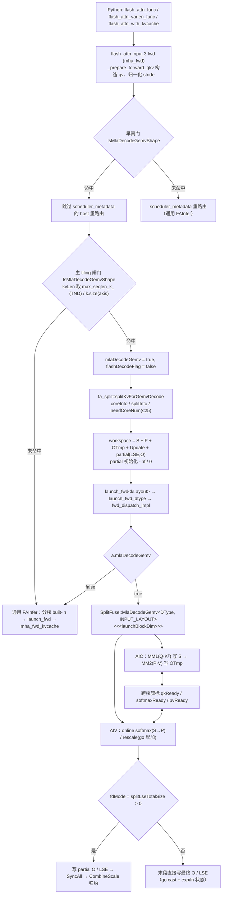

# MLA absorbed decode 专用 GEMV kernel 设计（FA3 / FA4 · Ascend 910B）

- 日期：2026-11-11
- 适用形态：absorbed MLA decode —— `qv` 非空、KV 头数 = 1、`rope 64 + latent 512`、`Dv` = 512、`Sq` = 1
- 适用布局：**BSND / BNSD / TND（packed varlen）**，由同一 kernel 模板按 `INPUT_LAYOUT` 实例化
- 适用范围：**FA3（`flash_attn_npu_3`）与 FA4（`flash_attn_npu_4`）双版本**。两版本各自持有一份 kernel 与 host 闸门，共用同一套算法与事件记账；差异见 §10。FA4 的 **prefill** 形态仍走通用 FAInfer，不在本文范围。
- 性能口径：候选内核设备时间 ÷ 同布局 CANN FIA（MLA）内核设备时间 **≤ 1.05**，只计 attention 计算内核，不含 metadata / host 包装

代码入口（`{3,4}` 表示 FA3 / FA4 各一份，FR 逻辑同构）：

| 环节 | 文件 |
| --- | --- |
| kernel（AIC+AIV 混合模板 + 持久 rescale） | [FA3 mla_decode_gemv.hpp](../../csrc/ascend910/flash_attn_npu_3/mla_decode_gemv.hpp) / [FA4 mla_decode_gemv.hpp](../../csrc/ascend910/flash_attn_npu_4/mla_decode_gemv.hpp) |
| 选路闸门 / 分核触发 / workspace | [FA3 flash_api.cpp](../../csrc/ascend910/flash_attn_npu_3/flash_api.cpp) / [FA4 flash_api.cpp](../../csrc/ascend910/flash_attn_npu_4/flash_api.cpp) |
| 分发（运行期门控） | [FA3 fwd_dispatch_impl.hpp](../../csrc/ascend910/flash_attn_npu_3/fwd_dispatch_impl.hpp) / [FA4 fwd_dispatch_impl.hpp](../../csrc/ascend910/flash_attn_npu_4/fwd_dispatch_impl.hpp) |
| KV 段分核 | [fa_split.h](../../csrc/ascend910/flash_attn_npu_3/fa_split.h) / [FA4 fa_split.h](../../csrc/ascend910/flash_attn_npu_4/fa_split.h) |
| partial 归约 | [combine_scale.hpp](../../csrc/ascend910/flash_attn_npu_3/combine_scale.hpp) / [FA4 combine_scale.hpp](../../csrc/ascend910/flash_attn_npu_4/combine_scale.hpp) |
| 复用组件 | [qk_matmul.hpp](../../csrc/ascend910/flash_attn_npu_3/qk_matmul.hpp) / [pv_matmul.hpp](../../csrc/ascend910/flash_attn_npu_3/pv_matmul.hpp) / [online_softmax.hpp](../../csrc/ascend910/flash_attn_npu_3/online_softmax.hpp)（FA4 同名的 `flash_attn_npu_4/*` 组件） |

> 下文 §2–§9 以 FA3 为叙述主线（几何、账本、流水完全共用）；FA4 独有的适配点集中在 §10。

历史 profile 与逐条试验记录见 [mla_decode_kernel_analysis.md](mla_decode_kernel_analysis.md)。

---

## 1. 要解决的问题

通用 FAInfer 路径按 **512-token KV stack** 行走，并为每段维护 stack descriptor、append-KV 回写、paged 寻址与 mask 状态机。对 canonical decode 形状（`Sq == 1`、KV 头数 1、`QK = 512 latent + 64 rope`、`Dv = 512`）来说，整个任务退化成一条 `M = qHeads` 的 GEMM 链，512 行 stack 的描述符与状态机全是纯开销：表现为 AIC 时间被 `scalar` 主导，而 `mac`/`mte2` 占比很低。

本 kernel 的做法：保留已验证的 `BlockMmadQK` / `BlockMmadPV` / online-softmax / rescale 组件，把 KV 走法换成 **128-token tile**，砍掉 descriptor / append / paged / mask 分支，并把 O 累加器做成 **UB 常驻**，从而消掉每段 2×64 KB 的 GM 往返。它由 `fwd_dispatch_impl.hpp` 在 FAInfer 分发之前按运行期标志选中，绝不进入非 MLA 路径。

---

## 2. 选路：host 闸门 `IsMlaDecodeGemvShape`

[flash_api.cpp](../../csrc/ascend910/flash_attn_npu_3/flash_api.cpp) 里的形状闸门是唯一判据，签名为
`IsMlaDecodeGemvShape(hasQv, numHeads, numHeadsK, headSizeOg, headSizeV, pagedKv, isLocal, isCausal, seqlenQ, kvLen)`：

| 条件 | 含义 |
| --- | --- |
| `hasQv` | 吸收形态必须有 `qv` |
| `numHeads >= 16` | `M < 16` 时 Q tile 会被补齐成整 fractal，共享 128-tile Q loader 不铺这种形状 |
| `numHeadsK == 1` | MLA latent cache 只有 1 个 KV 头 |
| `headSizeV == 512` | absorbed `Dv` |
| `headSizeOg + headSizeV == 576` | `64(rope) + 512(latent)`，即 rope-split 已拆开 |
| `!pagedKv && !isLocal && !isCausal` | 分页 / 窗口 / causal 仍留在通用路径 |
| `seqlenQ == 1` | decode 单查询行 |
| `kvLen >= 128` | 至少一个 128-token tile |

闸门在两个位置被调用，两处必须一致：

1. **早闸门**（`scheduler_metadata` 预处理）。若调用方传了 `scheduler_metadata` 而形状命中 gemv，则**跳过** metadata 的 host 重路由，避免 metadata 路径反过来改写 tiling。
2. **主 tiling**（分核、workspace、`fwd_args.mlaDecodeGemv` 赋值处）。

KV 长度口径：**TND（packed varlen-q）没有 per-batch KV 长度轴**，两处闸门都用调用方给的 `max_seqlen_k_`（主 tiling 处用 `max_kv_seqlen`）。这是踩过的坑——早闸门若沿用 `k.size(1)` 会把 TND 判成短 KV，`flash_attn_varlen_func` 内部生成的 scheduler_metadata 会让 TND 绕过 gemv 分支。

命中后：

- `mlaDecodeGemv = true`，`flashDecodeFlag = false`（专用 kernel 自带的 128-token 分核与通用 FD 几何无关）；
- `num_splits` 校验放行（`num_splits > 1` 在 gemv 下合法）；
- 走 `fa_split::splitKvForGemvDecode` 分核；
- `launchBlockDim = needCoreNum`（无任务的核不发射）。

选路**完全由 shape 推导**（`IsMlaDecodeGemvShape`），没有环境变量旁路开关。

---

## 3. 任务划分与分核

### 3.1 任务

```
task = (bIdx, [segStart, segEnd))        # 一个 batch 上的一段连续 128-token KV 段
segCount     = ceil(kvLen / 128)         # kv=1025 → 9 段
```

**一核一任务**：一个核负责一个 batch 上的连续若干段，段内按 `seg = segStart … segEnd-1` 顺序走。

### 3.2 `splitKvForGemvDecode` 的切分策略

[fa_split.h](../../csrc/ascend910/flash_attn_npu_3/fa_split.h)：

1. `batchWithWork` 统计 `kvLen > 0` 的 batch 数；为 0 时直接 `needCoreNum = 0` 返回。
2. 每 batch 的 split 预算 `nsplitPerBatch`：
   - `num_splits > 1`：显式值优先（`num_splits == 1` 不视为"单核"，回落到自动启发式，因为训练入口硬编码 1、`flash_attn_with_kvcache` 传 0，两者都值得切）；
   - 否则取 `ceil(maxSegCount / SEG_TARGET)`，`SEG_TARGET = 4`：把每 split 收敛到约 4 个 128-token tile。再切下去只增加 partial-O 流量与 CombineScale 宽度；
   - 上限 `maxSplitsPerBatch = blockDim / batchWithWork`，保证 `batch × actualSplits ≤ blockDim`。
3. 每 batch：`blocksPerSplit = ceil(segCount / nsplitPerBatch)`，`actualSplits = ceil(segCount / blocksPerSplit)`。
   → `splitInfo[b].splitNum = actualSplits`。
4. `coreInfo[coreIdx] = {startBIdx = endBIdx = b, startS2Idx = segStart, endS2Idx = segEnd}`，并记录本任务 partial 基址：
   - `firstSplitKVTaskLseOffset = lseTaskOffset + s * qHeads`
   - `firstSplitKVTaskOOffset   = oTaskOffset   + s * qHeads * headSizeV`
   - 账本按 batch 递增：`lseTaskOffset += actualSplits * qHeads`，`oTaskOffset += actualSplits * qHeads * headSizeV`。
5. `needCoreNum = min(coreIdx, MAX_NODE_NUM)`，`MAX_NODE_NUM = 25`（物理核数上限）。

### 3.3 direct / fd 两种收尾

- **任一 batch 被切成多片**（`anySplit`）→ `totalSplitNodeNum = batch 数`、`splitLseTotalSize / splitOTotalSize > 0`；kernel 内 `fdMode = (splitLseTotalSize > 0)`，各核把 partial 写进 workspace，末尾 `SyncAll` + `CombineScale` 归约。
- **每个 batch 都只有一片** → 三个 size 全置 0，各核**直接写最终 O / LSE**，partial 缓冲区不使用、CombineScale 整段跳过。

`splitInfo[]` 字段：`batchIdx / headStartIdx(=0) / headEndIdx(=qHeads) / qStartIdx(=0) / qEndIdx(=1) / splitNum / lseTaskOffset / oTaskOffset`。partial 在 workspace 中是 **group-major** 布局 `[batch][split][head]`，这正是 `CombineScale` 与 kernel 侧 write 地址共同的约定。

### 3.4 workspace 账本

`WORKSPACE_BLOCK_SIZE_DB = 128 × 512 = 64 KB`，`PRELANCH_NUM = 3`（= kernel 侧 `STACK_SLOTS`）：

| 区 | 大小（host 侧） | kernel 侧用途 |
| --- | --- | --- |
| `mm1OutSize` | `blockDim × 64KB × 4 × 3` | S 区（GM），槽 `seg % 3` |
| `smOnlineOutSize` | `blockDim × 64KB × 2 × 3` | P 区（GM），槽 `seg % 3` |
| `mm2OutSize` | `blockDim × 64KB × 4 × 3` | OTmp 区（GM），槽 `seg % 3` |
| `UpdateSize` | `blockDim × 64KB × 4 × 3` | 预留给旧 rescale 的 gUpdate；持久 rescale 不再读写 |
| `splitLseTotalSize` | `Σ actualSplits × qHeads × 4B` | partial LSE（fp32），初始化为 `-inf` |
| `splitOTotalSize` | `Σ actualSplits × qHeads × Dv × 4B` | partial O（fp32），初始化为 `0` |

kernel 侧每核实际使用的槽基址是 `wsSlotBase = coreIdx × 64KB × 3`（`coreIdx` 在 AIV 上由 `GetBlockIdx() / GetSubBlockNum()` 折回 AIC 编号）。partial 区从 `partialBase = mm1 + smOnline + mm2 + Update` 开始（通用 FAInfer 的 partial 在偏移 0，gemv 在尾部，两者不共用同一组地址假设）。partial 预初始化（LSE 全 `-inf`、O 全 `0`）保证空 split 被 `CombineScale` 忽略。

---

## 4. L1 / L0 / UB 内存排布

常量来源：[kernel_common.hpp](../../csrc/ascend910/flash_attn_npu_3/kernel_common.hpp) 的 `L1_MAX_N_NUM = 128`、`DOUBLE_BUFFER = 2`、`L1_HEAD_DIM_SLICE = 128`；tile 形状来自 [mla_decode_gemv.hpp](../../csrc/ascend910/flash_attn_npu_3/mla_decode_gemv.hpp) 的 `L1TileShapeQK = GemmShape<128,128,128>`、`L1TileShapePV = GemmShape<128,128,256>`、`L0TileShapeQK/L0TileShapePV = GemmShape<128,128,128>`。

### 4.1 L1（每 AIC，512 KB）

记 `H = qHeads`，`l1QKSize = H × 576 × 2 B`（Q 区宽度是 `qDynNum = RoundUp(embedQK, 16) = 576`）：

| 字节区间 | 内容 | 大小 |
| --- | --- | --- |
| `[0, 576H)` | Q：`qv` latent(512) + rope(64) 分段落进同一块 576 列 | `H × 576 × 2 B`（H=32 → 36 KB） |
| `[576H, 576H+64K)` | K ring slot 0 / P staging slot 0 | `128 token × 256 × 2 B` = 64 KB |
| `[576H+64K, 576H+128K)` | K ring slot 1 / P staging slot 1 | 64 KB |
| `[576H+128K, 576H+192K)` | V ring slot 0 | `vSegLen 256 × vSliceWidth 128 × 2 B` = 64 KB |
| `[576H+192K, 576H+256K)` | V ring slot 1 | 64 KB |
| `≥ 576H+256K` | append-KV nd2nz staging（decode 不触碰） | host 账本 `ndCopyL1Offset = 576H + 384K` |

要点：

- **K 与 P 共用同一段 L1**。`blockMmadQK.init(..., l1BufAddrStart = 0)` 把 K 的 2 个 ring 槽放在 `576H + 64K × i`；`blockMmadPV.init(..., l1BufAddrStart = l1QKSize)` 把 P 的 2 个 staging 槽放在同一地址（`l1QKSize + 128 × 256 × 2 × i`）。两者共享同一个 `PingPongState` 统一轮转，同一时段只被其中一个占用，因此省下一份 128 KB。
- P 的搬运路径是 **GM → L1 staging → L0A**：online-softmax 把 P 写进 GM workspace，MM2 用 `copyGmToL1A` 搬进上表的 P staging 槽。P 不驻留片上。
- decode 实际占用 = `576H + 256 KB`（H=32 → **292 KB**），距 512 KB 上限仍有约 220 KB 余量；余量随 H 线性收缩，`H` 越大 Q 区越吃 L1。
- `ndCopyL1Offset` 是按 Q+K×2+P×2+V×2 的保守账本算的（`576H + 6 × 64KB`），因为 decode 不触发 append-KV，这段地址只是保留。

### 4.2 L0（每 AIC）

`L0A / L0B / L0C` 各由 `PingPongState` 驱动按 `STAGES = 2` 一分为二。QK 与 PV 的 `L0TileShape` 都是 `128×128×128`，所以每槽：

- `L0A = M × K × 2 B = 32 KB`
- `L0B = N × K × 2 B = 32 KB`
- `L0C = M × N × 4 B = 64 KB`

### 4.3 UB（每 AIV，192 KB = 12 × 16 KB）

UB 布局全部定义在 `MlaDecodePersistRescale`（[mla_decode_gemv.hpp](../../csrc/ascend910/flash_attn_npu_3/mla_decode_gemv.hpp)），单位 `UB_UINT8_BLOCK_SIZE = 16 KB`：

| 字节偏移 | 区 | 大小 / 说明 |
| --- | --- | --- |
| `4 × 16K = 65536` | `lo` 双缓冲 slot 0 | `16 行 × 512 × 4 B` = 32 KB（上一段 OTmp） |
| `6 × 16K = 98304` | `lo` 双缓冲 slot 1 | 32 KB |
| `8 × 16K = 131072` | `goPersist`（fp32 O 累加器） | `16 行 × 512 × 4 B` = 32 KB，**跨段持久** |
| `8 × 16K = 131072` | `GO16`（fp16/bf16 输出 staging） | 与 `goPersist` **同址原地 cast** |
| `10 × 16K = 163840` | `tv`（BRCB 模板，9 KB）+ `gm` / `gl` / `dm` 状态 | 由 online-softmax 写入，rescale 复用 |
| `11 × 16K − 2304 = 177920` | `lseStaging` | `64 × 9 × 4 B` = 2304 B |
| 上限 `12 × 16K = 196608` | — | `static_assert` 保证 `goPersist` 与双缓冲 `lo` 均落在 192 KB 内、且 `lo` 不侵入 `goPersist` |

要点：

- `lo` 双缓冲（`slot % 2`）让 `rescale(seg)` 的 MTE2 读 `lo[seg%2]` 与 `rescale(seg-1)` 的 V 计算（`lo[(seg-1)%2]`）无别名，消掉段间 V→MTE2 串行等待；`lo` 区落在 softmax 的 LP 区内，由 `MTE3_MTE2 EVENT_ID6` 保护。
- `go` 全程驻留 UB：段内 `go = go × exp(m_old − m_new) + OTmp` 原地累加，不读写 `gUpdate`；只有末段做一次 cast 并写回 `gO`。
- 持久区按 **每子核 16 行** 规划（AIV 双子核各担一半 head），对应实测的 `qHeads = 32` 几何；此时 `rowLoop == 1`、`needRowLoop == 0`。
- 跨核 flag 配对保持：`MTE2_V EVENT_ID0`（lo/go 装载完成）、`MTE3_MTE2 EVENT_ID6`（OTmp slot 放行）、`V_MTE3 EVENT_ID0/4`（末段写 gO/gLse）。

---

## 5. 调用流程图



`INPUT_LAYOUT` 由 host 侧布局判定给出：`BSND`（`q`,`k`,`v` 均 BSND / 连续 BNSD 视图经 `transpose(1,2)`）、`BNSD`、`TND`（packed varlen，`cu_seqlens_q` 前缀即 batch 基址）。kernel 侧靠 `INPUT_LAYOUT` 分支切换 Q/KV 基址来源、KV 长度口径与 LSE 步长。

---

## 6. 并行流水线

### 6.1 三层并发

| 层 | 并发对象 | 同步手段 |
| --- | --- | --- |
| L1 跨核 | `launchBlockDim` 个核，每核一个 `(batch, [segStart, segEnd))` 任务 | GM partial + `SyncAll` + `CombineScale`（仅 fdMode） |
| L2 核内双引擎 | AIC（MM1 / MM2）∥ AIV（softmax / rescale） | 3 个跨核旗标按段复用 |
| L3 核内跨段 | 段间四拍软件流水 + 多缓冲 | pipe 级 `SetFlag/WaitFlag` + workspace 3 槽 |

### 6.2 段间四拍流水

`STACK_SLOTS = PRE_LAUNCH + 1 = 3`；`slot = seg % 3`。prologue 发 `MM1(0) + softmax(0)`，稳态迭代按
**`MM1(seg+1) → MM2(seg) → softmax(seg+1) → rescale(seg)`** 发令：

```
             seg=0        seg=1        seg=2                 seg=8
AIC  : MM1(0) MM1(1) MM2(0) MM1(2) MM2(1) MM1(3) MM2(2) ...   MM2(8)
AIV  :  sm(0)        rs(0)  sm(1)  rs(1)   sm(2)             rs(8)
         │            │      │
         └ qkReady(0) ┘      └ softmaxReady(0) → pvReady(0) → rs(0)
```

- cube 的 MM1(seg+1) 与 MM2(seg) 背靠背发射，K/V 搬运与 MMA 和 vector 的 softmax/rescale 跨段重叠；
- `softmax(seg+1)` 需要 `qkReady(seg+1)`，`rescale(seg)` 需要 `softmaxReady(seg)` 与 `pvReady(seg)`；
- 跨核旗标**按段循环复用**是安全的：两侧以相同相对顺序发令，`seg` 的消费恒早于 `seg+1` 的置位（`MM2(seg)` 紧跟 `MM1(seg+1)` 之后消费 `softmaxReady(seg)`，`pvReady` 同理）；
- 段内**没有** `SyncAll`；整个 kernel 只在 fdMode 的 `CombineScale` 之前做一次 `SyncAll`。

### 6.3 跨核旗标

| 旗标 | 方向 | 语义 |
| --- | --- | --- |
| `qkReady` | AIC → AIV，`CrossCoreSetFlag<0x2, PIPE_FIX>` | MM1 的 S 已落 GM workspace |
| `softmaxReady` | AIV → AIC，`CrossCoreSetFlag<0x2, PIPE_MTE3>` | softmax 的 P 已落 GM workspace |
| `pvReady` | AIC → AIV，`CrossCoreSetFlag<0x2, PIPE_FIX>` | MM2 的 OTmp 已落 GM workspace |

### 6.4 多缓冲与状态驻留

| 资源 | 份数 | 索引 | 作用 |
| --- | --- | --- | --- |
| GM S / P / OTmp | 3（`STACK_SLOTS`） | `seg % 3` | 让 `MM1(seg+1)` 与 `MM2(seg)` 落在不同槽 |
| L1 K/P 共享区 | 2 槽 ping-pong | 共享 `PingPongState` | QK 阶段放 K、PV 阶段放 P |
| L1 V 区 | 2 槽 ping-pong | 同上 | V 段搬运与 MM2 重叠 |
| UB `lo` | 2 槽 | `seg % 2` | rescale 的 OTmp 输入双缓冲 |
| UB `goPersist` | 1（跨段持久） | — | O 累加器不落 GM |
| UB `gm/gl/dm` 状态 | 每 batch 一份，槽 `BIdx % 3` | `stateSlot` | running max / sum 跨所有 KV 段保持 |

### 6.5 核内 pipe 级同步

- **AIC**：prelaunch 铺满 `M_MTE1 {0..3}`、`FIX_M {0,1}`、`MTE1_MTE2 {0,1,3,4,5,6}`，尾部按同一集合成对 `WaitFlag`；`loadQGM` 结束时补 `MTE1_MTE2 EVENT_ID3` 记账。
- **AIV**：prelaunch 铺满 `MTE3_V {0,1,2,4,6,7}`、`MTE3_MTE2 {0,2,3,4,5,6}`、`V_MTE2 {0,1,2,4}`，尾部成对 `WaitFlag`。
- 收尾 `PipeBarrier<PIPE_ALL>`，再进入 fdMode 的 `SyncAll` + `CombineScale`。

> **prelaunch 集合必须与 body 的 Wait/Set 计数严格配平。** 集合里多铺一个不会被 body 消费的 flag，会在尾部成对 `WaitFlag` 时死等；少铺一个 body 会消费的 flag，会在线内首次 `WaitFlag` 时死等。FA4 的 softmax 比 FA3 多一次 `MTE3_V(taskStateEventId)` 消费（见 §10.2），因此 FA4 的 rescale 必须补上对应的 `SetFlag`——这是 FA3/FA4 唯一一处不能逐字复制的记账点。

---

## 7. 数值路径

- **MM1**：`S = Q · Kᵀ`，`H` 行 × 128 token × `K = 576`（latent 512 走 `SetMlaLatentDim(embedV)`，rope 64 作为第二源由 `SetMlaRopeQ / SetMlaRopeK` 提供），乘 `softmax_scale`，`softcap = 0`。
- **online softmax**（AIV）：`m_new = max(m, rowmax(S))`、`P = exp(S − m_new)`、`l = l × exp(m − m_new) + rowsum(P)`；P 写 GM workspace（`LseModeT::OUT_ONLY`）。
- **MM2**：`OTmp = P · V`，`Dv = 512` 按 128 列分 4 段。
- **rescale（持久版）**：`go = go × exp(m_old − m_new) + OTmp`；状态 `m/s` 由 `gm/gl/dm` 维护。
  - 末段：`go` 在原地 cast 到 fp16/bf16 写入 `gO`，`LSE = ln(gl) + gm` 写入 `gLse`；
  - 中间段（fdMode）：写 partial `O = OTmp / gl` 与 partial `LSE = ln(gl) + gm` 到 workspace。
- **归约**（`CombineScale`）：按 `exp(lse_s − lse_max)` 对同一 `[batch][head]` 的各 split 加权求和。TND 传 `inputLayoutTND = true` + `totalQTokens` + `perBatchBase = false` + `gActualQseqlen`（group 归属序列把 `cu_seqlens_q` 前缀折进 O/LSE 目的地址，LSE head 步长取 `total_q`）；BSND/BNSD 传 `perBatchBase = true`。
- **LSE 布局**：BSND/BNSD 为 `(B, H, maxQSeqlen)`；TND 为 `(H, totalQTokens)`。partial LSE 缓冲区恒为 **group-major `[split][head]`、每 head 步长恒为 1**，所以 epilogue 侧 `headStride = (TND && !splitActive) ? totalQTokens : maxQSeqlen`。
- **精度**：输入 fp16/bf16、累加 fp32；验收口径 `rel L2 < 5e-3`（bf16）。

---

## 8. 构建与验收

### 8.1 环境

```bash
source /home/w00811046/cann/cann-9.2.0/cann-9.2.0/set_env.sh            # CANN 9.2
export LIBRARY_PATH=/usr/lib/gcc/aarch64-linux-gnu/11:/usr/lib/aarch64-linux-gnu
export TMPDIR=/home/w00811046/tmp                                        # 严禁写 /tmp
export ASCEND_RT_VISIBLE_DEVICES=0
```

Python：`/home/w00811046/miniconda3/envs/cann/bin/python`（3.10）。仓库根目录执行构建。

### 8.2 构建（v3 / v4）

AICPU 的 `fa_metadata.aicpu`（`-x aicpu`）与被 include 的 `-x asc` 单元对 `CPLUS_INCLUDE_PATH` 的要求相反，因此**必须两步走**：

```bash
V=v4   # 或 v3
# 2a. 先不带 CPLUS_INCLUDE_PATH：让 -x aicpu 编过并写下 AICPU stamp
env -u CPLUS_INCLUDE_PATH FLASH_ATTN_BUILD_NPU=910 FLASH_ATTN_BUILD_VERSION=$V \
  /home/w00811046/miniconda3/envs/cann/bin/python setup.py build_ext --inplace
# 2b. 再带上 CPLUS_INCLUDE_PATH：编 -x asc 单元并链接
CPLUS_INCLUDE_PATH=/usr/include/c++/11:/usr/include/aarch64-linux-gnu/c++/11:/usr/include \
  FLASH_ATTN_BUILD_NPU=910 FLASH_ATTN_BUILD_VERSION=$V \
  /home/w00811046/miniconda3/envs/cann/bin/python setup.py build_ext --inplace
```

步骤顺序不可颠倒。失败特征对照：

| 报错 | 原因 |
| --- | --- |
| `fatal error: 'cstdint'/'cstddef' file not found`（`-x asc`） | 缺 `CPLUS_INCLUDE_PATH`（步骤 2b） |
| `stdlib.h: expected function body after function declarator` + `no member named 'aligned_alloc'`（`-x aicpu`） | 该步不该带 `CPLUS_INCLUDE_PATH`；先跑 2a |
| `cannot find -lstdc++` | 缺 `LIBRARY_PATH` |

产物：`flash_attn_npu_{3,4}/flash_attn_npu_{3,4}.cpython-310-aarch64-linux-gnu.so`。

陷阱：`setup.py` 对 `fwd_dispatch_*.o` 用 mtime + `.cmdhash` 做增量判据，**不追踪被 include 的 kernel 头**。只改 `mla_decode_gemv.hpp`（或其它被 autogen 传送单 include 的头）时必须先删：

```
build/temp.linux-aarch64-cpython-310/flash_attn_npu_{3,4}.flash_attn_npu_{3,4}.objs/
    fwd_dispatch_*.o  fwd_dispatch_*.o.cmdhash  fwd_dispatch_*.o.d
```

否则改动不进 `.so`，测试静默跑旧 kernel，表现为"只有某个 batch / 某个形态数值错"。AICPU 单元带 stamp 增量，未动 `fa_split.h` / `tilingdata.h` 时会自动跳过。

### 8.3 数值验收

```bash
# FA3
ASCEND_RT_VISIBLE_DEVICES=0 /home/w00811046/miniconda3/envs/cann/bin/python -m pytest \
  tests/test_flash_attn_npu_v3_mla.py tests/test_flash_attn_npu_mla_consistency.py -q -p no:randomly
# FA4
ASCEND_RT_VISIBLE_DEVICES=0 /home/w00811046/miniconda3/envs/cann/bin/python -m pytest \
  tests/test_flash_attn_npu_v4_mla.py tests/test_flash_attn_npu_mla_consistency.py -q -p no:randomly
# 32 passed（v4 MLA 16 + consistency 16）
```

覆盖：BSND 无分页 / 默认 scale / 分页（paged 走通用路径作对照）、BNSD 跨 batch（钉住 `qv` 的 BNSD batch 基址）、BSND KV 多核分片与单核、**TND varlen（B ∈ {1,2} × kv ∈ {129,513,1025}）**、prefill 形态（BSND/BNSD/GQA/TND）、append-KV 拒绝路径。

### 8.4 性能验收

```bash
/home/w00811046/miniconda3/envs/cann/bin/python tests/perf/bench_mla_vs_fia.py
```

口径：只统计 attention 计算内核（`torch_npu.profiler` op_summary task duration），`ComputeFAMetadata*` / `Fill` 等调度与清洗内核被过滤，FA3/FA4 同一规则；每条 MLA 行与其**同布局**的 FIA 基线比较，门限 `candidate / same_layout_fia ≤ 1.05`。每行取 10 次稳态调用的内核时间中位数。

`perf_outputs/bench_kernel_summary.csv`（2026-11-11，两轮独立测量；下表取第 2 轮，括号内为第 1 轮）：

**decode（kv=1025）**

| 布局 | 候选 | FIA | 比值 | 结论 |
| --- | --- | --- | --- | --- |
| BSND (`flash_attn_func`, FA3) | 22.58 us | 24.37 us | **0.927** (0.935) | PASS |
| BSND (`flash_attn_with_kvcache`, FA3) | 21.97 us | 24.37 us | **0.902** (0.929) | PASS |
| BSND (`flash_attn_func`, **FA4**) | 22.62 us | 24.37 us | **0.928** (0.942) | **PASS** |
| TND (`flash_attn_varlen_func`, FA3) | 22.55 us | 24.02 us | **0.939** (0.934) | PASS |
| TND (`flash_attn_varlen_func`, **FA4**) | 22.73 us | 24.02 us | **0.946** (0.945) | **PASS** |

**prefill（198）**

| 布局 | 候选 | FIA | 比值 | 结论 |
| --- | --- | --- | --- | --- |
| BSND (`flash_attn_func`, FA3) | 41.22 us | 47.06 us | 0.876 (0.843) | PASS |
| BSND (`flash_attn_with_kvcache`, FA3) | 42.27 us | 47.06 us | 0.898 (0.815) | PASS |
| BSND (`flash_attn_func`, FA4) | 61.60 us | 47.06 us | 1.309 (1.251) | FAIL（范围外） |
| TND (`flash_attn_varlen_func`, FA3) | 43.08 us | 47.68 us | 0.904 (0.868) | PASS |
| TND (`flash_attn_varlen_func`, FA4) | 53.51 us | 47.68 us | 1.122 (1.009) | FAIL（范围外） |

结论：**decode 两个 FA4 接口（BSND ≈0.93×、TND ≈0.95×）两轮均达标**，且与 FA3 同位次，留有约 10% 余量。prefill 行中 FA4 `func_bsnd`（1.25–1.31×）与 `varlen_tnd`（1.01–1.12×）仍 FAIL —— FA4 prefill 未接专用 kernel，仍走通用 FAInfer，属本文范围之外（bench 的整场"结论"会因此报 FAIL，判定时只看 decode 两行）。


### 8.5 回退

选路只依赖 shape，没有环境变量开关。要让 MLA decode 回到通用 FAInfer 路径，只需构造不满足 `IsMlaDecodeGemvShape` 的形状（例如把 KV 头数置为非 1，或让 `head_size_og + head_size_v != 576`），无需重编。

---

## 9. 已知边界与风险

- **Q 区随 `qHeads` 线性增长**：`576 × H × 2 B`，H=32 时 36 KB、H=128 时 144 KB；decode 实际 L1 占用 `576H + 256 KB`，H 越大留给 K/V/P/V 的余量越小。闸门只设下限 `numHeads >= 16`，上限由 L1 预算隐式约束。
- **持久区按每子核 16 行规划**：`goPersist` 与 `lo` 各 32 KB 对应 `qHeads = 32`（每子核 16 行，`rowLoop == 1`）的实测几何。UB 上限硬约束见 §4.3 的 `static_assert`。
- **P 走 GM 中转**：softmax 写 GM、MM2 再 `copyGmToL1A` 搬回 L1，是当前链路的带宽敏感点；P 驻留片上属于未落地方向。
- **归约开销随 split 数线性**：`SEG_TARGET = 4` 即为在"每 tile 计算成本"与"每 split combine 成本"之间取的经验折中；`num_splits > 1` 时由调用方显式指定。
- **`MAX_NODE_NUM = 25`**：物理核数硬上限，超过的部分 batch 不再分片。
- **TND 长度口径**：任何新增的 host 分支都必须继续用 `max_seqlen_k_` / `max_kv_seqlen` 判定 KV 长度，否则会把 TND 判成短 KV 而绕过 gemv。
- **prelaunch 记账不可跨版本逐字复制**（FA4 踩坑）：FA3 与 FA4 的 `MlaDecodePersistRescale` 逐字相同，但两版本共用的 online-softmax 组件不同，对 `MTE3_V(taskStateEventId)` 的消费需求也不同。移植到 FA4 时只复制 kernel 而不核对组件事件足迹，会在 AIV 上死等（症状：`CCU_ERR` + aicore timeout，`symbol=..._mix_aiv`，单核单段即挂），详见 §10.2。

---

## 10. FA3 / FA4 双版本落地

FA4 的 gemv 是把 FA3 的 `mla_decode_gemv.hpp` 拷过来做**最小适配**得到的：算法、几何、L1/L0/UB 账本、跨核旗标与段间四拍流水完全一致，差异只在**组件接口**与**一处事件记账**。

### 10.1 组件接口适配（`MlaDecodeGemvKernel`）

| 维度 | FA3 | FA4 适配 |
| --- | --- | --- |
| tiling | 单结构 `tilingData` 直取 `mm1OutSize` / `batch` / `numHeads` 等 | **tiling / runtime 分离**：几何与尺寸取 `tilingData->{mm1OutSize,smOnlineOutSize,mm2OutSize,UpdateSize,batch,numHeads,maxQSeqlen}`，运行期量取 `runtimeData->{blockSize,scaleValue,softcapValue,totalQTokens}` |
| KV 追加 | 读 `kvNewSeqlen` | 恒取 `0`（decode 不回写 cache），`kvSeqlenAllocated = params.kvSeqlenAllocated` |
| QK matmul | `init(resource, nDyn, kDyn, qRows, qDyn, KVStackLen, l1BufAddrStart, ndCopyL1Offset)` | FA4 去掉了 `qRows`；Q 区宽度改用 `L1TileShape::M`，Q 装载调 `loadQGM(gQv[...], layoutQ, rowNum, qNBlockSize, strideQv)` + `SetMlaLatentQ/SetMlaRopeQ/SetMlaRopeK` |
| PV matmul | `init(..., vStages, vSegLen, vSliceWidth, ndCopyBufAddr)` | FA4 去掉 `ndCopyBufAddr`，改用 V 多级池 `l1VTensor[i]`，`embed = 512 > 2 × EMBED_SPLIT_SIZE(128)` 时走 `headDimSplitPV`（V 按 128 列切片 2 段），仍以 `vStages = DOUBLE_BUFFER = 2` 实例化 → `MTE1_MTE2 {5,6}` |
| online-softmax | 17 参重载（多一个 `softmaxTaskPlan`） | **FA4 的 16 参非 mask 重载**（`..., isSplitKV, startsWithMaskTile, startsWithMaskThenNomaskFlag`），即通用 FA4 内核非 mask 路径所用的那个；**不可误用 22 参 SWA 重载**（它走 `SubCoreCompute<true>`，额外的 `MTE3_V/V_MTE2 {0,1,2,4}` 流量与本 kernel 的 prelaunch/尾部排空不配对） |
| 持久 rescale | `SplitFuse::MlaDecodePersistRescale` | 同名类由 FA4 的 `mla_decode_gemv.hpp` **自带**（**不是** FA4 `rescale_o.hpp` 里的 `Catlass::Epilogue::Block::BlockEpilogue`；两者 UB 偏移不同：自带版 `lo` @ `4×16K`，`BlockEpilogue` @ `6×16K`）。缺失的 `MTE3_V(taskStateEventId)` 记账必须补，见 §10.2 |
| kernel 参数 | FA3 的 `FAIKernelParams` | FA4 的 18 参构造，`qv` 放在**最后一参**：`{q,k,v,mask=nullptr,blockTables=nullptr,actualQseqlen,actualKvseqlen,o,lse,workSpace,tiling,runtime,0UL,seqUsedQ=nullptr,seqUsedKv,kvSeqlenAllocated,sink=nullptr,qv}` |
| launcher | — | 走 FA4 `fwd_dispatch_impl.hpp`：`FwdLaunchArgs` 新增 `bool mlaDecodeGemv`，在 `FWD_BOOL_SWITCH(paged_KV, ...)` **之前**插入 `if (a.mlaDecodeGemv) { SplitFuse::MlaDecodeGemv<DType, LAYOUT><<<launchBlockDim,...>>>(...); return; }` |

host 侧 `flash_api.cpp` 的 `IsMlaDecodeGemvShape` 与 gemv 分核/workspace 分支、`fa_split.h` 的 `splitKvForGemvDecode`、`combine_scale.hpp` 的归约调用与 FA3 同构。

### 10.2 FA4 独有的事件记账坑：`MTE3_V(taskStateEventId)`

FA4 的 `online_softmax.hpp` `SubCoreCompute` 在**每个任务的第一个 stack tile**（`isFirstStackTile && isFirstRowLoop && LSE_MODE == OUT_ONLY`）会多做一次
`WaitFlag<MTE3_V>(taskStateEventId)`（`taskStateEventId = taskStateSlot==0 ? EVENT_ID4 : slot==1 ? EVENT_ID6 : EVENT_ID7`），语义是"等上一个任务把 O 落盘后再复用 m/s 状态槽"。FA3 的 softmax **没有**这个等待。

FA4 里它的配对 `SetFlag` 在共享的 [rescale_o.hpp](../../csrc/ascend910/flash_attn_npu_4/rescale_o.hpp) 的 `BlockEpilogue` 中（`isLastRowLoop` 内、写完 O/LSE 之后）。gemv 用的是**自带的** `MlaDecodePersistRescale`（从 FA3 复制），没有这个 `Set`。于是：

```
prelaunch: SetFlag<MTE3_V>(EVENT_ID4)         # 铺 1
body:      softmax WaitFlag<MTE3_V>(EVENT_ID4) # 耗尽 → 0（FA3 无此消费）
footer:    WaitFlag<MTE3_V>(EVENT_ID4)         # 0 → 死等
```

**修复**：在 `MlaDecodePersistRescale::SubCoreCompute` 的末段分支（`if constexpr (LSE_MODE == OUT_ONLY) { if (isLastRowLoop) { ...CopyLseToGm... } }`）内，紧接 `CopyLseToGm` 之后补：

```cpp
const uint32_t taskStateEventId =
    (taskStateSlot == 0U) ? EVENT_ID4 : ((taskStateSlot == 1U) ? EVENT_ID6 : EVENT_ID7);
AscendC::SetFlag<AscendC::HardEvent::MTE3_V>(taskStateEventId);
```

修复后按事件逐项配平（每核单任务）：`MTE3_V(4)` = prelaunch 1 − softmax 1 + rescale 1 − footer 1 = 0；`MTE3_V(6/7)` 在 `taskStateSlot==1/2` 时同理配平，否则 `prelaunch 1 − footer 1 = 0`。其余事件（`MTE3_V {0,1,2}`、`MTE3_MTE2 {0,2,3,4,5,6}`、`V_MTE2 {0,1,2,4}`）均为自配平或仅 prelaunch/footer 成对。

### 10.3 失败与定位特征

| 现象 | 根因 |
| --- | --- |
| AIV 死等，`plog` 出现 `MlaDecodeGemv<bf16,BSND>_mix_aiv+...`、`MTE_ERR / VEC_ERR / CCU_ERR`、`errorStr: timeout or trap error, subErrType:4`；单核单段（B=1、heads=32、kv=128）即挂 | `MTE3_V(taskStateEventId)` 记账失衡（§10.2） |
| 改完 `mla_decode_gemv.hpp` 后行为不变、且只有某个 batch/形态数值错 | `fwd_dispatch_*.o` 增量判据未失效（§8.2 陷阱），改动没进 `.so` |

定位手法：先构造一个不满足 `IsMlaDecodeGemvShape` 的对照形状（走通用 FAInfer）确认用例通过 ⇒ 只有 gemv 路径坏；再看 `plog` 的 AIV symbol 与 `CCU_ERR`（跨核 flag 超时）把范围收窄到核内事件记账。

