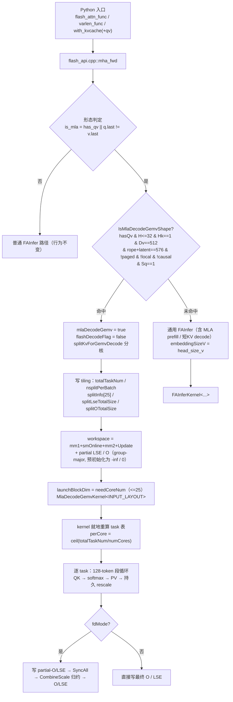
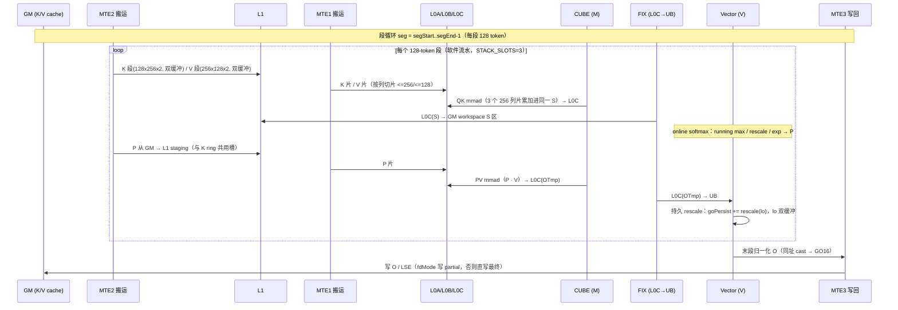
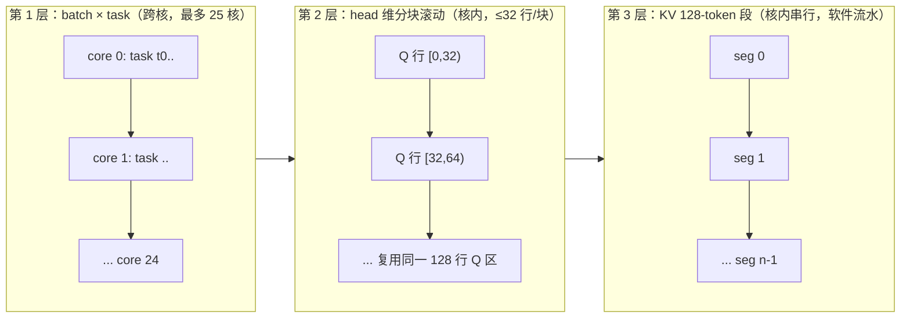

# MLA 场景设计与实现（FA3 / FA4 合并设计文档）

> 本文合并并重写了 `docs/mla/` 下全部 MLA 文档与 `docs/MLA 场景 L1 流水设计说明.md`，以**代码实现为准**（`csrc/ascend910/flash_attn_npu_{3,4}/`）重新校核了 L1/UB/L0 内存分布、关键流程与并行流水。
>
> - 设备：Ascend 910（Atlas A2 / dav-2201），L1 512 KB、UB 192 KB、L0A/L0B 64 KB、L0C 128 KB（每核）。
> - 版本：**FA3（`flash_attn_npu_3`）与 FA4（`flash_attn_npu_4`）双版本**，两版本各自持有一份 kernel 与 host 闸门，共享同一套算法、内存布局与事件记账。
> - 性能口径：候选内核设备时间 ÷ 同布局 CANN FIA（MLA）内核设备时间 **≤ 1.05**，只计 attention 计算内核，不含 metadata / host 包装。
> - 覆盖范围：MLA 的 **prefill（unabsorbed）** 与 **absorbed decode（专用 GEMV kernel）** 两条路径。
>
> 与旧文档的一处已知冲突：`mla_decode_gemv_design.md` §4.1/§9 将 L1 Q 区记为 `H×576×2B`（H=32→36 KB）。这是 G1 修复前的口径；**当前 FA3/FA4 代码均为 `qRows = L1TileShape::M = 128` 固定预留 144 KB**，L1 实占 400 KB 且与 H 无关。本文按代码修正（见 §5.1）。

---

## 目录

1. [总览](#1-总览)
2. [形态判定与接口契约](#2-形态判定与接口契约)
3. [Host 侧设计](#3-host-侧设计)
4. [Kernel 计算流程](#4-kernel-计算流程)
5. [内存分布（L1 / L0 / UB / GM workspace）](#5-内存分布l1--l0--ub--gm-workspace)
6. [算子计算并行流水](#6-算子计算并行流水)
7. [分核与调度](#7-分核与调度)
8. [布局支持（BSND / BNSD / TND）](#8-布局支持bsnd--bnsd--tnd)
9. [数值口径与精度](#9-数值口径与精度)
10. [FA3 / FA4 差异](#10-fa3--fa4-差异)
11. [性能与验证](#11-性能与验证)
12. [构建与验收](#12-构建与验收)
13. [附录：关键代码索引](#13-附录关键代码索引)

---

## 1. 总览

### 1.1 两种形态

MLA（Multi-head Latent Attention）在本仓是 **FA 前向流水内的一种形状签名**，不引入与 FA 平行的 ABI。它复用同一套 tiling、分核与 kernel 计算原语，按张量形状分成两种形态：

| 形态 | 口径 | Q | K | V | KV 头数 | 输出 Dv | 入口 |
| --- | --- | --- | --- | --- | --- | --- | --- |
| **prefill / unabsorbed**（训练口径） | 未吸收 | `nope(128)｜rope(64)` = 192 | `nope｜rope` = 192 | 128 | 可 >1（GQA） | 128 | `flash_attn_func` / `flash_attn_varlen_func` |
| **decode / absorbed**（推理口径） | 已吸收 | `q = rope(64)`，`qv = latent(512)` | `k = k_rope(64)`，latent 源即 V cache | `latent(512)` | 恒为 1 | 512 | v3：`flash_attn_with_kvcache`（含 `qv`）；v4：`flash_attn_func` / `flash_attn_varlen_func` + `qv` |

两种形态是**同一双线性形式**的两条实现路径（见 §9 训推一致性）：`out_prefill ≈ out_decode @ W_uvᵀ`。

### 1.2 设计原则

1. **形状驱动，无显式 flag**：MLA 判定完全由张量形状签名完成，判定点在 host 侧 `flash_api.cpp::mha_fwd`。
2. **不新增 tiling 字段**：`embeddingSizeV` 本来就是独立 runtime 字段（此前恒等于 `embeddingSize`），MLA 只是把它改写成真实值 `head_size_v`；tiling 结构体的字段、偏移、语义均不变，避免动 `tilingdata.h` 触发的跨编译单元 ABI 风险。
3. **不新增 dispatch 模板轴**：MLA 与普通 FA 走同一份编译出的 kernel，head dim 仍是 runtime 轴；`autogen/generate_kernels.py` 与 `setup.py` 无需改动，编译目标数量不变。
4. **专用 GEMV kernel 由形状闸门选中**，绝不进入非 MLA 路径；非 MLA 输入行为与改动前逐位一致。

### 1.3 代码索引

| 环节 | FA3 | FA4 |
| --- | --- | --- |
| 形态判定 / 输出分配 / workspace | [flash_api.cpp](../../csrc/ascend910/flash_attn_npu_3/flash_api.cpp) | [flash_api.cpp](../../csrc/ascend910/flash_attn_npu_4/flash_api.cpp) |
| 运行期门控 / 分发 | [fwd_dispatch_impl.hpp](../../csrc/ascend910/flash_attn_npu_3/fwd_dispatch_impl.hpp) | [fwd_dispatch_impl.hpp](../../csrc/ascend910/flash_attn_npu_4/fwd_dispatch_impl.hpp) |
| MLA decode GEMV kernel | [mla_decode_gemv.hpp](../../csrc/ascend910/flash_attn_npu_3/mla_decode_gemv.hpp) | [mla_decode_gemv.hpp](../../csrc/ascend910/flash_attn_npu_4/mla_decode_gemv.hpp) |
| 通用 FAInfer（prefill / decode 非 gemv） | [mha_fwd_kvcache.cpp](../../csrc/ascend910/flash_attn_npu_3/mha_fwd_kvcache.cpp) | 同名 |
| KV 段分核 | [fa_split.h](../../csrc/ascend910/flash_attn_npu_3/fa_split.h) | [fa_split.h](../../csrc/ascend910/flash_attn_npu_4/fa_split.h) |
| partial 归约 | [combine_scale.hpp](../../csrc/ascend910/flash_attn_npu_3/combine_scale.hpp) | [combine_scale.hpp](../../csrc/ascend910/flash_attn_npu_4/combine_scale.hpp) |
| 复用组件 | [qk_matmul.hpp](../../csrc/ascend910/flash_attn_npu_3/qk_matmul.hpp) / [pv_matmul.hpp](../../csrc/ascend910/flash_attn_npu_3/pv_matmul.hpp) / [online_softmax.hpp](../../csrc/ascend910/flash_attn_npu_3/online_softmax.hpp) / [kernel_common.hpp](../../csrc/ascend910/flash_attn_npu_3/kernel_common.hpp) | 同名组件 |

---

## 2. 形态判定与接口契约

### 2.1 判定表达式

```
has_q_v     = q_v_.has_value()
head_size_v = has_q_v ? q_v.size(-1) : v.size(-1)
is_mla      = has_q_v || (head_size_og != head_size_v)
```

即「**传了 `qv`**」或「**q/k 头维与 v 头维不等**」任一成立即进入 MLA。后者是 prefill 的判据，避免为训练口径新增参数。非 MLA 输入（`q.last == v.last` 且无 `qv`）不进入任何 MLA 分支。

### 2.2 接口契约

| 项 | v3 | v4 |
| --- | --- | --- |
| prefill 入口 | `flash_attn_func` / `flash_attn_varlen_func` | 同左 |
| decode 入口 | `flash_attn_with_kvcache`（含 `qv`） | `flash_attn_func` / `flash_attn_varlen_func` + `qv` + `page_table` / `seqused_k` |
| 输出末维 | `qv.last`（有 qv）或 `v.last` | 同左 |
| 默认 `softmax_scale`（有 qv） | `(q.last + qv.last) ** -0.5` | 同左 |
| 默认 `softmax_scale`（无 qv） | `q.last ** -0.5` | 同左 |
| layout | TND(0) / BSND(1) / BNSD(2) | 同左 |
| `softmax_lse` | 带 `qv` 时 `(..., s, h)` | 同左 |

> **scale 口径必须显式传**：prefill 的正确口径是 `192 ** -0.5`，absorbed decode 的 score 覆盖完整 576 宽内积，口径是 `576 ** -0.5`。两者不是同一个数，训推一致性测试必须显式传入统一 scale（见 §9）。

### 2.3 明确拒绝的约束

| 约束 | 触发点 | 结果 |
| --- | --- | --- |
| append-KV（`k_new`/`v_new`） | v3 `TORCH_CHECK(!appendKV)` | 报错 |
| `q.last > 256` 且带 `qv` | `TORCH_CHECK(head_size_og <= 256)` | 报错 |
| `v.last ∉ [1,512]` | `TORCH_CHECK(head_size_v ∈ [1,512])` | 报错 |
| 反向 | bwd 包装层拒绝不等 head dim | `ValueError` |
| `gather_kv_indices`（v4） | `flash_api.cpp` 直接 `TORCH_CHECK` | 报错 |

未使用的既有参数（`q_descale` / `k_descale` / `v_descale`）在 MLA 下必须为 `None`；带量化输入会被既有 dtype 校验拒绝。

---

## 3. Host 侧设计

### 3.1 `flash_api.cpp`（v3 / v4 对称）

1. **形态判定与校验**（§2.1）。MLA 额外校验：
   - `!has_q_v || head_size_og <= 256`：absorbed 形态的 rope Q 头维必须 ≤ 256。
   - `head_size_v ∈ [1, 512]`：输出/latent 宽度上限。
   - absorbed：`q_v.size(-1) == v.size(-1)` 且 dtype 与 q 一致、**全连续**（kernel 按 packed BSND/BNSD stride 读 latent query）。
2. **输出分配**：非 MLA 仍 `empty_like(q)`；BNSD（含 MLA）统一分配连续 `(B,S,H,dv)`；MLA 非 BNSD 复制 q 的 shape 后把末维替换为 `head_size_v`。**BNSD 分支必须排在 MLA 分支之前**：MLA BNSD 的 `q.sizes()` 是 `(B,H,S,dq)`，先走 MLA 分支会把输出错当成 `(B,H,S,dv)` 而静默错形状。
3. `embeddingSizeV = head_size_v`（原为 `head_size_og`）。
4. `splitCtx.head_size_v = head_size_v`：分核成本模型与 FlashDecode workspace 偏移都按输出宽度计。
5. `wsSplit = partialRowsUpper * (head_size_v + 1) * sizeof(float)`：FD 归约 workspace 按 v 宽分配（`partialRowsUpper = Q_TILE_CEIL * rowBlocksUpper`）。
6. `fwd_args.qvDevice = has_q_v ? q_v.data_ptr() : nullptr`：唯一新增的 fwd 入参。

`fa_split.h::splitBN2S1GS2` 本身未改动，MLA 与普通 FA 共用同一套 `coreInfo` / `splitInfo` 与同一套 FlashDecode 归约规划。AICPU metadata 同样无需改动：`fa_metadata.aicpu` 从 `metaArgs->embeddingSizeV` 读 `ctx.head_size_v`，host 把 `embeddingSizeV` 写对即自动一致。

### 3.2 选路闸门 `IsMlaDecodeGemvShape`

[flash_api.cpp](../../csrc/ascend910/flash_attn_npu_3/flash_api.cpp#L101) 里的形状闸门是 MLA decode 专用 GEMV kernel 的**唯一判据**：

```
IsMlaDecodeGemvShape(hasQv, numHeads, numHeadsK, headSizeOg, headSizeV,
                     pagedKv, isLocal, isCausal, seqlenQ)
```

| 条件 | 含义 |
| --- | --- |
| `hasQv` | 吸收形态必须有 `qv` |
| `numHeads <= 32` | head 数**上界**：分核与持久区按 `qHeads = 32` 几何验证，超出即回落通用 FAInfer |
| `numHeadsK == 1` | MLA latent cache 只有 1 个 KV 头 |
| `headSizeV == 512` | absorbed `Dv` |
| `headSizeOg + headSizeV == 576` | `64(rope) + 512(latent)`，即 rope-split 已拆开 |
| `!pagedKv && !isLocal && !isCausal` | 分页 / 窗口 / causal 仍留在通用路径 |
| `seqlenQ == 1` | decode 单查询行 |

闸门在**两个位置**被调用，两处必须一致：

1. **早闸门**（`scheduler_metadata` 预处理）：若调用方传了 `scheduler_metadata` 而形状命中 gemv，则**跳过** metadata 的 host 重路由，避免 metadata 路径反过来改写 tiling。
2. **主 tiling**（分核、workspace、`fwd_args.mlaDecodeGemv` 赋值处）。

> **闸门与 KV 长度无关**：早期版本曾把 `kvLen` 作为闸门入参（TND 无 per-batch KV 长度轴，取值口径踩过坑），该入参现已从签名移除；闸门只依赖 shape，两处调用天然一致。

命中后：`mlaDecodeGemv = true`、`flashDecodeFlag = false`（专用 kernel 自带 128-token 分核，与通用 FD 几何无关）；`num_splits > 1` 校验放行；走 `splitKvForGemvDecode` 分核；`launchBlockDim = needCoreNum`（无任务的核不发射）。选路**完全由 shape 推导**，没有环境变量旁路开关。

### 3.3 KV 分核 `splitKvForGemvDecode`

任务模型：`task = (bIdx, [segStart, segEnd))`，即一个 batch 上的一段连续 128-token KV 段；`segCount = ceil(kvLen / 128)`（kv=1025 → 9 段）。**一核一任务**：一个核负责一个 batch 上的连续若干段。

[fa_split.h](../../csrc/ascend910/flash_attn_npu_3/fa_split.h) 的切分策略：

1. `batchWithWork` 统计 `kvLen > 0` 的 batch 数；为 0 时直接 `needCoreNum = 0` 返回。
2. 每 batch 的 split 预算 `nsplitPerBatch`：
   - `num_splits > 1`：显式值优先（`num_splits == 1` 不视为「单核」，回落到自动启发式，因为训练入口硬编码 1、`flash_attn_with_kvcache` 传 0，两者都值得切）；
   - 否则取 `ceil(maxSegCount / SEG_TARGET)`，**`SEG_TARGET = 4`**：把每 split 收敛到约 4 个 128-token tile（再切下去只增加 partial-O 流量与 CombineScale 宽度，见 §7.2）；
   - 上限 `maxSplitsPerBatch = blockDim / batchWithWork`，保证 `batch × actualSplits ≤ blockDim`。
3. 每 batch：`blocksPerSplit = ceil(segCount / nsplitPerBatch)`，`actualSplits = ceil(segCount / blocksPerSplit)` → `splitInfo[b].splitNum = actualSplits`。
4. `coreInfo[coreIdx] = {startBIdx = endBIdx = b, startS2Idx = segStart, endS2Idx = segEnd}`，并记录本任务 partial 基址：
   - `firstSplitKVTaskLseOffset = lseTaskOffset + s * qHeads`
   - `firstSplitKVTaskOOffset   = oTaskOffset   + s * qHeads * headSizeV`
   - 账本按 batch 递增：`lseTaskOffset += actualSplits * qHeads`，`oTaskOffset += actualSplits * qHeads * headSizeV`。
5. `needCoreNum = min(coreIdx, MAX_NODE_NUM)`，`MAX_NODE_NUM = 25`（物理核数上限）。
6. `totalTaskNum` 下沉到 tiling；kernel 侧按相同规则就地重算 task 表（§7.1）。

### 3.4 direct / fd 两种收尾

- **任一 batch 被切成多片**（`anySplit`）→ `totalSplitNodeNum = batch 数`、`splitLseTotalSize / splitOTotalSize > 0`；kernel 内 `fdMode = (splitLseTotalSize > 0)`，各核把 partial 写进 workspace，末尾 `SyncAll` + `CombineScale` 归约。
- **每个 batch 都只有一片** → 三个 size 全置 0，各核**直接写最终 O / LSE**，partial 缓冲区不使用、CombineScale 整段跳过。

`splitInfo[]` 字段：`batchIdx / headStartIdx(=0) / headEndIdx(=qHeads) / qStartIdx(=0) / qEndIdx(=1) / splitNum / lseTaskOffset / oTaskOffset`。partial 在 workspace 中是 **group-major** 布局 `[batch][split][head]`，这是 `CombineScale` 与 kernel 侧 write 地址共同的约定。

> **`splitInfo` 表长度**：host 侧固定写 `splitNode splitInfo[25]`（`SplitInfoType = splitNode[25]`），非空 batch 数结构性满足 `≤ blockDim / 2 ≤ 12`，天然不越界，无需 workspace scratch 变长表（该简化方案已替代早期 device 侧重算 splitNode 的改动）。

### 3.5 Python 接口与 dispatch

**v3 `flash_attn_npu_interface.py`**：

- `_flash_attn_forward` 把 `qv = maybe_contiguous(qv)` 改为 `qv = qv.contiguous()`：kernel 按 packed BSND/BNSD stride 读 latent query，只保证末维连续不够——BNSD 视图的 head stride 也不连续，仅归一化末维会让 kernel 按固定 packed stride 读取时行错位、结果静默错误。
- `_detect_layout` 增加 `qv` 入参并返回 6 元组：absorbed 形态 KV 头数恒为 1，transposed BNSD 的 k/v 视图退化为连续存储、无法单独判定布局，改由 `q` + `qv`（带真实 head 轴）判定。
- `FlashAttnFunc.forward` / `FlashAttnVarlenFunc.forward` 的 `get_scheduler_metadata` 调用把 `headdim_v` 从 `head_size` 改为 `v.shape[-1]`：MLA prefill 的 v 宽度（128）与 q/k（192）不同，metadata 的 workspace 规划必须按 v 宽。
- `flash_attn_with_kvcache` 的 `qv` 语义沿用原有实现（`(q.last + qv.last) ** -0.5` 默认 scale）；BNSD 下额外拒绝 append-KV，并校验 `cache_seqlens` 不超过 BNSD 的 KV 序列维。

**v4 `flash_attn_npu_interface.py`**：`_flash_attn_forward` 的 `qv` 归一化同 v3；`_detect_layout` 对称改造；`_flash_attn_forward_fake` 的输出 shape 改为 `list(q.shape)` 后末维置为 `v.shape[-1]`（原 `empty_like(q)` 在 MLA 下形状错误）；v4 不新增 `flash_attn_with_kvcache`。

**Dispatch**：`FwdLaunchArgs` 末尾加 `uint8_t* qvDevice`，`FWD_LAUNCH` 宏末位透传，`launch_fwd_dtype` 取值后交给 `FAInfer(...)` 的末位默认参数 `GM_ADDR qv = nullptr`。模板轴（`dtype × layout × paged × mask × softcap × flashDecode`）**不新增 MLA 维**。

---

## 4. Kernel 计算流程

### 4.1 参数派生与模式开关

`FAInferKernel::init` 中派生（通用 FAInfer 路径）：

```
mlaAbsorbed  = (params.qv != nullptr);
embedQK      = mlaAbsorbed ? (embed + embedV) : embed;   // absorbed: 64 + 512 = 576
headDimSplit = embedQK > 256;                            // 原为 embed > 256
qL1DynNum    = RoundUp(embedQK, BLOCK_SIZE);             // 576
```

absorbed 下 `headDimSplit` 恒为真，`dSliceNum = ceil(576 / 256) = 3`：slice 0/1 覆盖 latent `[0,256)/[256,512)`，slice 2 起点 512 ≥ `mlaLatentDim`，自动落到 rope 源。

专用 GEMV kernel 里这些量直接由闸门保证的常量硬编码（D2 注释）：

```
kvHeads = 1;                          embed  = MLA_DECODE_ROPE_DIM   (64)
embedV  = MLA_DECODE_LATENT_DIM (512) embedQK = MLA_DECODE_QK_DIM     (576)
MLA_DECODE_KV_TILE = 128
```

### 4.2 Q / K 双源拼装

`qk_matmul.hpp::loadQGM` 的 MLA 分支复用 `loadQSegmentToL1`（与 V3 原实现逐字等价）：

```
loadQSegmentToL1(gQv,        0,              mlaLatentDim, ...)  // latent qv → L1 列 [0,512)
loadQSegmentToL1(mlaRopeQ,   mlaLatentDim,   embed - mlaLatentDim, ...) // rope q → L1 列 [512,576)
```

两段写入**同一个** 576 宽 zN 块的相邻列区间，`LayoutAInL1::GetOffset` 的 C0 块落点与 `headDimSplitQK` 的 L1A 偏移天然对齐，后续 QK matmul 不需要感知双源。

K 侧 `copyKHeadDimSliceToL1` 按 `dOffset = dSlice * l1KDynamic` 选源：

```
if (mlaAbsorbed && dOffset >= mlaLatentDim) {
    src = mlaRopeK;   // rope K
    dOffset -= mlaLatentDim;
}
```

latent 段的 K 源就是 **V cache**（`gV`），因此 QK 的 `layoutB`、token stride、page stride 全部切到 PV 口径；rope 段用单独注册的 `gK` 及其 stride。paged 场景下 `gOffset` 的 page 项也要按源切换（latent 用 `valuePageStride`，rope 用 `keyPageStride`）。

> **两段 score 共用累加器**：absorbed 的 QK 是**一次 576 宽 matmul**，不是两次 matmul 相加。Q/K 的 latent 与 rope 两段在 L1 内拼成连续的 576 宽 zN/nZ 块，`headDimSplitQK` 按 256 列切片（每片 16 对齐）依次累加进同一个 S 累加器（`dSlice==0 && kL0Idx==0` 时初始化，其余累加）。数学上 `score = scale·(qv·vᵀ + q_rope·k_ropeᵀ) = scale·[qv｜q_rope]·[v｜k_rope]ᵀ`。online softmax 看到的是一份完整 score。

两段宽度（512 / 64）均为 C0（16 元素）整数倍，分段 ND2NZ 与整块搬运结果逐位相同。

### 4.3 PV 与 online softmax

PV 的 V 就是 latent（512 宽，`embedV`），PV 流水无需为 MLA 改动；**rope 的 k 只进 QK 不进 PV**。需要改的是此前误用 `embed` 的三处输出侧几何：

| 位置 | 原值 | 改为 |
| --- | --- | --- |
| `LayoutUpdate layoutUpdate` | `embed, embedRound` | `embedV, embedRoundV` |
| `LayoutLse layoutgmLo`（FD 归约） | `embed * qNBlockSize` | `embedV * qNBlockSize` |
| `strideQv` / `qvHeadStride`（新增） | — | BNSD：`embedV` / `maxQSeqlen*embedV`；否则 `qHeads*embedV` / `embedV` |

prefill 形态 `embed=192 / embedV=128` 恰好暴露了这些旧假设，所以这组修改对 prefill 也是必需的。

latent query 的地址基址 `gmOffsetQv` 必须按 layout 分支：BNSD 下 batch 基址是 `BIdx * qHeads * qvHeadStride`（head 维是真实的物理轴），BSND/TND 下仍是 `prevQSeqlenSum * strideQv`。漏掉这一分支时 B>1 的 absorbed BNSD 会读到错误的 batch 基址。

### 4.4 持久 rescale 收尾（`MlaDecodePersistRescale`）

专用 GEMV kernel 的 online-softmax 收尾模块 `MlaDecodePersistRescale`（[mla_decode_gemv.hpp](../../csrc/ascend910/flash_attn_npu_3/mla_decode_gemv.hpp)）：

- 承接 P·V 的中间结果 **OTmp**，按 KV 检查点逐段做**带 running max 缩放的累加**，末段完成归一化后写回最终 **O** 与 **LSE**。
- 三项针对 decode 几何的专属优化：
  1. **`go` 持久驻留 UB**（`goPersist`，fp32 O 累加器跨段常驻），消除每段 2×64 KB 的 GM 往返；
  2. **`lo` 输入双缓冲**，消除段间串行等待；
  3. **末段同址 cast**：`GO16`（fp16/bf16 输出 staging）与 `goPersist` 同址原地类型转换，节省 UB 空间。
- fdMode 下把 partial-O 写回 workspace 供 `CombineScale` 归约；direct 模式直接写最终输出。
- 该类曾因 UB 越界触发崩溃，现由 `static_assert` 锁定边界（见 §5.3）。

### 4.5 关键流程图（全链路）



### 4.6 关键流程图（kernel 段间流水，单核视角）



---

## 5. 内存分布（L1 / L0 / UB / GM workspace）

> 常量来源：[kernel_common.hpp](../../csrc/ascend910/flash_attn_npu_3/kernel_common.hpp) 的 `L1_MAX_N_NUM = 128`、`DOUBLE_BUFFER = 2`、`L1_HEAD_DIM_SLICE = 128`、`L1_MAX_SIZE = 524288`、`PRE_LAUNCH = 2`；tile 形状来自 [mla_decode_gemv.hpp](../../csrc/ascend910/flash_attn_npu_3/mla_decode_gemv.hpp) 的 `L1TileShapeQK = GemmShape<128,128,128>`、`L1TileShapePV = GemmShape<128,128,256>`、`L0TileShapeQK / L0TileShapePV = GemmShape<128,128,128>`。

### 5.1 L1 内存分布（每 AIC，512 KB）

专用 GEMV kernel 的 L1 分配（`mla_decode_gemv.hpp::operator()`）：

```
const uint32_t nDynNum    = L1_MAX_N_NUM;                  // 128（KV tile 长度）
const uint32_t kDynNum    = 2U * L1_MAX_N_NUM;             // 256（K 列片宽）
const uint32_t qDynNum    = RoundUp(embedQK, BLOCK_SIZE);  // 576（Q 全宽）
const uint32_t qRows      = BlockMmadQK::L1TileShape::M;   // = Q_TILE_CEIL = 128  ← G1 关键
const uint32_t pRows      = BlockMmadPV::L1TileShape::M;   // 128
const uint32_t kPVDynNum  = 2U * L1_MAX_N_NUM;             // 256
const uint32_t vSegLen    = 2U * L1_MAX_N_NUM;             // 256
const uint32_t vSliceWidth= L1_HEAD_DIM_SLICE;             // 128
const uint32_t l1QKSize   = qRows * qDynNum * sizeof(ElementQ);  // 128*576*2 = 147456
```

初始化：
```
blockMmadQK.init(resource, nDynNum, kDynNum, qRows, qDynNum, MLA_DECODE_KV_TILE, /*l1BufAddrStart=*/0, ndCopyL1Offset);
blockMmadPV.init(resource, nDynNum, kPVDynNum, MLA_DECODE_KV_TILE, /*l1BufAddrStart=*/l1QKSize, DOUBLE_BUFFER, vSegLen, vSliceWidth, ndCopyL1Offset);
```

| 字节区间 | 内容 | 大小 |
| --- | --- | --- |
| `[0, 147456)` | **Q 区**：`qv` latent(512) + rope(64) 同一块 576 列，固定 128 行 | 128 × 576 × 2 B = **144 KB** |
| `[147456, 212992)` | K ring slot 0 ／ P staging slot 0（**二者共用**） | 128 × 256 × 2 B = 64 KB |
| `[212992, 278528)` | K ring slot 1 ／ P staging slot 1（**二者共用**） | 64 KB |
| `[278528, 344064)` | V ring slot 0 | 256 × 128 × 2 B = 64 KB |
| `[344064, 409600)` | V ring slot 1 | 64 KB |
| **实占小计** | 至 `409600` | **400 KB**（余 112 KB） |
| `ndCopyL1Offset = 540672` | append-KV nd2nz staging 账本（decode 不触碰） | — |

ASCII 视图：

```
L1 (512 KB) 0 ─────────────────────────────────────────────────────────────▶ 524288
┌──────────────────┬──────────────┬──────────────┬──────────────┬──────────────┐
│ Q 区 (固定128行)  │ K0 / P0 共用 │ K1 / P1 共用 │  V ring 0    │  V ring 1    │
│ 128 × 576 × 2B   │ 128×256×2B   │ 128×256×2B   │ 256×128×2B   │ 256×128×2B   │
│ 144 KB           │ 64 KB        │ 64 KB        │ 64 KB        │ 64 KB        │
└──────────────────┴──────────────┴──────────────┴──────────────┴──────────────┘
0              147456        212992        278528        344064        409600
     ▲ blockMmadQK.init(l1BufAddrStart=0)
                              ▲ blockMmadPV.init(l1BufAddrStart=l1QKSize=147456)
   实占 400 KB ─────────────────────────────────────────────────────────────▲
   ndCopyL1Offset = 540672（保守账本，decode 不触发 append-KV，仅保留）
```

要点：

- **K 与 P 共用同一段 L1**：`blockMmadQK` 把 K 的 2 个 ring 槽放在 `l1QKSize + 64K×i`，`blockMmadPV` 把 P 的 2 个 staging 槽放在同一地址（`l1QKSize + 128×256×2×i`）。二者共享同一个 `PingPongState` 统一轮转，同一时段只被其中一个占用，因此省下一份 128 KB。
- **P 的搬运路径是 GM → L1 staging → L0A**：online-softmax 把 P 写进 GM workspace，MM2 用 `copyGmToL1A` 搬进上表的 P staging 槽，因此 P 不驻留片上。
- **Q 行区必须与 H 无关（G1）**：head 分块滚动每次只把 ≤ `kMlaDecodeGemvHeadBlock`（≤32）行 Q 重装进这块区，常驻行数固定为 `L1TileShape::M`（= `Q_TILE_CEIL` = 128）而非 `qHeads`。若按 `qHeads` 预留，K/P/V 基址 `l1QKSize = qHeads*qDyn*sizeof(Q)` 会随 H 增长，H 变大后把 V/nd 区顶出 512 KB 上限，触发 MTE 写 on-chip buffer 越界。FA3 曾因 `qHeads ≥ 313` 触发此崩溃，已对齐为固定 128 行。
- **通用 FAInfer（MLA prefill / absorbed 非 gemv）** 的 L1 布局与上表同构（`qL1Rows = Q_TILE_CEIL = 128`、`qL1DynNum = 576`、`nDynNum = L1_D512_KV_TILE`、`kDynNum = 256`），差异仅在 KV tile 长度与 stack 深度。

### 5.2 L0 内存分布（每 AIC）

`L0A / L0B / L0C` 各由 `PingPongState` 驱动按 `STAGES = DOUBLE_BUFFER = 2` 一分为二。QK 与 PV 的 `L0TileShape` 都是 `128×128×128`，所以每槽：

| 缓冲 | 尺寸 | 每槽 |
| --- | --- | --- |
| `L0A` | 128 × 128 × 2 B | 32 KB（×2 槽） |
| `L0B` | 128 × 128 × 2 B | 32 KB（×2 槽） |
| `L0C` | 128 × 128 × 4 B | 64 KB（×2 槽，fp32 累加） |

### 5.3 UB 内存分布（每 AIV，192 KB = 12 × 16 KB）

UB 布局全部定义在 `MlaDecodePersistRescale`（[mla_decode_gemv.hpp](../../csrc/ascend910/flash_attn_npu_3/mla_decode_gemv.hpp#L115)），单位 `UB_UINT8_BLOCK_SIZE = 16 KB`：

| 字节偏移 | 区 | 大小 / 说明 |
| --- | --- | --- |
| `4 × 16K = 65536` (`LO_UB_TENSOR_OFFSET`) | `lo` 双缓冲 slot 0 | `16 行 × 512 × 4 B` = 32 KB（上一段 OTmp） |
| `6 × 16K = 98304` | `lo` 双缓冲 slot 1 | 32 KB |
| `8 × 16K = 131072` (`PERSIST_GO_UB_OFFSET`) | `goPersist`（fp32 O 累加器） | `16 行 × 512 × 4 B` = 32 KB，**跨段持久** |
| `8 × 16K = 131072` | `GO16`（fp16/bf16 输出 staging） | 与 `goPersist` **同址原地 cast** |
| `10 × 16K = 163840` | `tv`（BRCB 模板，9 KB）+ `gm` / `gl` / `dm` 状态 | 由 online-softmax 写入，rescale 复用 |
| `11 × 16K − 2304 = 177920` | `lseStaging` | `64 × 9 × 4 B` = 2304 B |
| 上限 `12 × 16K = 196608` | — | `static_assert` 边界 |

ASCII 视图：

```
UB (192 KB = 12 × 16 KB 块)  0 ──────────────────────────────────────────▶ 196608
块索引      0      1      2      3      4      5      6      7      8      9     10     11
        ┌──────┬──────┬──────┬──────┬──────┬──────┬──────┬──────┬──────┬──────┬──────┬──────┐
占用     │  ↑   │  ↑   │  ↑   │  ↑   │      lo s0      │      lo s1      │ goPersist    │  ↑   │
        │ 未使用（其它 UB 使用者 / 保留）  │  16×512×4B=32K  │  16×512×4B=32K  │ /GO16 (同址) │tv+lse│
        └──────┴──────┴──────┴──────┴──────┴──────┴──────┴──────┴──────┴──────┴──────┴──────┘
偏移        0    16K    32K    48K    64K    80K    96K   112K   128K  144K  160K  176K 196608
                                        ▲LO_UB_TENSOR_OFFSET=4×16K       ▲PERSIST_GO=8×16K
                                                                        lseStaging 位于 11×16K−2304=177920
static_assert(PERSIST_GO_UB_OFFSET + PERSIST_GO_UB_BYTES <= 12 * 16K);        // goPersist 不超 192 KB
static_assert(LO_UB_TENSOR_OFFSET + 2 * LO_SLOT_UB_BYTES <= PERSIST_GO_UB_OFFSET); // lo 不侵入 goPersist
```

### 5.4 GM workspace 分布

host 侧账本（[flash_api.cpp](../../csrc/ascend910/flash_attn_npu_3/flash_api.cpp#L732)）：

```
WORKSPACE_BLOCK_SIZE_DB = 128 × 512 = 64 KB
PRELANCH_NUM            = 3   (= kernel 侧 STACK_SLOTS = PRE_LAUNCH + 1 = 3)
```

| 区 | 大小（host 侧） | kernel 侧用途 |
| --- | --- | --- |
| `mm1OutSize` | `blockDim × 64KB × 4 × 3` | S 区（GM），槽 `seg % 3` |
| `smOnlineOutSize` | `blockDim × 64KB × 2 × 3` | P 区（GM），槽 `seg % 3` |
| `mm2OutSize` | `blockDim × 64KB × 4 × 3` | OTmp 区（GM），槽 `seg % 3` |
| `UpdateSize` | `blockDim × 64KB × 4 × 3` | 预留给旧 rescale 的 gUpdate；持久 rescale 不再读写 |
| `splitLseTotalSize` | `Σ actualSplits × qHeads × 4 B` | partial LSE（fp32），初始化为 `-inf` |
| `splitOTotalSize` | `Σ actualSplits × qHeads × Dv × 4 B` | partial O（fp32），初始化为 `0` |

```
workSpaceSize = mm1OutSize + smOnlineOutSize + mm2OutSize + UpdateSize
              + splitLseTotalSize + splitOTotalSize

GM workspace 布局:
[ mm1(S) ][ smOnline(P) ][ mm2(OTmp) ][ Update ][ partial LSE ][ partial O ]
                                                    ▲ partialBase(仅 gemv)
kernel 侧每核槽基址: wsSlotBase = coreIdx × 64KB × 3
```

kernel 侧每核实际使用的槽基址是 `wsSlotBase = coreIdx × 64KB × 3`（`coreIdx` 在 AIV 上由 `GetBlockIdx() / GetSubBlockNum()` 折回 AIC 编号）。partial 区从 `partialBase = mm1 + smOnline + mm2 + Update` 开始（**通用 FAInfer 的 partial 在偏移 0，gemv 在尾部，两者不共用同一组地址假设**）。partial 预初始化（LSE 全 `-inf`、O 全 `0`）保证空 split 被 `CombineScale` 忽略。

---

## 6. 算子计算并行流水

### 6.1 三层并行结构

MLA decode GEMV 的并行是**三层嵌套**的：



- **第 1 层（batch / task 跨核）**：`task = (b, [segStart, segEnd))`，一核认领一段连续 task；`blockDim` 上限 25。
- **第 2 层（head 维分块滚动）**：`kMlaDecodeGemvHeadBlock = 32`，`gemvNumHeadBlocks = ceil(qHeads / 32)`，逐块复用同一套 L1 布局与同一 128 行 Q 区。
- **第 3 层（KV 段循环）**：每段 128 token，段内按 QK → softmax → PV → 持久 rescale 顺序推进，段间用双缓冲与 prelaunch 配平形成软件流水。

### 6.2 队列与流水阶段

Ascend 910 的 AIC（cube）与 AIV（vector）各有独立指令队列，MLA decode 把它们组织成如下流水：

| 队列 | 角色 | 关键动作 |
| --- | --- | --- |
| `MTE2` | GM → L1 搬运 | 搬 K 段（128×256）、V 段（256×128）、P staging |
| `MTE1` | L1 → L0A/L0B 搬运 | 搬 Q/K/V/P 片；`loadQGM` 走 MTE1_MTE2 通道 |
| `M`（CUBE） | L0 矩阵乘 | QK mmad（3 列片累加）、PV mmad |
| `FIX` | L0C → UB/GM | S 出 L0C → GM S 区；OTmp 出 L0C → UB |
| `V`（Vector） | UB 向量运算 | online softmax（running max / exp / rescale）、持久 rescale |
| `MTE3` | UB → GM 写回 | 写 O / LSE（fdMode 写 partial） |

### 6.3 双缓冲与软流水（prelaunch 配平）

- **双缓冲**：K/V/P 在 L1 各 2 槽（`DOUBLE_BUFFER = 2`），L0A/L0B/L0C 各 2 槽，`lo` 在 UB 2 槽。前者消除「搬运 vs 计算」串行，后者消除「段间 rescale」串行。
- **三深槽 + 预投**：`STACK_SLOTS = PRE_LAUNCH + 1 = 3`。kernel 启动时**预置全部后续会 Wait 的 HardEvent 集合**（prelaunch 置位），使前 2 段可以提前投出、不必等待尚不存在的生产者；`PRE_LAUNCH = 2` 段在流水线上**in-flight**，第 3 槽用于排空。
- **尾部配平**：kernel 尾部用**完全相同的事件集合**成对 `Wait` 排空。prelaunch 每个 `(事件类型, EVENT_ID)` 组合只允许 `SetFlag` 恰好一次，多放令牌会破坏尾部配对平衡导致死锁。

**GEMV kernel 的 prelaunch 旗标裁剪（D2）**：

```
AIC 侧：
  M_MTE1   : EVENT_ID {0,1,2,3}                     // l0ABPingPongFlag 及其 +2（QK/PV 均如此）
  FIX_M    : EVENT_ID {0,1}
  MTE1_MTE2: EVENT_ID {0,1,3,4,5,6}                 // l1K/l1P pingpong {0,1}、loadQGM 的 3、
                                                    // PV initCompactDecode 的 4、D=512 的 5/6
AIV 侧：
  MTE3_V   : EVENT_ID {0,1,2,4,6,7}
  MTE3_MTE2: EVENT_ID {0,2,3, ...}
```

从未被消费的 `4..7` 与 `2/7`（对应类型下）的 prelaunch 置位与尾部 Wait **成对删除**，旗标记账保持平衡。

### 6.4 HardEvent 同步契约

- **命名规则 `A_B`**：A 为生产者 pipe，B 为消费者 pipe，含义是「A 完成后 B 才能启动」，用于防止 UB/L1 buffer 复用的反相关（WAR）hazard。
- **`EVENT_ID` 语义**：同一类事件下的独立信道编号，**不同 HardEvent 类型下的同号 ID 完全独立、互不干扰**。
- **跨队列刷干屏障**：相邻的同类型同 ID `SetFlag` / `WaitFlag` 可构成屏障——把 `SetFlag` 排入生产者队列末尾、`WaitFlag` 排入消费者队列，强制消费者等待生产者队列中所有前置搬运指令全部执行完成，无需额外同步变量。
- **已知记账点**：`MTE1_MTE2 EVENT_ID3` 的归还点放在 `loadQGM` 调用后立刻执行，属于纯记账配平写法，仅在**每核单 task**场景下安全；若后续改为单核多 task 调度，必须把该 `SetFlag` 移动到段循环全部消费完成之后，否则会触发 L1 Q 区覆写的 WAR hazard。

### 6.5 跨核同步与归约

```
fdMode = (splitLseTotalSize > 0)

逐核完成各 task 的 partial 累加 → 写 partial-O/LSE（group-major [batch][split][head]）
        │
        ▼
     AscendC::SyncAll()           // 全核栅栏
        │
        ▼
   CombineScale(qHeads, totalSplitNodeNum, embedV, splitInfo, gLseFD, gOFD, gO, gLse)
        // 在线合并：以 LSE 为权重对 partial-O 做加权归约，输出最终 O / LSE
```

- **仅任一 batch 被切成多片时**才进入 fd 收尾；否则三 size 全 0，各核直写最终 O/LSE，CombineScale 整段跳过。
- `CombineScale` 未改动：partial workspace 由 host 按 `head_size_v + 1` 预留，kernel 侧按 `embedV` 读写，两侧一致。
- partial 布局为 **group-major `[batch][split][head]`**，是 `CombineScale` 与 kernel 侧 write 地址共同的约定。

**分核/归约开销权衡（`SEG_TARGET = 4` 的由来）**：源码给出的两个实测常数为 **per-tile 计算成本 ≈ 2.4 us**、**per-split combine 成本 ≈ 1.4 us**，据此收敛到「每 split 约 4 个 KV tile」的经验折中。`SEG_TARGET` 是**每 split 容纳 tile 数的经验目标值，而非核数资源上限**；`maxSplitsPerBatch` 只作资源上限兜底。多切分虽提高核占用，但会同步抬高 partial-O 流量与 CombineScale 归约宽度（随 split 数线性增长），因此不能直接用核数上限作为切分目标。

---

## 7. 分核与调度

### 7.1 kernel 侧就地重算 task 表（P0 / G2）

设计约束：**host 只下沉标量规则，kernel 就地逐字复现调度规则**，使得：

- host 侧不再向 kernel 传 `coreInfo[25]` 的完整认领表（历史上 `npu_3` 存在固定 25 数组导致大 batch 静默截断的 bug，已由本机制修复）；
- kernel 侧只需 `totalTaskNum` 与 `nsplitPerBatch` 两个标量：

```
totalTaskNum = tilingData->totalTaskNum;
numCores     = AscendC::GetBlockNum();
perCore      = (totalTaskNum + numCores - 1U) / numCores;
taskStart    = coreIdx * perCore;
taskEnd      = min(taskStart + perCore, totalTaskNum);
```

随后沿 `(b, s, segStart, segEnd)` 的展开规则（与 `splitKvForGemvDecode` 完全一致）逐 task 定位，`b / s 与 lseBase / oBase` 作为循环的 running 状态。`taskStart >= taskEnd` 时空核，循环体不执行。

> 该方案成立的前提：**`fdMode` 启用时非空 batch 数 ≤ `blockDim / 2` ≤ 12**，因此 host 侧固定写 `splitInfo[25]` 天然不越界；撤销了早期 device 侧在 scratch workspace 上重算 splitNode 的 P0/G2 改动，删除了对应的 `gemvSplitNodeSize` workspace 项。

### 7.2 `anySplit` 判定与 direct 分核

`splitKvForGemvDecode` 第一遍循环在累加 `totalTaskNum / lseTaskOffset / oTaskOffset` 时维护一个**全局布尔** `anySplit`：只要存在任意一个 batch 的 `actualSplits > 1`，就置真。它决定 partial 缓冲与 CombineScale 通道是否启用：

| 维度 | `anySplit = false` | `anySplit = true` |
| --- | --- | --- |
| task 含义 | 一个完整 batch | batch 的一段 KV 子集 |
| `totalSplitNodeNum` | 0 | 有活 batch 数（CombineScale 组表行数） |
| `splitLse / OTotalSize` | 0（⇒ kernel `fdMode = false`） | `> 0` |
| `splitInfo[25]` | 不填 | 填组表供 CombineScale 读 |
| 收尾 | 核内直接写最终 O / LSE | 写 partial，末尾 `SyncAll` + CombineScale 归约 |

> 该标志是**全局**而非 per-batch：只要一个 batch 被切分，所有核都走 partial + Combine 路径。`anySplit` 成立蕴含 `nsplitPerBatch ≥ 2`（否则 `blocksPerSplit = segCount`、`actualSplits` 恒为 1），这也是 host 敢把组表行数写死进 `splitInfo[25]` 的前提推论。

**`anySplit = false` 时的分核**：此时每个 batch 的 `actualSplits == 1`，于是 `totalTaskNum = batchWithWork`（**一个 task 就是一个完整 batch**：覆盖该 batch 全部 `segCount` 段、全部 head），核间并行**只剩 batch 维度**——KV 不切、head 也不跨核：

```
numCores  = GetBlockNum()
perCore   = ceil(totalTaskNum / numCores)            # 连续 ceil-div 均摊
taskStart = coreIdx * perCore
taskEnd   = min(taskStart + perCore, totalTaskNum)   # 认领 [taskStart, taskEnd)

batch:  0  1  2  3  4  5      (batchWithWork=6, numCores=6) → 一核一 batch
      ┌──┬──┬──┬──┬──┬──┐
      │c0│c1│c2│c3│c4│c5│
      └──┴──┴──┴──┴──┴──┘

batch:  0  1  2  3  4  5  6  7 (batchWithWork=8, numCores=4) → 每核串行 2 个连续 batch
      ┌──────┬──────┬──────┬──────┐
      │  c0  │  c1  │  c2  │  c3  │
      └──────┴──────┴──────┴──────┘
```

- `batchWithWork ≤ blockDim`：`needCoreNum = batchWithWork`，一核一个 batch；
- `batchWithWork > blockDim`：一核认领多个**连续** batch，核内 for 循环串行处理。

head 维**不参与跨核分配**，而是核内按 `gemvHeadBlock` 滚动（`for (m0 = 0; m0 < qHeads; m0 += gemvHeadBlock)`，每块把 Q 重装进同一个 Q 区）。因此核内串行维度是 `head 块 × KV 段`，核间并行只有 batch。

小 batch 示例：

- **batch=1、kvLen=256**：`segCount = 2`，按 `SEG_TARGET = 4` 计算 `nsplitPerBatch = ceil(2/4) = 1` → **不切分**（direct 收尾，无 partial）。
- **大 batch（batchWithWork > blockDim）**：`maxSplitsPerBatch = blockDim / batchWithWork` 整数除法归零后被夹到 1，每 batch 只剩 1 个 task、KV 完全不切，同样走 direct 分核——kernel 端一核串行多个连续 batch。

---

## 8. 布局支持（BSND / BNSD / TND）

| 布局 | prefill | absorbed decode（gemv） | 备注 |
| --- | --- | --- | --- |
| TND(0)（packed varlen） | 支持 | 支持（用 `max_seqlen_k_` 判 KV 长度） | 无 per-batch KV 长度轴 |
| BSND(1) | 支持 | 支持 | 主轴 BSND |
| BNSD(2) | 支持 | 支持（依赖 `Sq > 1` 判定） | 输出统一连续 `(B,S,H,dv)` |

- **BNSD 不再被拒绝**（原 `TORCH_CHECK(!is_bnsd)` 已删除）：MLA 的 prefill 与 absorbed 两种形态都支持 BNSD 输入，输出连续 `(B,S,H,dv)`，与非 MLA BNSD 约定一致。
- 唯一例外：v3 `flash_attn_with_kvcache` 的 BNSD 分支仍拒绝 append-KV（该分支不更新 cache）。
- absorbed 的 BNSD 判定依赖 `Sq > 1`：`Sq == 1` 时 transposed BNSD 视图本身就是连续存储，不带任何 stride 证据，此时 BNSD 与 BSND 是同一块内存，无需也无法区分。
- BNSD 下 `strideQv = embedV`、`qvHeadStride = maxQSeqlen * embedV`、`kvHeadStrideK/V = kvSeqlenAllocated * embed(V)`；latent query 的 `gmOffsetQv` 按 `BIdx * qHeads * qvHeadStride` 计算。

---

## 9. 数值口径与精度

同一 latent 状态两条路：

- **prefill**：`q = [q_nope(128) | q_rope(64)]`、`k = [k_nope | k_rope]`、`v = latent @ W_uvᵀ`（128 宽）。
- **decode**：`qv = q_nope @ W_uk`（512）、`q = q_rope`（64）、`k = k_rope`（64）、`v = latent`（512）。

二者是同一双线性形式，因此 `out_prefill ≈ (out_decode @ W_uvᵀ)`。

**验收阈值**：bf16 下相对 L2 < 5e-3，并另用 FP64 CPU golden 分别交叉验证两条路。实测（v3/v4 相同）：

| 比对 | 相对 L2 |
| --- | --- |
| prefill vs golden | 2.283e-3 |
| decode vs golden | 2.184e-3 |
| prefill vs decode | 4.115e-3 |

> **注意**：`k_nope = latent @ W_ukᵀ` 与 `v = latent @ W_uvᵀ` 在 golden 中使用**同一次 bf16 舍入后的值**，否则 bf16 输入误差会被放大到超出阈值。

---

## 10. FA3 / FA4 差异

两版本共用同一套算法、内存布局与事件记账（本文 §2–§9 以 FA3 为主线叙述），差异如下：

| 维度 | FA3（`flash_attn_npu_3`） | FA4（`flash_attn_npu_4`） |
| --- | --- | --- |
| decode 入口 | `flash_attn_with_kvcache`（含 `qv`） | `flash_attn_func` / `flash_attn_varlen_func` + `qv` + `page_table` / `seqused_k` |
| prefill | 通用 FAInfer | 通用 FAInfer（**不在 gemv 范围**） |
| TND packed varlen | gemv 支持（`totalQTokens` / `cu_seqlens_q` / `seqused_k`） | — |
| kernel 文件 | `flash_attn_npu_3/mla_decode_gemv.hpp` | `flash_attn_npu_4/mla_decode_gemv.hpp` |
| L1 Q 行区 | `qRows = L1TileShape::M = 128`（FA3 移植时对齐 FA4） | `L1TileShape::M = 128` |

### 10.1 FA3 移植要点（把 FA4 的 MLA decode 优化搬到 FA3）

移植内容：

1. 删除 host 侧 `coreInfo[25]` 截断预清零逻辑，改为 kernel 内就地重算 task 认领表（§7.1）；
2. head 维按固定块滚动分配 L1 Q 行区（`qRows = L1TileShape::M`）；
3. 将 `nsplitPerBatch` 下沉到 `tilingdata` padding 槽位；
4. 对齐已知 G1 缺陷：**FA3 曾在 H ≥ 313 时 `qRows` 仍按 `qHeads` 预留 L1 Q 行区，导致 V/nd 区越界顶出 512 KB L1，触发 aicore 崩溃**；改为固定 `L1TileShape::M` 后消除。

FA3 三个接口（`flash_attn_func` / `flash_attn_varlen_func` / `flash_attn_with_kvcache`）均已同步。

> **ABI 提示**：FA3 `tilingdata.h` 中用于校验结构体跨语言 ABI 字节数（2376 字节）的 `sizeof` `static_assert` 已被移除，不再强制锁死尺寸契约，仅保留 trivial/copyable 等布局类断言。**FA4 的对应文件不做该修改。**

---

## 11. 性能与验证

### 11.1 性能口径与结果

- 口径：候选内核设备时间 ÷ 同布局 CANN FIA（MLA）内核设备时间 **≤ 1.05**。
- 设计动机：通用 FAInfer 按 **512-token KV stack** 行走并维护 stack descriptor / append-KV / paged / mask 状态机，对 `Sq == 1` 的 decode 形状是纯开销（AIC 时间被 `scalar` 主导，`mac` / `mte2` 占比低）。gemv kernel 把 KV 换成 **128-token tile**，砍掉 descriptor / append / paged / mask 分支，并把 O 累加器做成 **UB 常驻**，消掉每段 2×64 KB 的 GM 往返。

### 11.2 验证结论（历史执行记录）

- **FA4**：MLA decode / prefill 功能与精度用例全部通过。
- **FA3 移植后**：25 个功能用例全部通过；所有边界 batch 数与 head 维度 `bad = 0`；性能用例全部满足 1.05 门限。（整体 bench 脚本曾出现 `EXIT = 1`，系 FA4 prefill 行历史抖动，与 FA3 移植无关。）

---

## 12. 构建与验收

- 编译：FA3 与 FA4 分别构建，均需通过。
- 门禁：`clang-format`（与门禁钩子同版本）、`ruff check` / `ruff format`、行尾空白与文件尾换行。
- 功能验收：MLA prefill / absorbed decode 在 BSND / BNSD / TND 下的功能与精度用例。
- 性能验收：上述 1.05 门限。

---

## 13. 附录：关键代码索引

| 主题 | 位置 |
| --- | --- |
| 形态判定 / 输出分配 / workspace 账本 | [flash_api.cpp#L486-L877](../../csrc/ascend910/flash_attn_npu_3/flash_api.cpp#L486-L877) |
| 选路闸门 `IsMlaDecodeGemvShape` | [flash_api.cpp#L101](../../csrc/ascend910/flash_attn_npu_3/flash_api.cpp#L101) |
| KV 分核 `splitKvForGemvDecode` | [fa_split.h](../../csrc/ascend910/flash_attn_npu_3/fa_split.h) |
| gemv kernel 主体 / 参数派生 / L1 分配 | [mla_decode_gemv.hpp#L555-L760](../../csrc/ascend910/flash_attn_npu_3/mla_decode_gemv.hpp#L555-L760) |
| 持久 rescale / UB 布局常量 | [mla_decode_gemv.hpp#L115-L190](../../csrc/ascend910/flash_attn_npu_3/mla_decode_gemv.hpp#L115-L190) |
| Q/K 双源拼装 `loadQSegmentToL1` / `headDimSplitQK` | [qk_matmul.hpp](../../csrc/ascend910/flash_attn_npu_3/qk_matmul.hpp) |
| L1 分配公式（Q/K/P/V 池） | [qk_matmul.hpp](../../csrc/ascend910/flash_attn_npu_3/qk_matmul.hpp) / [pv_matmul.hpp](../../csrc/ascend910/flash_attn_npu_3/pv_matmul.hpp) |
| partial 归约 `CombineScale` | [combine_scale.hpp](../../csrc/ascend910/flash_attn_npu_3/combine_scale.hpp) |
| 通用 FAInfer 的 MLA 分支 | [mha_fwd_kvcache.cpp](../../csrc/ascend910/flash_attn_npu_3/mha_fwd_kvcache.cpp) |
| 常量（L1/UB/预投深度） | [kernel_common.hpp](../../csrc/ascend910/flash_attn_npu_3/kernel_common.hpp) |
| Python 入口 / layout 探测 | [flash_attn_npu_interface.py](../../csrc/ascend910/flash_attn_npu_3/flash_attn_npu_interface.py) |

---

### 附：本文相对旧文档的主要修正

| 项 | 旧文档 | 本文（按代码） |
| --- | --- | --- |
| L1 Q 区大小 | `H × 576 × 2B`（H=32→36 KB） | **固定 128 行 = 144 KB**，与 H 无关（G1） |
| L1 实占 | `576H + 256 KB`（H=32→292 KB） | **400 KB**（G1 后与 H 无关） |
| L1 实占（附） | — | `ndCopyL1Offset = 540672` 仅为保守账本，decode 不触碰 |
| FA3 ABI 断言 | 锁死 2376 字节 | 已移除 `sizeof` 断言（仅 FA3） |
| splitNode 表 | device 侧 scratch 重算 | host 固定 `splitInfo[25]`，kernel 只收标量 |
