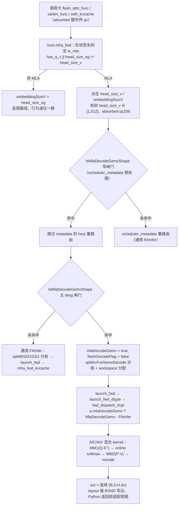
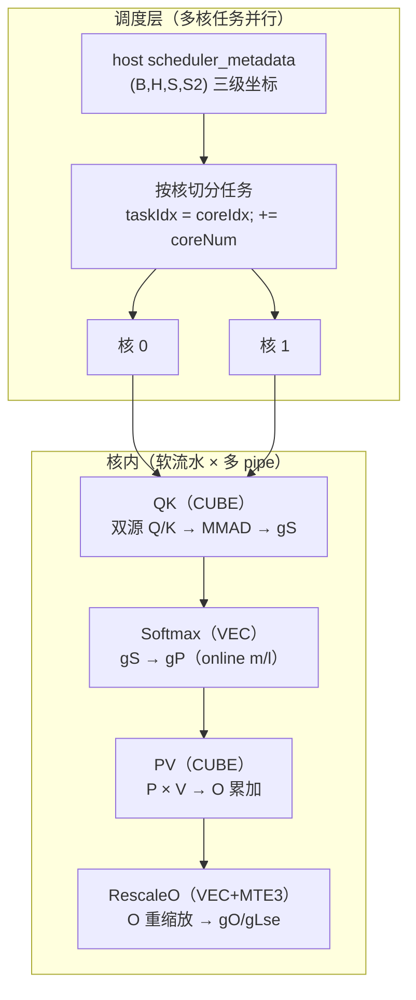
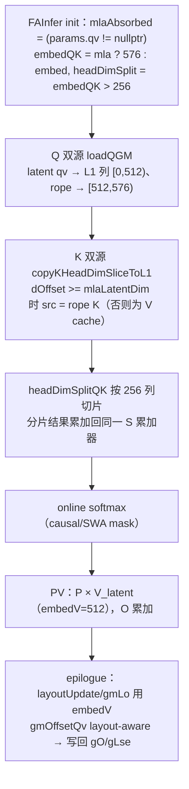

# FlashAttention NPU 算子 MLA（Multi-head Latent Attention）前向详细设计

> 覆盖范围：Ascend 910 两代后端的 MLA 前向完整特性，含两种形态（prefill / absorbed decode）、三种布局（TND / BSND / BNSD）与 decode GEMV 专用内核。
>
> | 后端目录 | 版本 | 平台 | 形态 |
> |---|---|---|---|
> | `csrc/ascend910/flash_attn_npu_3/` | v3（FA3） | Ascend 910 | prefill + absorbed decode（`flash_attn_with_kvcache`） |
> | `csrc/ascend910/flash_attn_npu_4/` | v4（FA4） | Ascend 910 | prefill + absorbed decode（`flash_attn_func` / `varlen_func` + phase 参数） |
>
> 对应提交：`bc1ae52 feat(mla): port absorbed MLA forward/decode to FA3/FA4 on Ascend 910`。
> 参考文档：[mla_design.md](./mla_design.md)（主体设计）、[mla_bnsd_design.md](./mla_bnsd_design.md)（BNSD 扩展）、[mla_decode_gemv_design.md](./mla_decode_gemv_design.md)（decode GEMV 内核）、[mla_l1_layout.md](./mla_l1_layout.md)（L1 布局）、[mla_pipeline.md](./mla_pipeline.md)（流水并发）、[daoailab_mla_analysis.md](./daoailab_mla_analysis.md)（对标分析）、[mla_test_cases.md](./mla_test_cases.md)（测试用例）。

## 1. 需求分析

### 1.1 需求背景

AR 链接与截图：内部需求，暂无 AR 单（待挂接）。

需求来源：MLA（Multi-head Latent Attention，DeepSeek 系）把 KV cache 压缩到低秩 latent 空间——`kv_lora_rank = 512`（latent），仅额外保留一份 `qk_rope_head_dim = 64` 的 RoPE 分量。标准 FlashAttention 的公开入口假定 Q/K 与 V 的 head 维相等（`q.last == v.last`），且不认 `qv` 张量，因此无法表达「吸收态 MLA」的 `Q_nope`（已吸收进 `W_uk` 的 512 宽 latent query）与 `Q_rope`（64 宽）二源结构；推理侧调用方只能自行把 MLA 拆成普通 FA 形状，无法直接受益于「V（latent cache）一物二用」与「latent 512 宽输出」的语义表达。

涉及的周边组件：

- `flash_attn_npu_3`（FA3）、`flash_attn_npu_4`（FA4）两份 Python 包与 C++ 扩展；
- `fa_metadata.aicpu`（AICPU scheduler metadata）：签名与内容不含 MLA 语义，MLA 复用既有单侧（见 2.2）；
- PTA / 图模式适配：**不需要额外适配**。本需求对外公开签名零新增 flag，MLA 由张量形状签名判定（`has_q_v` 或 `head_size_og != head_size_v`），上层 PTA（torch_npu）与图模式（`torch.compile`）调用路径不受影响；形状变化全部收敛在扩展内部。

### 1.2 功能分析

- **接口功能**：

  两代后端的公开入口支持 MLA 的两种形态，**仅前向**：

  | 形态 | 签名 | 计算 |
  |---|---|---|
  | prefill / unabsorbed（训练口径） | 不传 `qv`，`q.last == k.last == 192`，`v.last == 128` | 单段 QK（192 宽，`q_nope|q_rope` 已在末维拼好），PV 128 宽，支持 GQA |
  | decode / absorbed（推理口径） | 传 `qv`，`q.last == k.last == 64`，`qv.last == v.last == 512`，KV 头数 = 1 | 两段 score 累加进同一 S：`Q_nope·K_nopeᵀ ⊕ Q_rope·K_ropeᵀ`；PV 的 V 即 latent，输出 512 宽 |

  判定表达式（host 侧 `mha_fwd`，v3/v4 各一份 `flash_api.cpp`）：

  ```
  has_q_v    = q_v_.has_value()
  head_size_v = has_q_v ? q_v.size(-1) : v.size(-1)
  is_mla     = has_q_v || (head_size_og != head_size_v)
  ```

  即「传了 `qv`」或「q/k 头维与 v 头维不等」任一成立即进入 MLA。后者是 prefill 的判据，避免为训练口径新增参数；非 MLA 输入（`q.last == v.last` 且无 `qv`）不进入任何 MLA 分支，行为与改动前逐位一致。

  能力矩阵（`✓` 支持；`—` 该后端无此入口；`✗` 入口存在但 MLA 下拒绝）：

  | 平台 | 后端 | prefill | absorbed decode | BNSD | 稀疏 `gather_kv_indices` | 反向 |
  |---|---|---|---|---|---|---|
  | Ascend 910 | v3（FA3） | ✓ | ✓（`flash_attn_with_kvcache`） | ✓ | ✗ | ✗ |
  | Ascend 910 | v4（FA4） | ✓ | ✓（`flash_attn_func` / `flash_attn_varlen_func` + `page_table` / `seqused_k`） | ✓ | ✗ | ✗ |

  本需求为存量算子的功能扩展：收益是让推理侧 MLA 形状直接喂入、复用 FA 的 tiling / 分核 / online-softmax / FlashDecode 流水，并额外提供一条针对 canonical decode 形状的 GEMV 专用内核（见 2.6）。影响为零新增 tiling 字段、零新增编译模板轴，编译目标数不变。

- **计算公式**：

  两种形态统一为「QK → online softmax → PV」，本质是同一双线性形式的两条实现路径。

  **（1）latent 压缩 / 恢复骨架**：MLA 不存 per-head K/V，只存一份低秩 latent `c_kv`（`kv_lora_rank = d_c = 512`，所有 head 共享）加一份共享 rope 分量 `k_rope`（`qk_rope_head_dim = d_r = 64`）。记 nope head 维 `d_n = 128`、未吸收 V head 维 `d_v = 128`、上/下投影矩阵 `W_DKV, W_UK, W_UV, W_DQ, W_UQ, W_KR, W_QR`（忽略各 head 分组）：

  ```text
  c_kv   = h @ W_DKV                    # 1×d_c，低秩 latent（KV cache 只存它 + k_rope）
  K_nope = c_kv @ W_UK                  # d_c → 每头 d_n（上投影恢复无 rope 的 K）
  V      = c_kv @ W_UV                  # d_c → 每头 d_v（上投影恢复 V）
  Q_nope = (q @ W_DQ) @ W_UQ            # 压缩再上投影，每头 d_n
  Q_rope = RoPE(q @ W_QR),  k_rope = RoPE(h @ W_KR)    # 各 d_r，RoPE 作用于末维
  ```

  **（2）prefill / 未吸收（训练口径）**：把恢复出的 per-head K/V 显式展开再做标准 attention（`Dq = Dk = d_n + d_r = 128 + 64 = 192`，`Dv = d_v = 128`）：

  ```text
  S = Q·Kᵀ = Q_nope·K_nopeᵀ + Q_rope·k_ropeᵀ
    = Q_nope·W_UKᵀ·c_kvᵀ + Q_rope·k_ropeᵀ
  P = softmax(softmax_scale · S)
  O = P·V = P·c_kv·W_UVᵀ
  ```

  **（3）absorbed decode（推理口径）**：利用结合律把上投影矩阵「吸收」出注意力，使内核只与一份 `c_kv`（512 维）打交道（`Dq = Dk = 64`，`Dv = d_c = 512`）：

  - 吸收 `W_UK` 进 Query（score 侧）：

    ```text
    Qv = Q_nope @ W_UKᵀ
    S  = Qv·c_kvᵀ + Q_rope·k_ropeᵀ = [Qv | Q_rope]·[c_kv | k_rope]ᵀ
    ```

  - 吸收 `W_UV` 出 Output（value 侧，可折叠进 out_proj）：

    ```text
    P  = softmax(softmax_scale · S)
    O' = P·c_kv
    O  = O' @ W_UVᵀ
    ```

  这样 **`c_kv` 一物二用**：既是第二段 score 的 K（`Qv·c_kvᵀ`），又是 PV 的 V（`P·c_kv`）。本仓吸收态把 `W_UV` 的折叠交给调用方（kernel 只产出 `dv = 512` 的 `O'`）；prefill 态同理把 `W_UV` 展开保留在 V（128 宽）。

  **（4）两种口径的等价性**：代入结合律可知

  ```text
  O_prefill = softmax(scale · (Q_nope·W_UKᵀ·c_kvᵀ + Q_rope·k_ropeᵀ)) · c_kv·W_UVᵀ
            = O'_decode · W_UVᵀ
  ```

  即「decode 输出经 `W_UVᵀ` 投影 == prefill 输出」（训推一致性验收依据，见 4.2.1）。

  **（5）softmax_scale 口径**：两态不是同一个数，训推一致性必须显式传统一 scale：

  - prefill（覆盖完整拼接维 192）：`softmax_scale = 192^(-1/2)`；
  - absorbed decode（覆盖 64 + 512 = 576 全内积）：`softmax_scale = 576^(-1/2)`。

- **原型设计**：

  公开 Python 接口（两代一致，仅列出与本需求相关的增量参数；未列参数语义不变）：

  | 参数名 | 入参类型 | 默认值 | 基础类型 | 数据&格式类型 | 语义说明 |
  |---|---|---|---|---|---|
  | q | 必选输入 | 无 | Tensor | fp16/bf16：prefill rank-4 `[B,S,H,192]`；absorbed rank-4 `[B,S,H,64]`（rope） | query；BNSD 时以 `bnsd_q.transpose(1,2)` 视图传入 |
  | k / v | 必选输入（prefill）| 无 | Tensor | fp16/bf16：prefill `[B,S,H_k,192]` / `[B,S,H_k,128]`；absorbed 下由 cache 提供（v3 `k_cache`/`v_cache`、v4 `page_table`/`seqused_k`） | key/value；absorbed 下 k 为 rope cache `[B,S,1,64]`、v 为 latent cache `[B,S,1,512]` |
  | qv | 可选输入 | None | Tensor | fp16/bf16：仅 absorbed，rank-4 `[B,S,H,512]` | latent query（`Q_nope`），与 q 同 dtype、同 shape 前三维、**末维固定 512** |
  | out | 输出 | 无 | Tensor | 与 q 同 dtype | 连续张量，末维 = `dv`（prefill=128 / absorbed=512） |
  | lse | 输出 | 无 | Tensor | fp32 | 形状 `(B, H, S)` |

  **底层增量**（不对调用方透出，仅 host/kernel 内部）：

  | 参数名 | 入参类型 | 默认值 | 基础类型 | 语义说明 |
  |---|---|---|---|---|
  | qvDevice | 底层必选参数 | 无 | uint8_t* | absorbed 形态的 latent query 指针；prefill 为 `nullptr`，经 `FwdLaunchArgs.qvDevice` → `FAIKernelParams.qv` 透传 |
  | head_size_v | host 派生变量 | 无 | int64 | 输出/latent 宽度（prefill `v.size(-1)=128`，absorbed `q_v.size(-1)=512`），写入既有的 `embeddingSizeV` 字段 |

- **原型约束**：

  1. 非 MLA 判据：`q.last == v.last` 且无 `qv`，此时不进任何 MLA 分支，与改动前逐位一致；
  2. absorbed 形态：`head_size_og (=q.last) ≤ 256`、`head_size_v (=qv.last) ∈ [1,512]`、`q_v.size(-1) == v.size(-1)`、`q_v` 与 q 同 dtype 且**全连续**（kernel 按 packed stride 读 latent query）；
  3. 量化输入（`q_descale`/`k_descale`/`v_descale` 非空）在 MLA 下必须为 `None`，否则被既有 dtype 校验拒绝；
  4. `softmax_scale` 必须显式传：prefill 口径 `192^-0.5`、absorbed 口径 `576^-0.5`，两者不是同一个数（见 2.6）；
  5. 反向：MLA 输入执行 backward 抛 `NotImplementedError` / `ValueError`（仅前向）；
  6. 稀疏 `gather_kv_indices`（v4）：`flash_api.cpp` 直接 `TORCH_CHECK` 报错；
  7. BNSD 布局与 MLA 正交约束见 [mla_bnsd_design.md](./mla_bnsd_design.md) §5（`Hk==1` detected 由 q + qv 判定、`Sq==1` 不可区分等）。

### 1.3 对标实现分析

对标对象：Dao-AILab flash-attention（NVIDIA，仓库内同一套 MLA 数学模型，Hopper FA3 / Blackwell FA4 两代实现）。

| 对比项 | 竞品（NVIDIA flash-attention） | 本仓（Ascend 910 NPU 后端） |
|---|---|---|
| MLA 入口 | FA3：`flash_attn_with_kvcache(qv=)`；FA4：`flash_attn_func(qv=)` | v3：`flash_attn_with_kvcache(qv=)`；v4：`flash_attn_func` / `flash_attn_varlen_func` + `page_table`/`seqused_k`（对齐） |
| 形态判定 | 显式 `qv` 参数 | **无新增 flag**，形状签名判定（`has_q_v` 或 `head_size_og != head_size_v`），prefill 免新增参数 |
| Q 源 | `q` 可为 None（无 rope，仅 `qv`） | 必须提供 `q`（rope 分量），不支持 `q=None` |
| 稀疏 | FA4 支持 `gather_kv_indices`（末维 `%128==0`） | 明确拒绝（`TORCH_CHECK`） |
| 反向 | FA4 稀疏 MLA 有反向 | 仅前向，backward 抛异常 |
| FP8 量化 | FA4 单 CTA kernel 支持 + descale | 不支持，量化输入被 dtype 校验拒绝 |
| 计算语义 | 与竞品一致：`O = softmax(scale·(Q@Kᵀ + Qv@Vᵀ))@V` | 完全一致（同一双线性形式） |
| 内核形态 | 专用 CUTE/hopper kernel | 复用通用 FA 流水 + 针对 canonical decode 的 GEMV 专用内核（`mla_decode_gemv.hpp`） |

## 2. 特性实现方案

### 2.1 算子整体计算流程图

910 后端（v3/v4 同构，差异见 §2.2 与 [mla_design.md](./mla_design.md) §2.1）：



三层并发视图（调度层多核并行 → 核内软流水 → 双缓冲多 pipe；MLA 不引入新流水结构）：



### 2.2 aclnn设计

本仓为 PTA 扩展形态（pybind + torch custom op），无独立 aclnn 算子层；对应设计层为 **host C++ 底层入口 + custom op 签名**：

- **host 底层入口**：v3/v4 `flash_api.cpp::mha_fwd` 新增 metric 形状判定与校验，`embeddingSizeV` 由 `head_size_og` 改为 `head_size_v`；`fwd_args.qvDevice` 为唯一新增 fwd 入参（v3 经 `FWD_LAUNCH` 宏末位透传；v4 末位为 `sinkDevice, qvDevice`）。
- **custom op 签名**：`_flash_attn_forward(..., qv)`（Python 侧归一化后透传 detected 后的连续 `qv`）。
- **host 侧校验**（以 v3 为例，v4 对称）：
  - `head_size_v ∈ [1, 512]`；
  - absorbed 下 `head_size_og (=q.last) ≤ 256`；
  - `q_v.size(-1) == v.size(-1)`、`q_v` dtype == q dtype、`q_v` 全连续；
  - 稀疏 `gather_kv_indices`（v4）直接 `TORCH_CHECK` 拒绝。
- **-1/-2 场景适配**：本仓要求静态 shape 输入，不涉及 unknownShape（-1）/ unknownRank（-2）动态 shape 推导。
- **AICPU / AICore 场景区分**：前向计算全部在 AIC（AICore）执行；AICPU 仅承载 `fa_metadata.aicpu` 的 scheduler metadata。metadata 从 `metaArgs->embeddingSizeV` 读 `ctx.head_size_v`；但不等于「`fa_metadata.aicpu` 完全不动」——v3 的该文件在本次提交被改（+8−1）：新增 dense MLA → FlashDecode 判定 `denseMlaFd`，并把 `fdFlag` 从 `(pagedKV && isVarlen)` 扩为 `((pagedKV && isVarlen) || denseMlaFd)`（`numHeadsK==1 && embeddingSizeV==512 && embeddingSize+embeddingSizeV==576 ...`）。v4 的 `fa_metadata.aicpu` 在本次提交未变。
- **dispatch 模板轴**：`dtype × layout × paged × mask × softcap × flashDecode` **不新增 MLA 维**（head dim 是 runtime 轴）；`autogen/generate_kernels.py` 与 `setup.py` 无需改动，编译目标数不变。

### 2.3 Infershape设计

输出推导（静态 shape，host 侧完成）：

- **out**：
  - 非 MLA：`empty_like(q)`；
  - MLA BNSD：统一分配连续 `(B, S, H, dv)`；
  - MLA 非 BNSD：复制 q 的 shape 后把末维替换为 `head_size_v`（BSND `(B,S,H,dv)`、TND `(total,H,dv)`）；
  - **分支顺序**：BNSD 分支必须排在 MLA 分支之前——MLA BNSD 的 `q.sizes()` 是 `(B,H,S,dq)`，先走 MLA 分支会把输出错当 `(B,H,S,dv)` 而静默错形状（见 [mla_bnsd_design.md](./mla_bnsd_design.md) §4.2.2）。
- **out dtype** 与 q 一致（fp16/bf16）。
- **LSE 形状**：`(B, H, S)`（带 `qv` 时 `(..., s, h)`，v3/v4 相同）；kernel 侧物理排布恒为 `(B, H, maxQSeqlen)`。
- **v4 fake op**：`_flash_attn_forward_fake` 的输出 shape 改为 `list(q.shape)` 后末维置 `v.shape[-1]`（原 `empty_like(q)` 在 MLA 下形状错误）。

### 2.4 Tiling设计

- **tiling 字段增量**：`embeddingSize`（QK 宽度）与 `embeddingSizeV`（输出/PV 宽度）本就是独立的 runtime 字段，此前 host 侧恒把 `embeddingSizeV` 写成 `embeddingSize`；MLA 把它改成真实值 `head_size_v`（v3 `flash_api.cpp: set_embeddingSizeV(head_size_v)`）。absorbed 的 576 宽 QK 由 kernel 用 `embedQK = mlaAbsorbed ? (embed+embedV) : embed` 现场派生；latent query 指针 `qv` 走 kernel 启动参数 `FAIKernelParams.qv`，不占 tiling 位。**但「tiling 结构体零改动」已不成立**——GEMV 分核在 v3 `FAInferTilingData` / v4 `FAInferRuntimeData` 里新增了 `firstBatchTaskNum`、`totalTaskNum`、`nsplitPerBatch`、`numSplits`（补在 padding 槽位），用于下沉分核规则标量、供 kernel 就地重算 task 表。注：`mla_fa3_port_design.md` 曾写「新增 `static_assert(sizeof(FAInferTilingData)==2376)`」，实际 v3 `tilingdata.h` **无此断言**，ABI 尺寸靠占用 padding 槽位隐式维持。
- **形状驱动选路（GEMV 专用）**：`IsMlaDecodeGemvShape(hasQv, numHeads, numHeadsK, headSizeOg, headSizeV, pagedKv, isLocal, isCausal, seqlenQ)` 是 decode GEMV 的**唯一判据**：

  | 条件 | 含义 |
  |---|---|
  | `hasQv` | 吸收了形态必须有 `qv` |
  | `numHeads <= 32` | head 数**上界**：分核与持久区按 `qHeads = 32` 几何验证（每子核 16 行），超出即回落通用 FAInfer |
  | `numHeadsK == 1` | MLA latent cache 只有 1 个 KV 头 |
  | `headSizeV == 512` | absorbed `Dv` |
  | `headSizeOg + headSizeV == 576` | `64(rope) + 512(latent)`，rope-split 已拆开 |
  | `!pagedKv && !isLocal && !isCausal` | 分页 / 窗口 / causal 仍留通用路径 |
  | `seqlenQ == 1` | decode 单查询行 |

  闸门 v3 在早闸门（`scheduler_metadata` 预处理）与主 tiling 两处调用，v4 仅在早闸门调用、主 tiling 复用其布尔结果；闸门判定**不含 KV 长度**（早期版本里的 `kvLen` 入参已移除），两处只需同一组 shape 参数即可天然保持一致。
- **分核策略**：
  - 通用 FAInfer MLA：复用 `fa_split.h::splitBN2S1GS2`（batch × kvHeads × Q-N-block × Q-S-tile），MLA 与普通 FA 共用同一套 `coreInfo` / `splitInfo` 与 FlashDecode 归约规划，只把 `splitCtx.head_size_v` 改写为输出宽度、`wsSplit` 按 `partialRowsUpper * (head_size_v + 1) * sizeof(float)` 分配。
  - GEMV 专用：`splitKvForGemvDecode` 只做「统计 `totalTaskNum` + 下沉 `nsplitPerBatch`，`anySplit` 时回填 `splitInfo`」，**不再写固定 25 项的 `coreInfo`**（大 batch 装不下，见 [mla_fa3_port_design.md](./mla_fa3_port_design.md) P0/G2）；task 由 kernel 按同一规则就地重算 `(b, s, [segStart, segEnd))`，每核认领连续 `[taskStart, taskEnd)`（`perCore = ceil(totalTaskNum/blockDim)`），即**一核多 task**。每 batch 的 split 预算 `nsplitPerBatch`（`num_splits > 1` 显式优先，否则 `ceil(maxSegCount / 4)`，`SEG_TARGET = 4`），上限 `maxSplitsPerBatch = blockDim / batchWithWork`；所需核数 `needCoreNum = FaMin(totalTaskNum, ctx.blockDim)`（**无 `MAX_NODE_NUM=25` 截断**）。
- **workspace 账本**（GEMV）`WORKSPACE_BLOCK_SIZE_DB = 128×512 = 64KB`、`PRELANCH_NUM = 3`（= kernel 侧 `STACK_SLOTS`）：

  | 区 | 大小（host 侧） | kernel 侧用途 |
  |---|---|---|
  | `mm1OutSize` | `blockDim × 64KB × 4 × 3` | S 区（GM），槽 `seg % 3` |
  | `smOnlineOutSize` | `blockDim × 64KB × 2 × 3` | P 区（GM），槽 `seg % 3` |
  | `mm2OutSize` | `blockDim × 64KB × 4 × 3` | OTmp 区（GM），槽 `seg % 3` |
  | `UpdateSize` | `blockDim × 64KB × 4 × 3` | 预留给旧 rescale 的 gUpdate；持久 rescale 不再读写 |
  | `splitLseTotalSize` | `Σ actualSplits × qHeads × 4B` | partial LSE（fp32），初始化 `-inf` |
  | `splitOTotalSize` | `Σ actualSplits × qHeads × Dv × 4B` | partial O（fp32），初始化 `0` |

  partial 区 v3 从 `partialBase = mm1 + smOnline + mm2 + Update`（尾部）开始，v4 在偏移 0（与通用 FAInfer 相同）。direct（每 batch 单 split）收尾直接写最终 O/LSE，fd（任一 batch 多 split）收尾走 `SyncAll` + `CombineScale` 归约。

### 2.5 片上内存资源设计

片上资源分配与普通 FA **结构一致**，MLA 不新增 L1 结构，仅激活「K/V 按列切片的 split 路径」：

- **通用 FAInfer MLA absorbed（`embed=576 > 256` → split 分支）L1 布局**（`L1_MAX_SIZE = 512KB`）：

  ```
  L1 地址从低到高：
  ┌────────────────┬────────────┬────────────┬───────────┬──────────────┬─────────┐
  │ Q (128×576)    │ K0(128×256)│ K1(128×256)│ P 区 ×2   │ V 区 ×2      │ ndCopy  │
  │ A 侧·全宽常驻   │ B 侧·K 按列│ B 侧 ping- │ (pL1Rows× │ (256×128)    │ 预留    │
  │ 576 = 512+64   │ 片 0       │ 片 1 pong  │ 256)×2   │ ×2          │         │
  └────────────────┴────────────┴────────────┴───────────┴──────────────┴─────────┘
   L1_QK_SIZE=147456   qkKPool=131072    kPVPool   vPool=131072
  ```

  关键参数：`qL1DynNum = RoundUp(576,16) = 576`（Q 全宽常驻 L1）、`kDynNum = 256`（K 按列切 256，576 = 2×256+64 三片）、`vL1Stages/vSegLen/vSliceWidth = 2/256/128`（V=512 再切 4 片 128 宽）。非 MLA（`embed ≤ 256`）仍走全宽单块路径。

  **总占用**：Q 区 `L1_QK_SIZE = 147456B`（144KB）+ K 双缓冲 `qkKPoolSize = 131072B`（128KB）+ P 区 `kPVPoolSize`（`pL1Rows × kPVDynNum × 2B × pL1Stages`）+ V 双缓冲 `vPoolSize = 131072B`（128KB）+ ndCopy 预留，累计由 `SetBufferRange` 预算并约束 `≤ L1_MAX_SIZE = 512KB`。已明确三项 Q+K+V = 400KB，P 区与 ndCopy 在剩余 112KB 内排布。

- **GEMV 专用 kernel L1（每 AIC，512KB）**：记 `qDynNum = RoundUp(embedQK,16) = 576`、`qRows = BlockMmadQK::L1TileShape::M = 128`（**固定 128 行，不是 qHeads**）。Q 行区与 H 解耦——H 以 `kMlaDecodeGemvHeadBlock = 32` 头为块滚动，逐块复用同一块 128 行 Q 区，故 L1 占用与 H 无关：

  | 字节区间 | 内容 | 大小 |
  |---|---|---|
  | `[0, 144K)` | Q：`qv` latent(512) + rope(64) 同块 576 列，固定 128 行 | `128×576×2B = 147456B`（144KB，恒定） |
  | `[144K, 144K+64K)` | K ring slot 0 / P staging slot 0（共享） | `128×256×2B` = 64KB |
  | `[144K+64K, 144K+128K)` | K ring slot 1 / P staging slot 1（共享） | 64KB |
  | `[144K+128K, 144K+192K)` | V ring slot 0 | `256×128×2B` = 64KB |
  | `[144K+192K, 144K+256K)` | V ring slot 1 | 64KB |
  | `≥ 144K+256K` | append-KV nd2nz staging（decode 不触碰） | `ndCopyL1Offset` 在其后 |

  **K 与 P 共用同一段 L1**：`blockMmadQK` 与 `blockMmadPV` 经 `SetPingPongState(&pingPongState)` 共享同一 `PingPongState`，K 双槽与 P 双槽物理复用（同一时段只被其一占用），省一份 128KB。

  **总占用**：Q 144KB + K/P ring 128KB + V ring 128KB ≈ **400KB，与 H 无关**（占 512KB 的 78%）。旧版按 `qHeads` 预留的 `576H + 256KB` 与「`H ≤ 227` 越界」已废弃：head 分块（`kMlaDecodeGemvHeadBlock=32`）后 H 不再有上界（已验证到 512）。

- **GEMV UB（每 AIV，192KB）**（`MlaDecodePersistRescale`，单位 16KB）：

  | 字节偏移 | 区 | 大小 / 说明 |
  |---|---|---|
  | `4×16K` | `lo` 双缓冲 slot 0 | `16×512×4B` = 32KB（上一段 OTmp） |
  | `6×16K` | `lo` 双缓冲 slot 1 | 32KB |
  | `8×16K` | `goPersist`（fp32 O 累加器） | 32KB，**跨段持久** |
  | `8×16K` | `GO16`（fp16/bf16 输出 staging） | 与 `goPersist` 同址原地 cast |
  | `10×16K` | `tv` + `gm/gl/dm` 状态 | online-softmax 写入，rescale 复用 |
  | `11×16K−2304` | `lseStaging` | `64×9×4B` = 2304B |
  | 上限 `12×16K` | — | `static_assert` 保证不越 192KB |

  **总占用**（与 H 无关，固定）：`lo` 双缓冲 32KB×2 + `goPersist` 32KB + `tv/gm/gl/dm` 状态（`tv` BRCB 约 9KB）+ `lseStaging` 2304B ≈ 107KB；`GO16` 与 `goPersist` 同址原地 cast 不另算。上界由 `static_assert` 收敛在 `12×16KB = 192KB`（UB 全量）。

  - `go` 全程驻留 UB：段内 `go = go × exp(m_old − m_new) + OTmp` 原地累加，不读写 `gUpdate`；只有末段做一次 cast 写回 `gO`，**消掉每段 2×64KB 的 GM 往返**，这是 GEMV 内核较通用 FAInfer 的主要收益来源。

**片上占用一览**：

| 片上结构 | 总占用 | 上限 | 说明 |
|---|---|---|---|
| 通用 FAInfer MLA absorbed L1 | Q 144KB + K 128KB + V 128KB = 400KB（P 区 + ndCopy 另计） | 512KB = `L1_MAX_SIZE` | `SetBufferRange` 预算 |
| GEMV 专用 L1（每 AIC） | Q 144KB + K/P 128KB + V 128KB ≈ 400KB（恒定，与 H 无关） | 512KB = `L1_MAX_SIZE` | Q 固定 128 行 + head 分块 32 + K/P/V ring |
| GEMV UB（每 AIV） | ≈107KB | 192KB（`static_assert`） | `lo`×2 + `goPersist` + 状态 + `lse` |

**并行计算相互掩盖流水**：片上双缓冲 / 环槽正是为「CUBE 与 VEC 跨拍重叠」服务。核内软流水时间轴（`PRE_LAUNCH = 2`，QK 与 PV 错拍、CUBE 与 VEC 并行）：

```mermaid
gantt
    title 核内软流水时间轴（CUBE ∥ VEC 相互掩盖）
    dateFormat X
    axisFormat %L
    section QK(CUBE·MMAD)
    KV0 : 0, 10
    KV1 : 10, 10
    KV2 : 20, 10
    KV3 : 30, 10
    section Softmax(VEC)
    KV0 : 4, 8
    KV1 : 14, 8
    KV2 : 24, 8
    KV3 : 34, 8
    section PV(CUBE·MMAD)
    KV0 : 12, 10
    KV1 : 22, 10
    KV2 : 32, 10
    KV3 : 42, 10
    section RescaleO(VEC+MTE3)
    KV0 : 22, 4
    KV1 : 32, 4
    KV2 : 42, 4
```



- CUBE 的 QK/PV 背靠背发射、VEC 的 softmax/rescale 交错其间：`softmax(seg)` 只等 `qkReady(seg)`，`PV` 只等 `softmaxReady(seg)`，均不阻塞下一拍 QK，故搬运 / 矩阵乘 / softmax 的时延相互被掩盖；
- GEMV 专用内核同样按「AIC=cube ∥ AIV=vector」跨段重叠：`MM1(seg+1) → MM2(seg) → softmax(seg+1) → rescale(seg)` 四拍，`qkReady/softmaxReady/pvReady` 三个跨核旗标按段循环复用（详见 2.6）。

### 2.6 kernel方案

kernel 分两条路径，均由 runtime 标志 `a.mlaDecodeGemv` 在 `fwd_dispatch_impl.hpp` 分发，绝不相交。

**通用 FAInfer MLA 分支**（`mha_fwd_kvcache.cpp` + `qk_matmul.hpp`）：



关键实现点（易错处）：

1. **`headDimSplit` 必须改用 `embedQK`（=576）而非 `embed`（=64）**：否则 absorbed 的 576 宽 QK 不会切片、装不进 L1A。
2. **Q/K 双源拼装**：latent 走主操作数，rope 走副源（`SetMlaRopeQ`/`SetMlaRopeK`），两段各自 stride 搬运，在 L1 里按列首尾相接成一块 576；两段宽度（512/64）均为 C0（16 元素）整数倍，分段 ND2NZ 与整块搬运结果逐位相同。
3. **两段 score 共用累加器**：absorbed 的 QK 是**一次 576 宽 matmul**（不是两次 matmul 相加），`headDimSplitQK` 按 256 切片依次累加进同一个 S 累加器，online softmax 看到的是一份完整 score。
4. **K 源在 absorbed 下是 V cache**：`layoutB`、`strideKV`（`strideV`）、`pageStride`（`valuePageStride`）三者必须一起切到 PV 口径，只改其一会分页读错页。
5. **输出侧几何用 `embedV`**：`LayoutUpdate` 的 `embed→embedV`、`LayoutLse layoutgmLo` 的 `embed*qNBlockSize→embedV*qNBlockSize`、新增 `strideQv`/`qvHeadStride`（BNSD：`embedV`/`maxQSeqlen*embedV`）。prefill 形态（192/128）恰好暴露这些旧 `embed` 假设，故对 prefill 也必需。
6. **`gmOffsetQv` layout-aware**（`mla_bnsd_design.md` §4.3）：BNSD 下 batch 基址是 `BIdx * qHeads * qvHeadStride`，BSND/TND 下是 `prevQSeqlenSum * strideQv`；漏掉此分支会使 `B>1` 的 absorbed BNSD 读错 batch 基址。

**GEMV 专用 kernel**（`mla_decode_gemv.hpp`，AIC+AIV 混合模板）：

数值路径：`MM1(S = Q·Kᵀ) → online softmax → MM2(OTmp = P·V) → 持久 rescale → (fdMode ? CombineScale : 直写)`，`Dv=512` 按 128 分 4 段；段间四拍软流水（`STACK_SLOTS = 3`，`slot = seg % 3`），prologue 发 `MM1(0)+softmax(0)`，稳态按 `MM1(seg+1)→MM2(seg)→softmax(seg+1)→rescale(seg)` 发令，cube 背靠背、vector 重叠，跨核旗标 `qkReady`/`softmaxReady`/`pvReady` 按段复用。

精度转换策略：MLA 与普通 FA 走完全相同的计算与精度路径（同一份 matmul/online-softmax/rescale 代码，仅操作数来源与片宽不同）；输入 fp16/bf16、累加 fp32，验收口径 `rel L2 < 5e-3`（bf16）。无额外精度处理。

训推一致性口径：prefill `q=[q_nope(128)|q_rope(64)]`、`v=latent @ W_uv^T`（128）；decode `qv=q_nope @ W_uk`（512）、`q=q_rope`（64）、`v=latent`（512），二者是同一双线性形式，故 `out_prefill ≈ out_decode @ W_uv^T`。**scale 必须显式传统一**：prefill `192^-0.5`，absorbed decode 覆盖完整 576 宽内积、口径 `576^-0.5`。

## 3. 其他算子交付件

| 状态 | 交付件名称 | 完成状态 | 备注 |
|---|---|---|---|
| [✓] | README.md | 已完成 | 仓库根 README 随需求维护 |
| [✓] | Example | 已完成 | 以 `tests/*mla*.py` 作为 Python 调用示例；C++ Aclnn Example 不涉及（非 aclnn 独立算子形态） |
| [—] | ACLNN 文档 | 不涉及 | 本仓为 PTA 扩展形态，接口说明由 `flash_attn_npu_interface*.py` docstring 承担 |
| [✓] | UT | 已完成 | `tests/test_flash_attn_npu_v3_mla.py` / `_v4_mla.py` / `_mla_consistency.py` 共 30+ 用例，端到端精度 + 训推一致 + 拒绝路径覆盖 |
| [—] | DT | 不涉及 | ATK 看护由 pytest 套件承担（两代主回归 + MLA 专项），性能由 `tests/perf/bench_mla_vs_fia.py` 独立脚本承担 |

## 4. 测试设计（开发&&测试）

### 4.1 测试标杆

精度对比标杆（CPU 参考实现，供用例直接调用）：

- prefill：`scores = scale · q @ kᵀ`，`out = softmax(scores) @ v`（支持 causal 与 GQA）；FP32 手写；
- decode：`scores = scale · (qv @ v_latentᵀ + q_rope @ k_ropeᵀ)`，`out = softmax(scores) @ v_latent`；
- 训推一致性另配 FP64 CPU golden 分别交叉验证两条路；
- 断言容差：相对 L2 `< 5e-3`（bf16，`-p no:randomly`，已知顺序相关抖动）。

### 4.2 测试用例设计

#### 4.2.1 白盒用例

V3（`tests/test_flash_attn_npu_v3_mla.py`，11 用例）与 V4（`_v4_mla.py`，10 用例）、一致性（`_mla_consistency.py`，16 用例双后端参数化）：

| 验证场景 | 验证用例 | 覆盖场景 |
|---|---|---|
| 功能 | `test_mla_prefill_bsnd_func`（v3/v4） | 用户 prefill 场景（198×198，192/128，causal） |
| 功能 | `test_mla_prefill_bsnd_func_default_scale` | 缺省 scale = `192^-0.5` |
| 功能 | `test_mla_prefill_tnd_varlen` | TND varlen + causal |
| 功能 | `test_mla_prefill_gqa` | GQA + Dq≠Dv |
| 功能 | `test_mla_decode_bsnd_no_paged` | 非分页 absorbed decode |
| 功能 | `test_mla_decode_bsnd_default_scale` | 缺省 scale = `576^-0.5` |
| 功能 | `test_mla_decode_bsnd_paged` / `test_mla_decode_paged_varlen` | 分页 decode（v3 kvcache / v4 varlen） |
| 拦截 | `test_mla_decode_rejects_append_kv` | append-KV + qv 拒绝 |
| 功能 | `test_mla_prefill_bnsd` / `test_mla_prefill_bnsd_gqa` / `test_mla_decode_bnsd_cross_batch` | BNSD prefill / GQA / absorbed 跨 batch（钉 `gmOffsetQv`） |
| 一致性 | `test_mla_prefill_decode_consistency` | decode 输出经 `W_uv^T` 投影 == prefill |
| 一致性 | `test_mla_{prefill,decode}_matches_fp64_golden` | FP64 golden 交叉验证 |
| 对齐 | `test_mla_{prefill,decode}_default_scale_is_{192,576}` | 缺省 scale 口径 |
| 拦截 | `test_mla_backward_unsupported` / `test_mla_rejects_gather_kv_indices` / `test_mla_rejects_invalid_layout` | 反向 / 稀疏 / 非法 layout 拒绝 |
| 布局 | `test_mla_accepts_bnsd` | BNSD 与同值 BSND 结果一致（布局寻址等价） |

实测精度（v3/v4 相同）：prefill-vs-golden `2.283e-3`、decode-vs-golden `2.184e-3`、prefill-vs-decode（经 `W_uv^T` 投影）`4.115e-3`，均 `< 5e-3`。

回归看护（非 MLA 零回归）：`tests/test_flash_attn_npu_v3.py` 589 passed、`tests/test_flash_attn_npu_v4.py` 412 passed，0 failed。

#### 4.2.2 性能用例

性能脚本 `tests/perf/bench_mla_vs_fia.py`（同进程交错测量，`WARMUP=10`/`ROUNDS=50` 取中位数；场景来自 `tests/perf/mla_user_scenarios.py`）：

| 验证项 | 场景 | 基准口径 | 结果 |
|---|---|---|---|
| MLA / 非 MLA 不劣化（正式门槛） | prefill 198×198（H32,192/128）与 decode 1×1025（H32,KV1,576） | `mla/nomla ≤ 1.05` | 通过，最差 `1.005×` |
| 候选 GEMV / FIA（同布局 kernel 时长） | decode kv=1025、prefill 198，BSND/TND 各入口 | `candidate/FIA ≤ 1.05` | 通过，decode `0.902~0.946`、prefill `0.940` 量级 |
| 对 FIA 整体时延（参考） | 同形状非 MLA 亦存在 | 仅记录 | `1.45×~2.7×`，属 FA 既有 host metadata/launch 架构差异（见 §5） |

## 5. 遗留问题

1. **MLA 反向未实现**：两后端 backward 对 MLA 抛异常（仅前向需求）；后续如需反向需单独立项（必要时对齐 FA4 稀疏反向口径）。
2. **稀疏 `gather_kv_indices` 不支持**：v4 直接 `TORCH_CHECK` 拒绝；量化（descale）、FP8 输入同样不支持（被既有 dtype 校验拒绝）。
3. **`q = None`（无 rope 分量）不支持**：本仓要求 `q`（rope）必须提供，未实现竞品 FA4 的「仅 `qv`」形态。
4. **`head_size_v` 对齐未全覆盖**：当前只验证 latent 512（`head_size_og=64`），768 / 非 64 对齐的 latent 宽度未覆盖，后续需补对齐用例。
5. **对 FIA 的时延差距**（`1.45×~2.7×`）属本仓 FA 既有架构差异（host `get_scheduler_metadata` + launch 开销），非 MLA 引入；缩小差距应作为独立课题处理 FA 的 host 开销（非 MLA 路径同样受益）。
6. **G1「QP 4 槽 + KV 3 槽环形」优化未落地**：[mla_decode_gemv_l1_pipeline_plan.md](./mla_decode_gemv_l1_pipeline_plan.md) 提出的「Q 分块 + QP 4 槽复用 + KV 3 槽环形」进一步压 L1 占用的方案当前**纯设计、未实现**。需与已落地能力区分——大 H 的 L1 越界已通过「Q 行区固定 128 行 + head 分块滚动（`kMlaDecodeGemvHeadBlock=32`）」解除（H 已验证到 512），G2（大 B 调度：去 `MAX_NODE_NUM` 截断 + kernel 就地重算 task）也已实现；该 plan 文档把 G1/G2 都标为「纯设计未实现」已过时（G2 实为已实现）。
7. **AR 单待挂接**（需求来源为内部需求，见 1.1）。