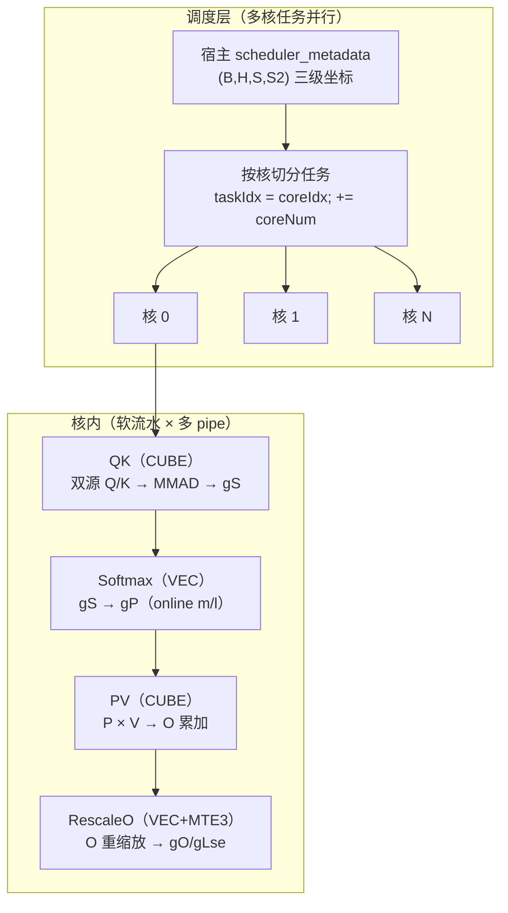
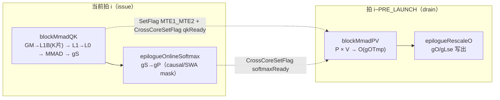
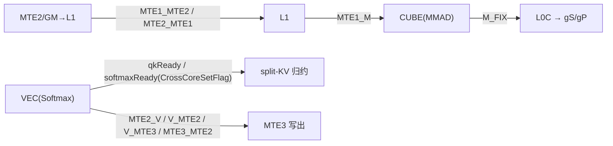
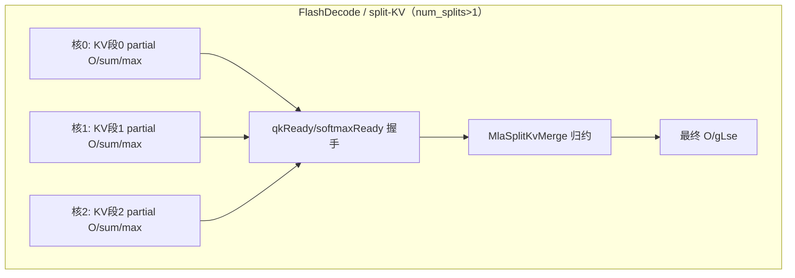

# MLA 性能排布与流水并发

> 设备：Ascend 910（Atlas A2）。代码路径：`csrc/ascend910/flash_attn_npu_3/`（v4 对称）。
> 相关文档：[mla_l1_layout.md](./mla_l1_layout.md)（L1 布局）、[mla_design.md](./mla_design.md)（主体设计）。

MLA 的性能排布分三层：**多核任务并行**（调度层）→ **核内软流水**（QK→Softmax→PV 错拍流水）→ **双缓冲 + 多 pipe 并行**。MLA 没有引入新结构，QK 阶段的双源（latent+rope）搬运与 576 宽列切片是仅有的差异。

## 1. 三层并发总览

## 2. 核内软流水（KV 段循环 + PRE_LAUNCH 错拍）

主循环 `runMainLoop`（`mha_fwd_kvcache.cpp` L961-1130）：

环形槽 `descriptors[issuedStackCount % STACK_SLOTS]` 传递每拍的 K/V 源、页表、cache 写回、taskStateSlot、first/last 标记；`issuedStackCount >= PRE_LAUNCH` 后才 drain，实现 QK+Softmax（当前拍）与 PV（前 PRE_LAUNCH 拍）重叠。

时间轴示意（PRE_LAUNCH=2）：

```mermaid
gantt
    title 核内流水时间轴
    dateFormat X
    axisFormat %L
    section QK(CUBE)
    KV0: 0, 10
    KV1: 10, 10
    KV2: 20, 10
    KV3: 30, 10
    section Softmax(VEC)
    KV0: 4, 8
    KV1: 14, 8
    KV2: 24, 8
    KV3: 34, 8
    section PV(CUBE)
    KV0: 12, 10
    KV1: 22, 10
    KV2: 32, 10
    KV3: 42, 10
    section RescaleO(MTE3)
    KV0: 22, 4
    KV1: 32, 4
    KV2: 42, 4
```

CUBE（QK/PV）与 VEC（Softmax）在不同 pipe 上并行；PV 只等 softmaxReady，不阻塞下一拍 QK。

## 3. 双缓冲（隐藏搬运延迟）

| 缓冲 | 机制 | 位置 |
| --- | --- | --- |
| L1B K 片 | `DOUBLE_BUFFER` 深 ping-pong，DMA 预取下一片时 MMAD 消费当前片 | `mha_fwd_kvcache.cpp` L319-321 |
| L1B V 片 | `vL1Stages=2` 同理 | L324 |
| L0A / L0B / L0C | `l0ABPingPongFlag` / `l0CPingPongFlag` 双份，搬运与 MMAD 错拍 | `qk_matmul.hpp` L388-398 |
| P / O 中间量 | workspace 按 `STACK_SLOTS × WORKSPACE_BLOCK_SIZE_DB` 分槽 + `softmaxPingPongFlag` | `mha_fwd_kvcache.cpp` L989-990 |

## 4. pipe 间 / 核间事件同步

- `MTE1_MTE2 / MTE2_MTE1`：GM↔L1 搬运互斥（`qk_matmul.hpp` L172-188）
- `MTE1_M / M_FIX`：L1→L0 完成、mmad 可读（L388-398、L546-557）
- `qkReady / softmaxReady`：split-KV 跨核握手，保证 O/sum/max 合并顺序（`mha_fwd_kvcache.cpp` L1018、L1070）
- `MTE2_V / V_MTE2 / V_MTE3 / MTE3_MTE2`：O 重缩放与写出（`rescale_o.hpp` L334-392）

## 5. 多核并发与 split-KV

- 每核独立 `runMainLoop`，任务按 BN2 / S1G / S2 三级坐标切分（L437、L520 的 `+= coreNum` 分法）；
- FlashDecode 把同一 (B,H,qBlock) 的 KV 切多段分核，partial O/sum/max 靠跨核握手 + `epilogueRescaleO` 合并；
- MLA：`num_splits>1` → 带独立 `MlaSplitKvMerge` 的 grouped kernel；`num_splits==1` → direct 路径 + `SplitWithoutFlashDecode` 关 FD。

## 6. MLA 与普通 FA 的流水差异

| 项 | 普通 FA | MLA |
| --- | --- | --- |
| 流水骨架 | 相同 | 相同（无新 pipeline） |
| Q 源 | 单张量整块搬 | 双源：latent(512)+rope(64) 分两段进同一 L1A |
| K 源 | K 单张量 | latent 半用 v_cache（`gQKSrcLatent = gV[gmOffsetV]`，L998），rope 半走 `SetMlaRopeK` |
| K 片宽 | 全宽（≤256） | 576 切 256/256/64 三片（split 分支） |
| 页表 stride | keyPageStride | QK 用 valuePageStride（latent 即 v_cache，L357） |

一句话：**并发 = 多核切任务 × 核内 QK→Softmax→PV 软流水（错 PRE_LAUNCH 拍）× L0/L1/workspace 双缓冲 × CUBE/VEC/MTE 三 pipe 并行**；MLA 只在 QK 的操作数来源与片宽上与 FA 不同。

## 7. 关键代码位置

| 内容 | 位置 |
| --- | --- |
| 主流水循环 | `mha_fwd_kvcache.cpp` `runMainLoop`（L633 起，主循环 L961-1130） |
| QK issue（双源） | `mha_fwd_kvcache.cpp` L916-1014 |
| Softmax issue | L1020-1070 |
| PV drain | L1073-1130 |
| L1 预算 / init | L319-376 |
| L0/L1 ping-pong + 事件 | `qk_matmul.hpp` L388-398、L546-557 |
| O 重缩放事件 | `rescale_o.hpp` L334-392 |
