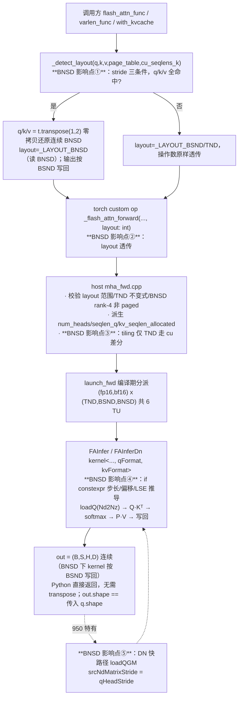
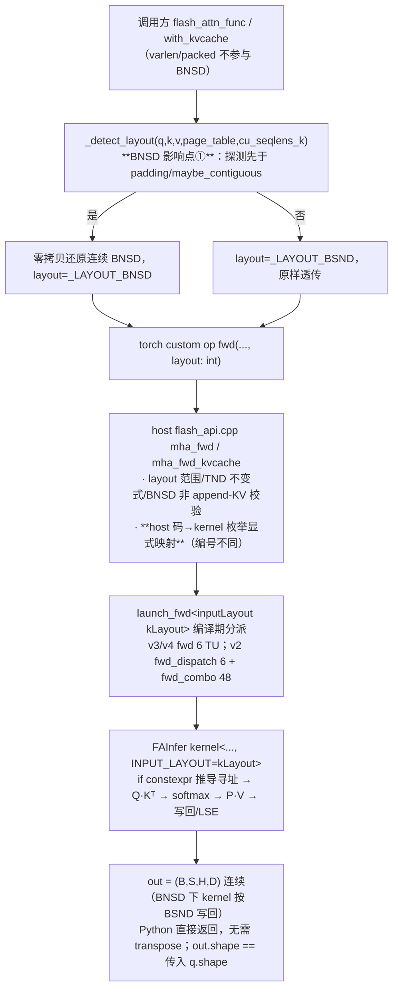
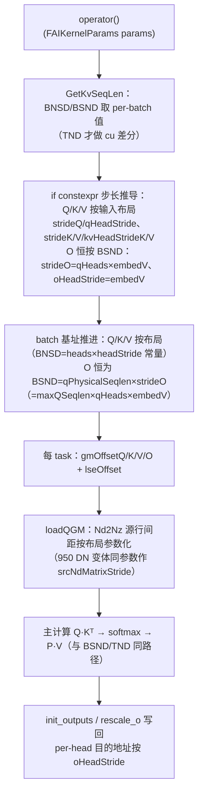

# FlashAttention NPU 算子 QKV 支持 BNSD 布局（仅前向）详细设计

> 覆盖范围：两代芯片共 5 个后端
>
> | 代际 | 后端目录 | 版本 | 平台 |
> |---|---|---|---|
> | Ascend 950 | `csrc/ascend950/flash_attn_npu_3/` | v3 | Ascend 950 |
> | Ascend 950 | `csrc/ascend950/flash_attn_npu_4/` | v4 | Ascend 950 |
> | Ascend 910 | `csrc/ascend910/flash_attn_npu/` | v2 | Ascend 910 |
> | Ascend 910 | `csrc/ascend910/flash_attn_npu_3/` | v3 | Ascend 910 |
> | Ascend 910 | `csrc/ascend910/flash_attn_npu_4/` | v4 | Ascend 910 |
>
> 对应提交：`9773e0f feat: support BNSD (B,H,S,D) QKV layout in the Ascend 910/950 backends' forward`（950 先行提交 `a514357`，910 移植提交 `0309443`）。
> 参考文档：[docs/enable-qkv-bnsd/spec.md](enable-qkv-bnsd/spec.md)、[implementation.md](enable-qkv-bnsd/implementation.md)、[checklist.md](enable-qkv-bnsd/checklist.md)。

## 1. 需求分析

### 1.1 需求背景

AR 链接与截图：内部需求，暂无 AR 单（待挂接）。

需求来源：推理侧场景中，Q 与 KV cache 常以 BNSD（`(B, H, S, D)`，per-head plane）形式存放。两代后端
（950 v3/v4、910 v2/v3/v4）的 `flash_attn_func` / `flash_attn_varlen_func` / `flash_attn_with_kvcache`
此前只接受 BSND（`(B, S, H, D)`）与 TND（varlen packed）布局，调用方需要 `q.transpose(1, 2)`
（910 还须再 `.contiguous()`）转成 BSND 形状再喂入，长序列 / 长 cache 下产生明显额外拷贝与显存开销，
且「输入到底是 BSND 还是 BNSD 转置视图」这一语义在接口上不可表达。

涉及的周边组件：

- `flash_attn_npu`（910 v2）、`flash_attn_npu_3`（910 v3）、`flash_attn_npu_4`（910 v4）三份 Python 包与 C++ 扩展；
- `flash_attn_npu_3`（950 v3）、`flash_attn_npu_4`（950 v4）两份 Python 包与 C++ 扩展；
- PTA / 图模式适配：**不需要额外适配**。本需求对外 Python 公开签名零变化（不新增 `bnsd` / `q_bnsd` / `kv_bnsd` 参数），
  上层 PTA（torch_npu）与图模式（`torch.compile`）调用路径不受影响；布局变化全部收敛在扩展内部
  （Python 探测 → custom op `layout: int` 形参 → host → kernel 编译期模板参数）。

### 1.2 功能分析

- **接口功能**：

  两代后端的公开入口支持 Q/K/V 以 BNSD（`(B, H, S, D)`）布局输入，**仅前向**；对外公开签名不新增任何布局参数，
  布局由「stride 严格匹配」自动探测决定。探测命中时把转置视图零拷贝还原为连续 BNSD 交给 kernel（**读 BNSD**），
  输出 `O` 则一律按 **BSND 语义**写回（**写 BSND**），故返回的 `out` **恒为连续 BSND**——形状等于调用方传入的 `q`
  （`out.shape == q.shape`）且 `out.is_contiguous() == True`，调用方无需再补 `contiguous()`；
  未命中时一律按既有 BSND / TND 语义处理，数值与行为完全不变。反向不支持 BNSD（**仅前向**）：
  显式布局守卫已在上游 `c395523` 撤回，BNSD 反向现由 bwd 输入校验拒绝（950 实测抛 `RuntimeError`，见 5.1）。

  支持矩阵（`✓` = 支持 BNSD 探测与零拷贝路径；`—` = 该后端无此公开入口；`✗` = 入口存在但不做 BNSD 解读）：

  | 平台 | 后端 | `flash_attn_func` | `flash_attn_varlen_func` | `flash_attn_with_kvcache` | packed 变体 |
  |---|---|---|---|---|---|
  | Ascend 950 | v3 | ✓ | ✗（恒 TND） | ✓ | ✗ |
  | Ascend 950 | v4 | ✓ | ✗（TND/BSND，不含 BNSD） | —（v4 无此入口） | ✗ |
  | Ascend 910 | v2 | ✓ | ✗ | ✓ | ✗ |
  | Ascend 910 | v3 | ✓ | ✗（恒 TND） | ✓ | ✗ |
  | Ascend 910 | v4 | ✓ | ✗（TND/BSND，不含 BNSD） | —（v4 无此入口） | ✗ |

  本需求为存量算子的功能断点补齐：收益既包含**输入侧**——长序列 / 长 cache 场景免去调用方
  `transpose(1,2).contiguous()` 的全量拷贝，也包含**输出侧**——`out` 恒为连续 BSND，调用方无需再对结果
  补一次 `contiguous()`；影响是编译实例数增加（fwd TU 4 → 6，910 v2 fwd_combo 32 → 48），BSND / TND 路径行为与数值零变化。

- **计算公式**：

  主计算与存量 FlashAttention 完全一致，本需求**不改变任何计算语义，只改变输入内存布局的解读方式**：

  $S = Q \cdot K^\top \cdot softmax\_scale,\quad P = softmax(S),\quad O = P \cdot V$

  （含 causal mask / 滑窗 / softcap 变体时按既有规则作用于 $S$；前向输出 LSE 按各入口既有约定返回。）

  布局判据（对 shape 为 `(B, S, H, D)` 的输入视图 `t`，记 `_, n1, _, n3 = t.shape`，即 `n1=S`、`n3=D`）：

  $stride(3) = 1 \;\land\; stride(1) = n_3 \;\land\; stride(2) = n_1 \cdot n_3$

  即「连续 BNSD 张量经 `.transpose(1, 2)` 得到的 BSND 形状视图」的步长特征，见
  [flash_attn_npu_interface_950.py](file:///home/w00811046/code/fan/261021v2/flash-attention-npu/flash_attn_npu_3/flash_attn_npu_interface_950.py#L47-L54)。
  推导：该视图是 `t = bnsd.transpose(1,2)`，故 `stride(1)`（S 维）被换为 BNSD 的 `D`、`stride(2)`（H 维）被换为
  BNSD 的 `S*D`；连续张量 stride 是 shape 的纯函数，先经 `is_contiguous()` 短路排除。

  数值等价性：设 `t` 为连续 BNSD，`V = t.transpose(1,2)`，则 `V[b,s,h,d] == t[b,h,s,d]`。把 `V` 当 BSND 读
  与把 `t` 当 BNSD 读访问同一逻辑元素，故 BNSD 路径与等价 BSND 调用**逐元素相等**，仅省去一次物化拷贝。

- **原型设计**：

  公开 Python 接口（两代一致，仅列出与本需求相关参数；均为增量说明，未列参数语义不变）：

  | 参数名 | 入参类型 | 默认值 | 基础类型 | 数据&格式类型 | 语义说明 |
  |---|---|---|---|---|---|
  | q | 必选输入 | 无 | Tensor | fp16/bf16: rank-4 `[B,S,H,D]`（允许 BNSD stride 视图） | query；BNSD 时以 `bnsd_q.transpose(1,2)` 视图传入 |
  | k / v | 必选输入 | 无 | Tensor | fp16/bf16: rank-4 `[B,S,H_kv,D]`（允许 BNSD stride 视图）；`with_kvcache` 为 `k_cache` / `v_cache` | key/value；BNSD 时 shape 为 `(B, H_kv, S_alloc, D)` 的转置视图 |
  | out | 输出 | 无 | Tensor | 与 q 同 dtype | **恒为连续 BSND**：形状恒等于调用方传入的 q 形状（`out.shape == q.shape`）且 `out.is_contiguous() == True` |
  | lse | 输出 | 无 | Tensor | fp32 | 各入口既有形状约定（见 2.3），不因布局路径改变 |

  **底层增量**（不对调用方透出）：

  | 参数名 | 入参类型 | 默认值 | 基础类型 | 语义说明 |
  |---|---|---|---|---|
  | layout | 底层必选参数 | 无 | int64 | Python 探测结果透传给 host：`0=TND / 1=BSND / 2=BNSD`；公开 Python 签名不暴露 |

- **原型约束**：

  1. BNSD 判定要求 q/k/v 全部 rank-4、非 paged（无 `page_table`）、无 `cu_seqlens_k`；
  2. q/k/v 三者必须**全部**命中 stride 判据，混合输入整体按 BSND 解读；
  3. `H_kv ≥ 2`：`H_kv == 1` 时 KV 转置视图含 size-1 维，torch `is_contiguous()` 跳过该维判为连续，判据不命中；
  4. `S_alloc ≥ max(cache_seqlens)`（BNSD KV 的已分配序列维必须覆盖实际使用长度，否则 host 报错）；
  5. BNSD 下 k/v 的 (batch, heads, seqlen) 三维必须一致（head 维数可不同——此处指 k 与 v 彼此一致）；
  6. v3 的 append-KV（`k_new` / `v_new` / `q_v` 非空）与 BNSD 互斥，host 报错拒绝；
  7. `num_heads % num_heads_k == 0`；head dim `D ∈ [1, 256]`；
  8. 全局不变式：`layout == TND ⟺ cu_seqlens_q 非空`（Python 与 host 侧各校验一次）；
  9. 反向：BNSD 输入执行 backward 会被拒（无显式布局守卫，由 bwd 输入校验拒绝并抛 `RuntimeError`，见 5.1）。

### 1.3 对标实现分析

对标对象：Dao-AILab flash-attention（CUDA 版）与 PyTorch SDPA（flash / mem-efficient 后端）。

| 对比项 | 竞品（CUDA flash-attn / SDPA） | 本仓（两代 NPU 后端） |
|---|---|---|
| 布局参数 | 不暴露布局参数，靠 tensor stride 自动适配 BHSD/BSHD 任意布局 | 同样不暴露参数，靠 stride 严格匹配自动探测（对齐行为） |
| BNSD 转置视图 | 接受任意 stride 组合，kernel 内按 stride 寻址 | 仅 Q/K/V 三者全部命中判据才走 BNSD 零拷贝路径；更保守：不做 shape 猜测（同一组 `(dim1,dim2)` 既可读 `(S,H)` 也可读 `(H,S)`，猜测会静默选错），未命中一律按文档化 BSND 解读，数值仍正确 |
| 拷贝开销 | BHSD 视图零拷贝 | 判据命中零拷贝；混合输入安全回退 BSND（多一次 `contiguous()`） |
| 确定性策略 | 前向默认确定性 | 与 BSND/TND 完全同一路径，确定性默认行为不变；未启用 BNSD 的调用数值与改动前逐位一致 |

## 2. 特性实现方案

### 2.1 算子整体计算流程图

950 后端（v3/v4 同构）：

910 后端（v2/v3/v4 同构，差异：无 DN 变体、无 host `FwdLayout` 枚举、LSE 恒 `(B,H,S)`、kernel 单布局模板参数）：

kernel 内部主计算（与 BSND/TND 完全一致，BNSD 只改变寻址参数取值）：

`copy_in(loadQ GM→L1 Nd2Nz) → Q·Kᵀ（matmul）→ softmax（online）→ P·V（matmul）→ rescale/init copy_out → out / lse`

### 2.2 aclnn设计

本仓为 PTA 扩展形态（pybind + torch custom op），无独立 aclnn 算子层；对应设计层为 **host C++ 底层入口 + custom op 签名**：

- **950 v3/v4**：`mha_fwd` 底层入口新增 `int64_t layout`（原 `std::optional<bool> bnsd_` 已移除），见
  [mha_fwd.cpp](file:///home/w00811046/code/fan/261021v2/flash-attention-npu/csrc/ascend950/flash_attn_npu_3/mha_fwd.cpp#L57-L60)；
  custom op `_flash_attn_forward(..., layout: int)`。
- **910 v3/v4**：`flash_api.cpp::mha_fwd` 新增 `int64_t layout`；
  **910 v2**：`mha_fwd` 与 `mha_fwd_kvcache` 均新增 `int64_t layout`（`mha_varlen_fwd` rank-3/TND 不参与 BNSD）。
- host 侧校验（以 950 v3 为例，910 同构）：
  - `layout ∈ {0,1,2}`；
  - `(layout == TND) == is_varlen_q`，冲突时报错（[mha_fwd.cpp:185-188](file:///home/w00811046/code/fan/261021v2/flash-attention-npu/csrc/ascend950/flash_attn_npu_3/mha_fwd.cpp#L185-L188)）；
  - BNSD 要求 q/k/v rank-4、非 paged、非 varlen（[mha_fwd.cpp:198-217](file:///home/w00811046/code/fan/261021v2/flash-attention-npu/csrc/ascend950/flash_attn_npu_3/mha_fwd.cpp#L198-L217)）；
  - 910 另校验 BNSD 下 append-KV（`k_new`/`v_new`/`q_v`）为空。
- **-1/-2 场景适配**：本仓要求静态 shape 输入（BNSD 强制 rank-4），不涉及 unknownShape（-1）/unknownRank（-2）
  动态 shape 推导；rank-3（TND varlen）与 paged 输入天然不判 BNSD，走原路径。
- **AICPU / AICore 场景区分**：前向计算全部在 AIC（AICore）执行；AICPU 仅承载 `fa_metadata.aicpu`
  的 scheduler metadata。metadata 的 ABI 与内容**不含布局语义**（只承载数字），BNSD 直接复用与 BSND 相同的
  metadata（尺寸一律取探测**之前**的 BSND 形状），`fa_metadata.aicpu` 预编译产物不做任何修改；
  host 侧 metadata 分支的 KV 上界按布局取序列维（BNSD 读 `k.size(2)`，其余读 `k.size(1)`，见
  [mha_fwd.cpp:298-304](file:///home/w00811046/code/fan/261021v2/flash-attention-npu/csrc/ascend950/flash_attn_npu_3/mha_fwd.cpp#L298-L304)）。

输出 dtype / shape 推导逻辑见 2.3。

### 2.3 Infershape设计

输出推导（静态 shape，host 侧完成）：

- BNSD 下 kernel「读 BNSD、写 BSND」，host 把 `out` 直接分配为**连续 `(B, S, H, D)`**：950 侧由
  `output_sizes = {B, S, H, v.size(-1)}` 派生（不再用 `q.sizes()` / `empty_like(q)`）；910 侧由
  `torch::empty_like(q)` 改为按 `(B, S, H, v.size(-1))` 显式分配。调用方显式传入 `out` 时按同一连续 BSND
  形状校验。Python 侧**不再转置**，`_flash_attn_forward` 在 `layout == BNSD` 时按 `(B, S, H, D)` 声明输出
  （与其 fake 一致），恒满足 **`out.shape == 调用方传入的 q.shape`** 且 **`out.is_contiguous() == True`**（连续 BSND）；
  BSND/TND 路径 `out` 原样以传入 shape 返回（连续 BSND 输入本就输出连续 BSND，行为与数值不变）。
- `out_transposed` 仅用于 stride 判据 / 校验（标记输入是否为 `bnsd.transpose(1,2)` 视图），**不再**驱动
  返回前的 `out.transpose(1, 2)`。
- out dtype 与 q 一致（fp16/bf16）。
- LSE 形状沿用各入口既有约定，不因布局路径改变：

  | 入口 | LSE shape |
  |---|---|
  | 950 v3 `flash_attn_func` | `(B, S, H)` |
  | 950 v3 `flash_attn_with_kvcache` | `(B, H, S)` |
  | 950 v4（func/varlen） | `(B, H, S)` |
  | 910 全部入口（v2/v3/v4） | `(B, H, S)` |

- kernel 侧 LSE 物理排布恒为 `(B, H, maxQSeqlen)`；BNSD 的 LSE offset 由循环内 batch 计数 `curBatch`
  与 `qHeads_` 直接给出（不从 `qBOffset/strideQ` 反推 batch 索引——BNSD 下 `strideQ == embed`，反推会错），见
  [fwd_kernel.cpp:424-429](file:///home/w00811046/code/fan/261021v2/flash-attention-npu/csrc/ascend950/flash_attn_npu_3/fwd_kernel.cpp#L424-L429)。

### 2.4 Tiling设计

- **TilingKey / 分派范式**：本仓不使用运行时 TilingKey，对应物为**编译期 dispatch 实例矩阵**（autogen TU）。
  `autogen/generate_kernels.py` 的 `LAYOUTS` 增加 `("bnsd", "BNSD", "Format::BNSD")` 项
  （[generate_kernels.py:24-28](file:///home/w00811046/code/fan/261021v2/flash-attention-npu/csrc/ascend950/flash_attn_npu_3/autogen/generate_kernels.py#L24-L28)），
  `setup.py` 用 glob 收集 `autogen/*.cpp`，无需改动。实例矩阵：

  | 后端 | 前向 TU | 反向 TU |
  |---|---|---|
  | 950 v3 / v4 | 4 → 6（`{fp16,bf16} × {TND,BSND,BNSD}`） | 不变 |
  | 910 v3 | fwd 4 → 6 | bwd 4 不变 |
  | 910 v4 | fwd 4 → 6 | — |
  | 910 v2 | `fwd_dispatch` 4 → 6；`fwd_combo` 32 → 48 | `fag_general_dispatch` / `varlen_bwd_dispatch` 保持 2（BNSD 不进入反向） |

  dispatch 模板签名：950 为 `launch_fwd_impl<DType, Format kLayout>`（`FWD_KERNEL_LAUNCH` 把 `kLayout` 同喂
  kernel 的 `qFormat`/`kvFormat` 两个模板参数）；910 为 `launch_fwd_dtype<DType, inputLayout kLayout>`
  （kernel 单模板参数 `INPUT_LAYOUT`）。**910 注意**：host 码 `0=TND/1=BSND/2=BNSD` 与 kernel 枚举
  `inputLayout{BSND=0,TND=1,BNSD=2}` 编号不同，host 必须显式三分派映射，不可 `static_cast`。

- **tiling 输入校验与上限**：
  - BNSD 下 `kvSeqlenBound` 按布局取 `k.size(2)`（非 BNSD 取 `k.size(1)`）；
  - `max_kv_seqlen ≤ kv_seqlen_allocated`，越界报错（[mha_fwd.cpp:340-344](file:///home/w00811046/code/fan/261021v2/flash-attention-npu/csrc/ascend950/flash_attn_npu_3/mha_fwd.cpp#L340-L344)）；
  - 其余维度沿用既有上限（head dim ∈ [1,256]，batch>0 等），未约束维度泛化至 uint32 上界（GM 不超上限）。
- **TilingData**：**字段集合零新增、零修改**（950 v3/v4 `FAInferTilingData` 与 910 v3/v4 同名结构体、
  910 v4 `FAInferStaticTilingData`/`FAInferRuntimeData` 均不动），布局语义全部走 kernel 入口编译期模板参数，
  内存对齐保持现状（原有 int64/uint64 字段对齐不变）。关键字段：

  | 变量名 | 语义 | 设计边界 |
  |---|---|---|
  | FAInferTilingData->numHeads | Q head 数 | [1, uint32 上界]，且 numHeads % kvHeads == 0 |
  | FAInferTilingData->embeddingSize / embeddingSizeV | Q/K 与 V 的 head dim | [1, 256] |
  | FAInferTilingData->maxQSeqlen / maxKvSeqlen | batch 内最大 Q / KV 实际长度 | [1, uint32 上界]（BNSD 下 maxKvSeqlen ≤ kvSeqlenAllocated） |
  | FAInferTilingData->kvHeads | KV head 数 | [2, numHeads]（BNSD 探测要求 H_kv ≥ 2） |
  | FAInferTilingData->batch | batch 数 | [1, uint32 上界] |
  | FAIKernelParams->kvSeqlenAllocated | BNSD KV 已分配序列维（head-plane 宽） | int64；BNSD 取 `k.size(2)`，其余布局填 0 |

  （`kvSeqlenAllocated` 位于 kernel 入口参数 [kernel_common.hpp:53](file:///home/w00811046/code/fan/261021v2/flash-attention-npu/csrc/ascend950/flash_attn_npu_3/kernel_common.hpp#L53)，
  非 tiling 字段；950 host 侧另有 `FwdLayout layout` 枚举承载于 [tilingdata.h:17-21](file:///home/w00811046/code/fan/261021v2/flash-attention-npu/csrc/ascend950/flash_attn_npu_3/tilingdata.h#L17-L21)
  与 `FAInferContext`（tiling.cpp:79），与 kernel 侧 `Format` 逐项一致。）

- **分核策略**：不变。任务划分仍为 batch × kvHeads × Q-N-block × Q-S-tile；仅两处 cumulated-KV 读取分支
  限定为 `FwdLayout::TND` 执行（[tiling.cpp:286](file:///home/w00811046/code/fan/261021v2/flash-attention-npu/csrc/ascend950/flash_attn_npu_3/tiling.cpp#L286-L291)、
  [tiling.cpp:446](file:///home/w00811046/code/fan/261021v2/flash-attention-npu/csrc/ascend950/flash_attn_npu_3/tiling.cpp#L446-L453)），
  BNSD/BSND 使用 per-batch KV 长度列表（拒绝 batch+1 累加形式）。

### 2.5 片上内存资源设计

本需求为**纯寻址改造**，片上资源分配零变化：

- **UB**：分块/缓冲数量与尺寸均不因布局改变（`qL1BufNum` / `kL1BufNum` / `vL1BufNum` / `pL1BufNum`、
  `qkL1TileM/N/K`、`pvL1TileM/N/K`、`qBaseTile` / `kvBaseTile` 等 tiling 字段取值与 BSND/TND 完全一致）；
- **L1**：950 侧 L1 上限沿用常量 `ASCEND950_L1_SIZE = 512KB`（tiling.cpp:32）；Nd2Nz 的**目的** L1 布局不变，
  仅 GM **源**行间距参数化（`loadQGM` 新增 `qHeadStride`，见 2.6）；
- **workspace / 中间缓冲**：`RESCALE_OTMP_STAGE_SIZE = 32KB`（tiling.cpp:33）、FD workspace 等尺寸与布局无关，不变；
- GM 侧：BNSD 下 Q/K/V 为连续 plane 布局，DataCopy 行为与 BSND 同构（同 tile 尺寸、不同源地址计算），无额外对齐开销。

### 2.6 kernel方案

计算流程（950 与 910 共性，`if constexpr` 按编译期布局参数推导，BSND/TND 取值与改造前逐项一致）：

步长 / 偏移推导公式（以 950 v3 `Format` 为例，[fwd_kernel.cpp:272-290](file:///home/w00811046/code/fan/261021v2/flash-attention-npu/csrc/ascend950/flash_attn_npu_3/fwd_kernel.cpp#L272-L290)；
910 以 `inputLayout kLayout` 表达，公式相同）。**核心：输入步长按布局，输出步长恒按 BSND**——
下表 BNSD 列的 Q/K/V 行仍取 BNSD 取值，O 相关行在任何布局下都取 BSND 取值：

| 量 | BNSD 取值 | BSND/TND 取值（回归不变） |
|---|---|---|
| strideQ | `embed_`（输入按 BNSD） | `qHeads_ * embed_` |
| qHeadStride | `maxQSeqlen * embed_`（输入按 BNSD） | `embed_` |
| strideK / strideV | `embed_` / `embedV_`（输入按 BNSD） | `kvHeads_ * embed_` / `kvHeads_ * embedV_` |
| kvHeadStrideK / V | `kvSeqlenAllocated * embed_`（/`* embedV_`）（输入按 BNSD） | `embed_` / `embedV_` |
| batch 推进 kBatchStride（KV 输入） | `kvHeads_ * kvHeadStrideK`（常量） | `kvPhysicalSeqlen * strideK` |
| gmOffsetQ | `qBOffset + qS*strideQ + qNStartIdx*qHeadStride` | 同左（参数取值不同） |
| **strideO** | `qHeads_ * embedV_`（**输出恒按 BSND**） | `qHeads_ * embedV_` |
| **oHeadStride** | `embedV_`（**输出恒按 BSND**） | `embedV_` |
| **oBatchStride（O 批量推进）** | `qPhysicalSeqlen * strideO`（= `maxQSeqlen * qHeads_ * embedV_`，**BSND 形式**） | 同左 |
| **gmOffsetO / oBOffset（910）** | BSND 形式（`oBatchStride` 累加；910 为 `prevQSeqlenSum * strideO`） | 同左 |
| LSE offset | `(curBatch*qHeads_ + qNStartIdx)*maxQSeqlen + qSOffset` | BSND/TND 既有公式 |
| KV 实际长度 | per-batch 值（同 BSND，不走 TND cu 差分） | — |

**910 侧补充（输出行距与 BSND 自洽）**：910 v3 的输出行距 `LayoutO` 取 `embed * qHeads`（= BSND 行距
`qHeads * embedV`，head 组内以 `embedV` 排布），由 `init_outputs.hpp` 的 `oHiddenSize = layoutOutput.shape(1)`
与 `embedV = oHiddenSize / qHeads` 自洽推回（[init_outputs.hpp:62-64](file:///home/w00811046/code/fan/261022confict/flash-attention-npu/csrc/ascend910/flash_attn_npu_3/init_outputs.hpp#L62-L64)）；
910 v4 的 `oRowStride` 取 BSND 语义 `qHeads * embedV`，`oHiddenSize` 取输出 BSND 形状的行距（[init_outputs.hpp:62-66](file:///home/w00811046/code/fan/261022confict/flash-attention-npu/csrc/ascend910/flash_attn_npu_4/init_outputs.hpp#L62-L66)）。
两代 910 的 `oBOffset` 与 `strideO` / `oHeadStride` 均按上表 BSND 取值。

950 特有 **DN 快路径（Qᵀ·K 变体）**：`qk_matmul_DN.hpp` 的 `loadQGM` 新增运行时形参 `qHeadStride`
并作为 Nd2Nz 的 `srcNdMatrixStride`（[qk_matmul_DN.hpp:190-212](file:///home/w00811046/code/fan/261021v2/flash-attention-npu/csrc/ascend950/flash_attn_npu_3/qk_matmul_DN.hpp#L190-L212)，
改动前硬编码 `embed` 仅在 BSND/TND 成立）；`kUseDnFastPath = (MaskCat == NO_MASK) && IsDN`
（[fwd_dispatch_impl.hpp:76-77](file:///home/w00811046/code/fan/261021v2/flash-attention-npu/csrc/ascend950/flash_attn_npu_3/fwd_dispatch_impl.hpp#L76-L77)），
BNSD×DN 的两处排除已放开，非 masked 时实例化 `FAInferDn<BNSD>`（masked 仍走 `FAInfer`）。910 无 DN 变体。

**精度转换策略**：BNSD 与 BSND/TND 走完全相同的计算与精度路径（同一份 matmul/softmax/rescale 代码，
仅地址参数取值不同），与竞品（CUDA flash-attn 任意 stride 布局）对齐；无额外精度差异，无需特殊处理。

## 3. 其他算子交付件

| 状态 | 交付件名称 | 完成状态 | 备注 |
|---|---|---|---|
| [✓] | README.md | 已完成 | 仓库根 README（BNSD 支持说明随需求维护） |
| [✓] | Example | 已完成 | 以 `docs/tests/test_flash_attn_npu_v*_bnsd*.py` 作为 Python 调用示例（可正常调用）；C++ Aclnn Example 不涉及（非 aclnn 独立算子形态） |
| [—] | ACLNN 文档 | 不涉及 | 本仓为 PTA 扩展形态，接口说明由 `flash_attn_npu_interface*.py` docstring 承担 |
| [✓] | UT | 已完成 | `docs/tests/` 5 个 BNSD 测试文件 + `docs/enable-qkv-bnsd/test_kv_seqlen_allocated.py`；infershape/tiling/kernel 覆盖通过端到端精度与拒错用例实现 |
| [—] | DT | 不涉及 | ATK 看护由 pytest 套件承担（两代主回归套件 + BNSD 专项） |

## 4. 测试设计（开发&&测试）

### 4.1 测试标杆

精度对比标杆脚本（仓内已有，供用例直接调用）：

- `tests/common/attention_ref.py`：`ref_flash_attention` / `ref_flash_attention_pair`（CPU 参考实现，flash 参考公式 + golden mask）；
- torch SDPA 双标杆（`out_pt` / `lse_pt`）；
- 断言：`tests/common/compare.py::assert_fa_close`，容差 `rtol = atol = 2e-2`；
- BNSD 输入标准构造手法：CPU BSND 张量 → `t.permute(0,2,1,3).contiguous().npu()` 得连续 BNSD → `.transpose(1,2)` 视图喂入。

### 4.2 测试用例设计

#### 4.2.1 白盒用例

950 侧（`docs/tests/test_flash_attn_npu_v3_bnsd.py` 9 个用例函数、`test_flash_attn_npu_v4_bnsd.py` 9 个，
含 dtype 参数化；`docs/enable-qkv-bnsd/test_kv_seqlen_allocated.py` 2 个）：

| 验证场景 | 验证用例 | 覆盖场景 |
|---|---|---|
| 功能 | `test_bnsd_stride_view_matches_reference`（fp16/bf16，v3/v4 各一） | stride 零拷贝路径精度对齐标杆 |
| 断言 | 各 BNSD 用例内 `_assert_contiguous_bsnd(out, q_view, ...)`（v3/v4 全覆盖） | `out.shape == q.shape` 且 `out.is_contiguous() is True`（输出恒为连续 BSND） |
| 断言 | `test_bnsd_inputs_not_contiguous_copied`（v3/v4 各一） | BNSD 路径 Q/K/V 未被 `.contiguous()`：输入视图 `stride()`/`data_ptr`/storage 未改写、内容未原地修改（零拷贝回归） |
| 功能 | `test_bnsd_causal_matches_reference`（fp16/bf16） | causal mask 下 LSE/输出随 batch plane 正确 |
| 功能 | `test_bnsd_lse_layout_and_values`（v3 `(B,S,H)`、v4 `(B,H,S)`） | LSE 形状约定与数值 |
| 拦截 | `test_bnsd_backward_not_implemented` | BNSD 反向被拒（`NotImplementedError` / `RuntimeError` 均可） |
| 边界 | `test_bnsd_kvcache_allocated_plane_matches_reference`（v3） | `S_alloc > cache_seqlens` 平面间距，尾部哨兵不污染结果 |
| 功能 | `test_bnsd_dn_grouped_heads_with_lse` / `dn_head_size_192` / `dn_wide_group_two_kv_heads`（v3） | DN 快路径 BNSD（GQA、大 head dim、宽组） |
| 功能 | `test_v4_bnsd_multi_group_heads_matches_reference` | v4 多组 GQA |
| 功能 | `test_v4_bnsd_dn_grouped_heads_with_lse` / `dn_head_size_256` / `dn_unaligned_q_seqlen`（v4） | v4 DN 快路径（head 256、非对齐 q seqlen） |
| 边界 | `test_bsnd_used_length_equals_cache_length` | BSND 下 used==alloc 边界（回归） |
| 拦截 | `test_bnsd_allocated_cache_longer_than_used` | `S_alloc > used` 正常 + `cache_seqlens > S_alloc` 拒错 |

910 侧（`docs/tests/test_flash_attn_npu_v2_bnsd_910.py` 9 个、`v3_bnsd_910.py` 9 个、`v4_bnsd_910.py` 8 个）：

| 验证场景 | 验证用例 | 覆盖场景 |
|---|---|---|
| 功能 | `test_v{2,3,4}_bnsd_stride_view_matches_reference`（fp16/bf16） | stride 零拷贝路径 |
| 功能 | `test_v{2,3,4}_bnsd_matches_equivalent_bsnd`（fp16/bf16） | 与等价 BSND 调用逐元素相等（数值等价性） |
| 异常 | `test_v{2,3,4}_contiguous_rank4_falls_back_to_bsnd` | 连续 rank-4（含退化形状）回退 BSND，不误判 |
| 断言 | 各 BNSD 用例内 `_assert_contiguous_bsnd(out, q_view, ...)`（v2/v3/v4 全覆盖） | `out.shape == q.shape` 且 `out.is_contiguous() is True`（输出恒为连续 BSND） |
| 回归 | `test_v{2,3,4}_bnsd_matches_equivalent_bsnd` / `test_v{2,3,4}_contiguous_rank4_falls_back_to_bsnd` 的连续 BSND 分支 | 连续 BSND 输入仍输出连续 BSND（`out.is_contiguous()`，回归） |
| 断言 | `test_v{3,4}_bnsd_inputs_not_contiguous_copied`（本需求新增） | BNSD 路径 Q/K/V 零拷贝：输入视图 `stride()`/`data_ptr`/storage 未改写、内容未原地修改 |
| 功能 | `test_v{2,3,4}_bnsd_causal_matches_reference` / `test_v{2,3,4}_bnsd_lse_layout_and_values` | causal 与 LSE `(B,H,S)` |
| 拦截 | `test_v{2,3,4}_bnsd_backward_not_implemented` | 反向拒错（`NotImplementedError` / `RuntimeError` 均可） |
| 功能 | `test_v{2,3,4}_bnsd_gqa_grouped_heads` | GQA（H_kv≥2） |
| 边界 | `test_v{2,3}_bnsd_kvcache_allocated_plane_matches_reference` | `S_alloc > cache_seqlens`（v4 无 kvcache 入口） |
| 拦截 | `test_v2_packed_varlen_not_bnsd` | v2 packed/varlen 入口不判 BNSD |

回归看护（两代旧功能零回归基线）：950 主套件 `tests/test_flash_attn_npu_v3.py`（345 passed / 99 skipped）、
`tests/test_flash_attn_npu_v4.py`（320 passed / 4 skipped），0 failed；910 三后端主套件全量 0 failed。

#### 4.2.2 性能用例

仓内暂无 BNSD 专项性能用例（功能收益为输入侧免一次全量 `transpose(1,2).contiguous()` 拷贝、
输出侧免一次调用方 `contiguous()`，kernel 计算路径与 BSND 相同）。
建议补充的验证项（待落地）：

| 验证项 | 验证平台信息 | 性能基线 | 备注 |
|---|---|---|---|
| 长序列 / 长 cache（如 S=8k/32k）BNSD 零拷贝 vs BSND+`transpose(1,2).contiguous()` 端到端时延 | Ascend950PR / Ascend910B3 | 不劣于等价 BSND 调用；host 侧省一次全量拷贝，输出免调用方 `contiguous()` | 待补充 |
| BNSD 与 BSND kernel 侧时延一致性（同 shape 同参数） | Ascend950PR / Ascend910B3 | 差值在测量噪声内 | 待补充 |

## 5. 遗留问题

1. **BNSD 反向未实现**：两代各后端 backward 不支持 BNSD（仅前向需求）。上游 `c395523` 撤回了本分支为反向路径添加的显式 BNSD 布局守卫（理由：feature stays forward-only，反向入口保持引入 BNSD 前的行为与保存状态），因此反向不再抛 `NotImplementedError`，而是走到 bwd 输入校验被拒：950 v3/v4 实测抛
   `RuntimeError: Ascend950 v{3,4} bwd: KV heads must divide query heads`（BNSD 张量按 BSND 解读，`size(2)` 被当作 head 数）；910 无设备未实测。
   **残余风险**：拒绝依赖形状恰好不合法，若某组 BNSD 形状通过该校验，反向可能进入占位 bwd 实现而静默产出错误梯度，故 BNSD 反向仍应视为「不支持」，后续如需支持需单独立项（910 v2 的 FAG 布局常量与 `mha_varlen_fwd` 本次明确不改）。
2. **packed / varlen / paged 入口不参与 BNSD**：rank-3 TND、`cu_seqlens_k`（cu-packed）、`page_table`（paged KV）均不做 BNSD 解读；BNSD 与 FlashDecode（仅 paged KV）天然互斥。
3. **连续 BNSD 无法识别**：连续张量 stride 是 shape 的纯函数，无法与连续 BSND 区分，按 BSND 解读；调用方须以 `bnsd.transpose(1,2)` 视图喂入才走零拷贝路径。（此限制仅关**输入探测**；**输出侧**不再受限——BNSD 路径下 `out` 恒为连续 BSND，见 1.2 / 2.3。）
4. **`H_kv == 1` 的 KV 转置视图不命中判据**（torch 对 size-1 维跳过连续性校验判为连续），此类场景按 BSND 处理（数值正确，多一次拷贝）。
5. **混合输入回退**：Q/K/V 部分命中 stride 时整体按 BSND 解读，数值正确但失去零拷贝收益。
6. **BNSD 专项性能用例与性能基线待补充**（见 4.2.2）。
7. **AR 单待挂接**（需求来源为内部需求，见 1.1）。
